# Лабораторная работа №2

> [!IMPORTANT]
> Для запуска: 
> ```bash
> docker compose up --build
> ```

Для начала я создал два сервиса из [Maven Webapp Archetype](https://maven.apache.org/archetypes/maven-archetype-webapp/): 
  - [Picker Service](pickerService)
  - [User Service](userService)

В Picker Service я добавил класс [`PickerServlet`](pickerService/src/main/java/pickerService/PickerServlet.java).

В сервлете переопределен метод `init`:

```java
@Override
public void init() throws ServletException {
    super.init();

    KAFKA_BOOTSTRAP_SERVERS = System.getenv("KAFKA_BOOTSTRAP_SERVERS");
    if (KAFKA_BOOTSTRAP_SERVERS == null) {
      KAFKA_BOOTSTRAP_SERVERS = "localhost:9092";
    }

    KAFKA_TOPIC = System.getenv("KAFKA_TOPIC");
    if (KAFKA_TOPIC == null) {
      KAFKA_TOPIC = "orders";
    }

    KAFKA_GROUP_ID = System.getenv("KAFKA_GROUP_ID");
    if (KAFKA_GROUP_ID == null) {
      KAFKA_GROUP_ID = "picker-group";
    }

    INSTANCE_NAME = System.getenv("INSTANCE_NAME");
    if (INSTANCE_NAME == null) {
      INSTANCE_NAME = "picker-1";
    }

    properties.setProperty("group.id", KAFKA_GROUP_ID);
    properties.setProperty("auto.offset.reset", "earliest");
    properties.setProperty("bootstrap.servers", KAFKA_BOOTSTRAP_SERVERS);
    properties.setProperty("key.deserializer", "org.apache.kafka.common.serialization.StringDeserializer");
    properties.setProperty("value.deserializer", "org.apache.kafka.common.serialization.StringDeserializer");
    consumer = new KafkaConsumer<>(properties);
    consumer.subscribe(List.of(KAFKA_TOPIC));

    Thread consumerThread = new Thread(() -> {
      while (true) {
        ConsumerRecords<String, String> records = consumer.poll(Duration.ofMillis(500));
        for (ConsumerRecord<String, String> record : records) {
          try {
            Thread.sleep(500);
          } catch (InterruptedException e) {
            /* IGNORING */
          }
          processed.add(record.partition() + " " +
              record.offset() + " " + record.key() + " " +
              record.value() + " " + INSTANCE_NAME);
        }
      }
    });
    consumerThread.setDaemon(true);
    consumerThread.start();
}
```

В нем я читаю переменные окружения и, если они не заданы, заменяю значения дефолтами. Создаю нового KafkaConsumer с соответствующими параметрами, и подписываю его на все топики (пока что только один `KAFKA_TOPIC`).

Обработка сообщений из Kafka вынесена в отдельный фоновый поток, запускаемый внутри `init()`. Метод `consumer.poll()` блокирующий и должен вызываться регулярно в цикле одним и тем же потоком, так как Kafka-консьюмер не потокобезопасен для параллельных вызовов. Если бы чтение из Kafka происходило прямо в `doGet()`, то на каждый HTTP-запрос создавался бы новый вызов `poll()`, а то и новый `KafkaConsumer`, что ломает модель consumer-группы. Несколько экземпляров консьюмера с одним и тем же логическим сервлетом конкурировали бы за партиции и постоянно вызывали бы ребалансировку.

Один consumer создаётся один раз при старте сервлета в методе `init()`, и один поток бесконечно вызывает `poll()`, накапливая обработанные записи в потокобезопасную коллекцию `CopyOnWriteArrayList`. Веб-страница `doGet()` только читает эту коллекцию для отображения, не трогая сам консьюмер. Поток помечен как `daemon`, чтобы не мешать штатной остановке приложения.

Метод `doGet` был переопределен следующим образом:

```java
@Override
protected void doGet(final HttpServletRequest request, final HttpServletResponse response)
      throws ServletException, IOException {

    response.setContentType("text/html;charset=UTF-8");
    final StringBuilder sb = new StringBuilder();
    sb.append("<html><body><h1>" + INSTANCE_NAME + "</h1> <br> <ul>");

    for (final String entry : processed) {
      sb.append("<li>" + entry + "</li>");
    }

    sb.append("</ul></body></html>");

    response.getWriter().write(sb.toString());
}
```

В нем каждое вхождение из обработанных печатается на экран в виде списка. 

В классе [`UserServlet`](userService/src/main/java/userService/UserServlet.java) также переопределен метод `init`:

```java
@Override
public void init() throws ServletException {
    super.init();

    KAFKA_BOOTSTRAP_SERVERS = (System.getenv("KAFKA_BOOTSTRAP_SERVERS") == null) ? "localhost:9092"
        : System.getenv("KAFKA_BOOTSTRAP_SERVERS");

    KAFKA_TOPIC = (System.getenv("KAFKA_TOPIC") == null) ? "orders" : System.getenv("KAFKA_TOPIC");

    Properties properties = new Properties();
    properties.put("bootstrap.servers", KAFKA_BOOTSTRAP_SERVERS);
    properties.put("key.serializer", "org.apache.kafka.common.serialization.StringSerializer");
    properties.put("value.serializer", "org.apache.kafka.common.serialization.StringSerializer");

    kafkaProducer = new KafkaProducer<>(properties);
}
```

Он также читает переменные окружения, и, при отсутствии, заменяет их на дефолты. С полученными параметрами создается `KafkaProducer`.

Метод `doGet` копирует [`userService.html`](userService/src/main/webapp/userService.html) на экран:

```java
@Override
protected void doGet(final HttpServletRequest request, final HttpServletResponse response)
      throws ServletException, IOException {

    final File file = new File(getServletContext().getRealPath("userService.html"));
    if (file.isFile()) {
      final ServletOutputStream outputStream = response.getOutputStream();
      Files.copy(file.toPath(), outputStream);
    } else {
      response.setStatus(HttpServletResponse.SC_NOT_FOUND);
    }
}
```

[`userService.html`](userService/src/main/webapp/userService.html) при нажатии на кнопку, вызывает метод `POST` и пичатает на экран json, который отвечает `POST`:

```html
<!doctype html>
<html lang="en">
  <head>
    <meta charset="UTF-8" />
    <meta name="viewport" content="width=device-width, initial-scale=1" />
    <title></title>
    <link href="css/style.css" rel="stylesheet" />
  </head>
  <body>
    <button type="submit" onclick="createOrder()">Создать заказ</button>

    <div id="orders-log"></div>
  </body>

  <script>
    const ordersLog = document.getElementById("orders-log");

    async function createOrder() {
      const response = await fetch("/", { method: "POST" });
      const data = await response.json();

      ordersLog.innerHTML =
        `
        <div>заказ ${data.orderId} -> partition ${data.partition}, offset ${data.offset}</div>
      ` + ordersLog.innerHTML;
    }
  </script>
</html>
```

Переопределен метод `doPost`:

```java
@Override
protected void doPost(HttpServletRequest request, HttpServletResponse response) throws ServletException, IOException {

    String orderId = UUID.randomUUID().toString();
    String value = "{\"orderId\":\"" + orderId + "\",\"items\":[\"item-A\",\"item-B\"]}";
    ProducerRecord<String, String> producerRecord = new ProducerRecord<String, String>(KAFKA_TOPIC, orderId, value);

    Future<RecordMetadata> send = kafkaProducer.send(producerRecord);
    try {
      RecordMetadata recordMetadata = send.get();
      response.setContentType("application/json;charset=UTF-8");
      response.getWriter().write("{\"orderId\":\"" + orderId + "\",\"partition\":" + recordMetadata.partition()
          + ",\"offset\":" + recordMetadata.offset() + "}");
    } catch (InterruptedException | ExecutionException e) {
      response.setStatus(HttpServletResponse.SC_INTERNAL_SERVER_ERROR);
    }
}
```

В нем формируется `ProducerRecord`, который отправляется `KafkaProducer`.

`producer.send(record)` является асинхронным вызовом, он возвращает `Future<RecordMetadata>` сразу, не дожидаясь подтверждения от брокера. Чтобы получить `partition` и `offset`, на которые действительно записалось сообщение, вызывается `.get()`, что блокирует поток до тех пор, пока Kafka не подтвердит запись и не вернёт метаданные. Ключом сообщения выбран `orderId`, что гарантирует, что все сообщения с одинаковым ключом всегда попадали бы в одну и ту же партицию, так как Kafka распределяет сообщения по партициям на основе хэша ключа.

---

Были созданы два `Dockerfile` для [`userService`](userService/Dockerfile) и [`pickerService`](pickerService/Dockerfile), которые получают `.war` файл командой `mvn clean package` и кладет его в каталог tomcat для деплоя.

```Dockerfile
FROM maven:3.9-eclipse-temurin-21 AS build
WORKDIR /app
COPY pom.xml .
RUN mvn dependency:go-offline
COPY src ./src 
RUN mvn clean package -DskipTests

FROM tomcat:10.1-jre21 
RUN rm -rf /usr/local/tomcat/webapps/*

COPY --from=build /app/target/*.war /usr/local/tomcat/webapps/ROOT.war 

EXPOSE 8080
CMD ["catalina.sh", "run"]
```

Также был создан [`docker-compose.yml`](docker-compose.yml) с двумя сервисами на портах `8081` и `8082`:

```yml
services:
  picker-service:
    build: ./pickerService/.
    ports:
      - "8081:8080"
    environment:
      - KAFKA_BOOTSTRAP_SERVERS=kafka:9092
      - KAFKA_TOPIC=orders
      - KAFKA_GROUP_ID=picker-group
      - INSTANCE_NAME=picker-1

  user-service:
    build: ./userService/.
    ports:
      - "8082:8080"
    environment:
      - KAFKA_BOOTSTRAP_SERVERS=kafka:9092
      - KAFKA_TOPIC=orders
```

Также добавлены `kafka` и `kafka-ui`:

```yml
kafka:
    image: apache/kafka:3.7.1
    environment:
      - KAFKA_NODE_ID=1
      - KAFKA_PROCESS_ROLES=broker,controller
      - KAFKA_CONTROLLER_QUORUM_VOTERS=1@kafka:9093
      - KAFKA_LISTENERS=PLAINTEXT://:9092,CONTROLLER://:9093
      - KAFKA_ADVERTISED_LISTENERS=PLAINTEXT://kafka:9092
      - KAFKA_CONTROLLER_LISTENER_NAMES=CONTROLLER
      - KAFKA_LISTENER_SECURITY_PROTOCOL_MAP=PLAINTEXT:PLAINTEXT,CONTROLLER:PLAINTEXT
      - KAFKA_OFFSETS_TOPIC_REPLICATION_FACTOR=1
    ports:
      - "9092:9092"

kafka-ui:
    image: provectuslabs/kafka-ui
    environment:
      - KAFKA_CLUSTERS_0_BOOTSTRAPSERVERS=kafka:9092
      - KAFKA_CLUSTERS_0_NAME=local
    ports:
      - "8080:8080"
```


Kafka UI доступен на `http://localhost:8080`, там видны кластер `local`, топик `orders`, его партиции и consumer-группа `picker-group`.

---

Также был добавлен `kafka-init`:

```yml
kafka-init:
    image: apache/kafka:3.7.1
    depends_on:
      - kafka
    entrypoint: ["/bin/sh", "-c"]
    command:
      - |
        /opt/kafka/bin/kafka-topics.sh --bootstrap-server kafka:9092 --list
        /opt/kafka/bin/kafka-topics.sh --create --if-not-exists \
          --topic orders \
          --bootstrap-server kafka:9092 \
          --partitions 1 \
          --replication-factor 1
```

Сервис `kafka-init` использует тот же образ `apache/kafka`, чтобы получить доступ к скрипту `kafka-topics.sh`, запускает команду создания топика один раз при старте и завершается. `depends_on: [kafka]` гарантирует только порядок запуска контейнеров, но не гарантирует, что брокер уже готов принимать соединения, при первом запуске в логах `kafka-init` видны предупреждения `Connection to node -1 ... could not be established`, пока брокер ещё поднимается. Сам `kafka-topics.sh` устроен с встроенным retry, поэтому команда не падает, а просто повторяет попытки, пока брокер не станет доступен. В итоге топик создаётся успешно. Флаг `--if-not-exists` нужен, чтобы повторные `docker compose up` не приводили к ошибке "topic already exists".

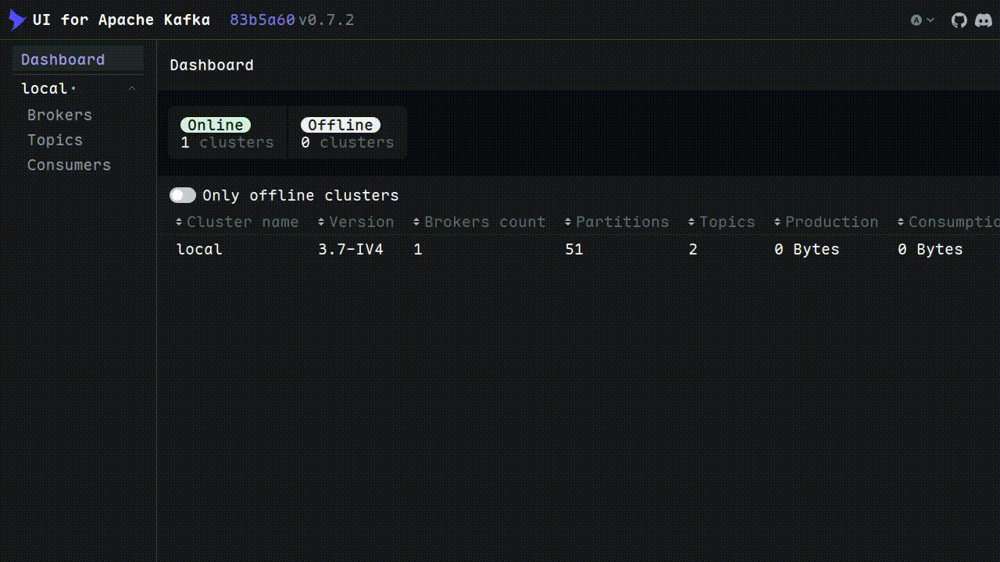

---

Я увеличил количество партиций с одной до трех:

```yml
kafka-init:
  image: apache/kafka:3.7.1
  depends_on:
    - kafka
  entrypoint: ["/bin/sh", "-c"]
  command:
    - |
      /opt/kafka/bin/kafka-topics.sh --bootstrap-server kafka:9092 --list
      /opt/kafka/bin/kafka-topics.sh --create --if-not-exists \
        --topic orders \
        --bootstrap-server kafka:9092 \
        --partitions 1 \
        --replication-factor 1
      /opt/kafka/bin/kafka-topics.sh --alter \
        --topic orders \
        --bootstrap-server kafka:9092 \
        --partitions 3
```

Число партиций топика является единицей параллелизма для потребителей внутри одной consumer-группы, то есть одну партицию в конкретный момент может читать только один потребитель из группы. При 1 партиции сколько бы `picker-service` ни было поднято в группе `picker-group`, реально работать будет только один экземпляр, остальные будут простаивать. Увеличение до 3 партиций даёт возможность до трёх потребителей работать параллельно.

Команда `--create --if-not-exists` не изменяет уже существующий топик, она лишь пропускает создание, если топик есть. Поэтому изменение числа партиций сделано отдельной командой `--alter --partitions 3`, которая применяется к существующему топику независимо от того, только что он создан или уже существовал. Такая последовательность делает конфигурацию идемпотентной, то есть результат один и тот же при любом количестве повторных `docker compose up`.

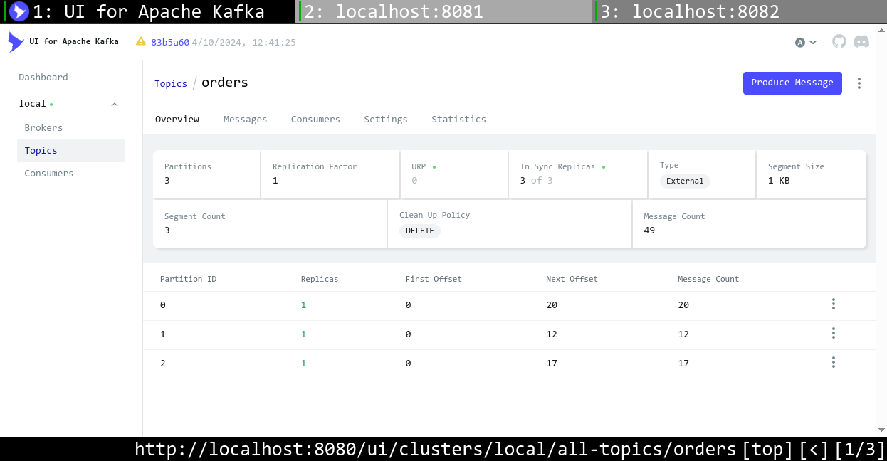 

Я добавил еще один `pickerService`:

```yml
picker-service-2:
  build: ./pickerService/.
  ports:
    - "8083:8080"
  environment:
    - KAFKA_BOOTSTRAP_SERVERS=kafka:9092
    - KAFKA_TOPIC=orders
    - KAFKA_GROUP_ID=picker-group
    - INSTANCE_NAME=picker-2
```

 

Затем я проверил случай, когда консьюмеров столько же, сколько партиций. Для этого я поднял третий `pickerService`:

```yml
picker-service-3:
  build: ./pickerService/.
  ports:
    - "8084:8080"
  environment:
    - KAFKA_BOOTSTRAP_SERVERS=kafka:9092
    - KAFKA_TOPIC=orders
    - KAFKA_GROUP_ID=picker-group
    - INSTANCE_NAME=picker-3
```

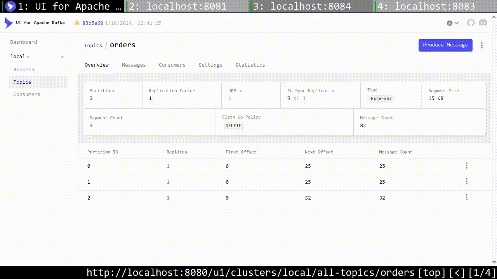 

Я добавил еще один `pickerService`, чтобы консьюмеров было больше чем партиций:

```yml
picker-service-4:
  build: ./pickerService/.
  ports:
    - "8085:8080"
  environment:
    - KAFKA_BOOTSTRAP_SERVERS=kafka:9092
    - KAFKA_TOPIC=orders
    - KAFKA_GROUP_ID=picker-group
    - INSTANCE_NAME=picker-4
```

При 3 партициях и 4 потребителях в одной группе один из потребителей (`picker-2`) не получил ни одной партиции и остался полностью простаивающим, несмотря на то, что он штатно подключился к группе и зарегистрировался у координатора. У Kafka нет физической возможности назначить одну и ту же партицию сразу двум потребителям из одной группы, поэтому лишние экземпляры остаются в резерве, они продолжают опрашивать брокер (`poll()`), но получают пустые результаты, пока не освободится партиция (например, при падении одного из активных потребителей и последующей ребалансировке).

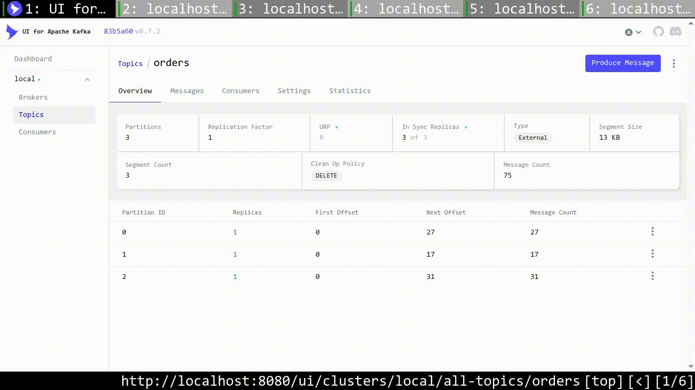 

После завершения "распродажи" лишние `picker-service` были удалены из `docker-compose.yml`, оставлен только один, и конфигурация вернулась к прежнему числу обработчиков.

С партициями вернуть прежнее значение не удалось. Партиция физически является упорядоченным логом сообщений на диске, и Kafka распределяет сообщения по партициям детерминированно, на основе хэша ключа. Если бы число партиций уменьшилось, эта формула изменилась бы для всех уже существующих ключей, и сообщения, физически лежащие в удаляемых партициях, стали бы недостижимы или были бы потеряны. Поэтому у `kafka-topics.sh` в принципе нет опции уменьшения числа партиций, только увеличения. Попытка выполнить это вручную подтверждает ограничение:

```bash
$ docker compose exec kafka /opt/kafka/bin/kafka-topics.sh --alter --topic orders --bootstrap-server kafka:9092 --partitions 1
Error while executing topic command : The topic orders currently has 3 partition(s); 1 would no
t be an increase.
[2026-09-12 17:17:12,306] ERROR org.apache.kafka.common.errors.InvalidPartitionsException: The 
topic orders currently has 3 partition(s); 1 would not be an increase.
 (org.apache.kafka.tools.TopicCommand)
```

Единственный способ действительно уменьшить число партиций подразумевает создание нового топика с меньшим числом партиций и перенос туда данных, что является миграцией в другой топик, а не уменьшением существующего.

---

Затем я остановил `picker-service`, чтобы увидеть накопившиеся сообщения:

```bash
docker compose stop picker-service
```

Пока `picker-service` остановлен, `user-service` продолжает публиковать заказы в топик `orders` без каких-либо ошибок, так как продюсеру не важно, есть ли активные потребители, он просто пишет в лог партиции. Заказы физически сохраняются на диске брокера и никуда не пропадают, так как Kafka хранит сообщения в топике до истечения retention, независимо от того, прочитал их кто-то или нет, в отличие от классических брокеров очередей, где сообщение обычно удаляется сразу после доставки подписчику.

В Kafka UI видно, что сообщения в топике есть, но группа `picker-group` их не прочитала, образуется lag. Consumer-группа хранит только указатель на прочитанную позицию в каждой партиции, а не сами сообщения, поэтому при возвращении picker-а он продолжит читать ровно с той позиции, где остановился, а не потеряет и не пропустит накопившееся.

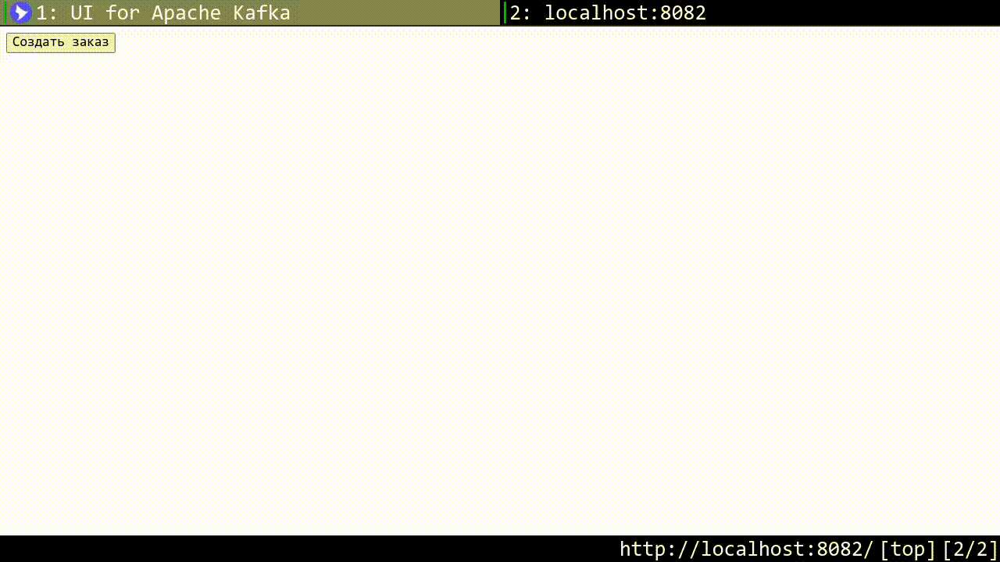

Потом я вернул `picker-service`:

```bash
docker compose start picker-service
```

Сначала было состояние ребалансировки. При повторном подключении `picker-service` к группе `picker-group` происходит ребалансировка. Kafka заново назначает партиции живым участникам группы. Ребалансировка занимает какое-то время, в течение которого потребитель ещё не начал вычитывать накопившиеся сообщения.

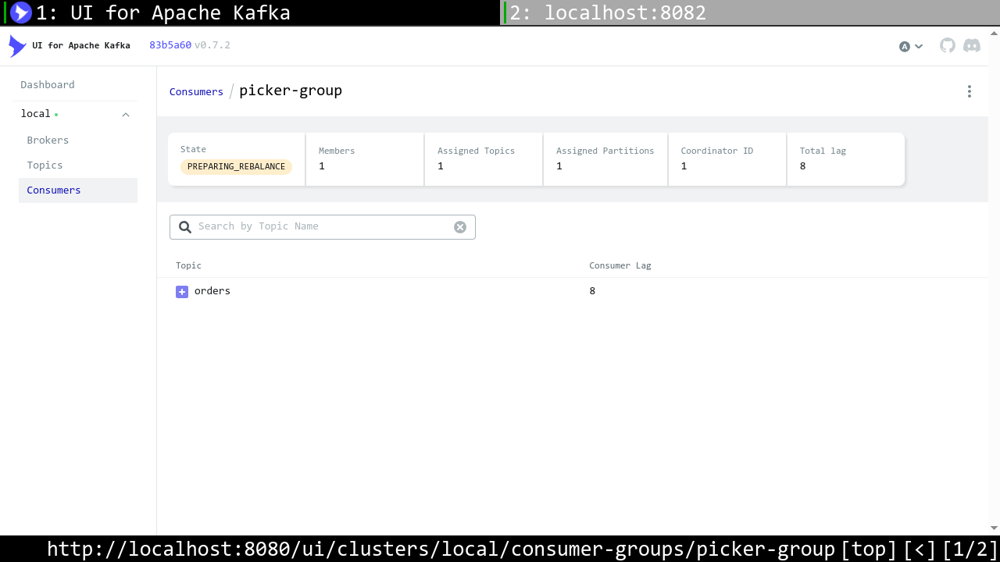

Затем все записи появились в первом picker. После завершения ребалансировки `picker-service` начал вычитывать все сообщения, накопившиеся за время простоя, начиная с того offset, на котором остановился до отключения, и ни один заказ не был потерян. Kafka выступает буфером между продюсером и потребителем, и временная недоступность потребителя не приводит к потере данных, а лишь откладывает их обработку до момента, когда потребитель снова станет доступен.

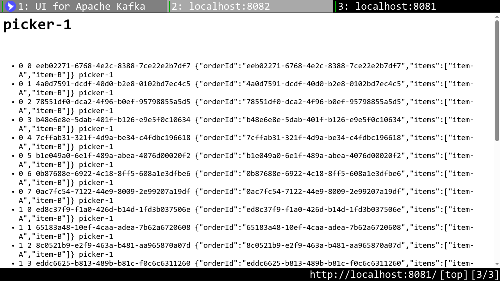

---

Я выбрал сообщение с `orderId`:

```
7a691bcf-62d7-4511-8a44-8548f481fd6c
```

В Kafka я посмотрел `offset` и `partition`:

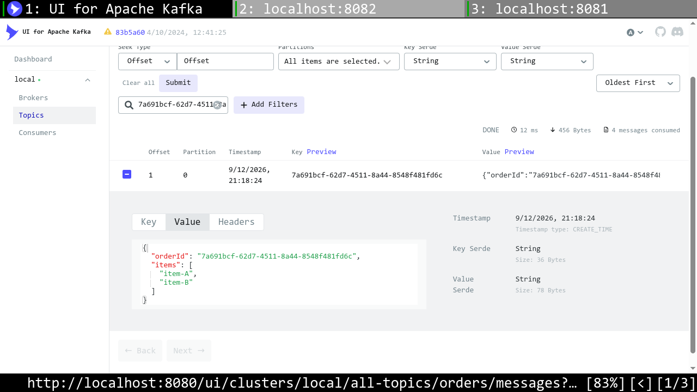 

`partition=0`
`offset=1`


`offset` группы равен 2 (>= 1), то есть сообщение обработано.

--- 

Для начала, я остановил `picker-service`:

```
docker compose stop picker-service
```

Остановка потребителя перед сбросом offset'ов обязательна, так как Kafka UI не позволяет менять committed offset у активной consumer-группы, пока хотя бы один потребитель подключён и владеет партициями, брокер не даст сторонним образом переписать позицию чтения, чтобы не создать конфликт с тем, что потребитель уже знает о своём прогрессе.

Дальше в Kafka UI выбран топик `orders` и стратегия Earliest, которая переводит committed offset группы на начало каждой партиции, независимо от того, до какой позиции группа дочитала ранее.

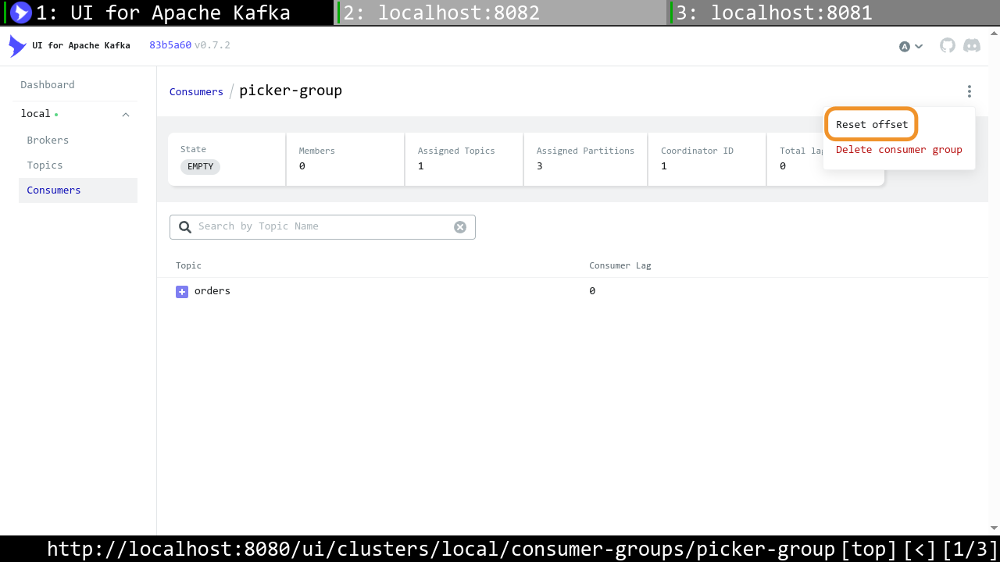 
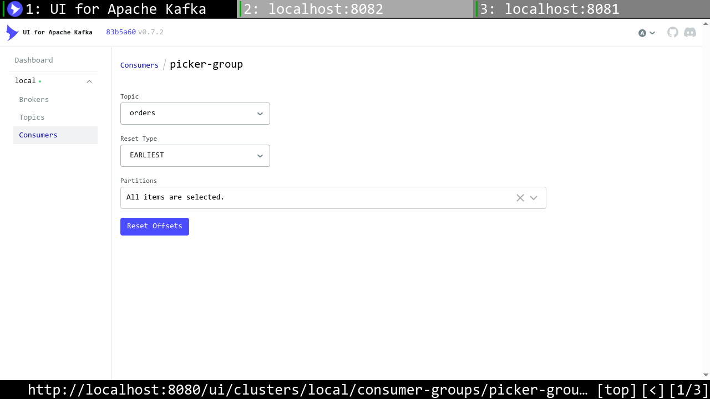 
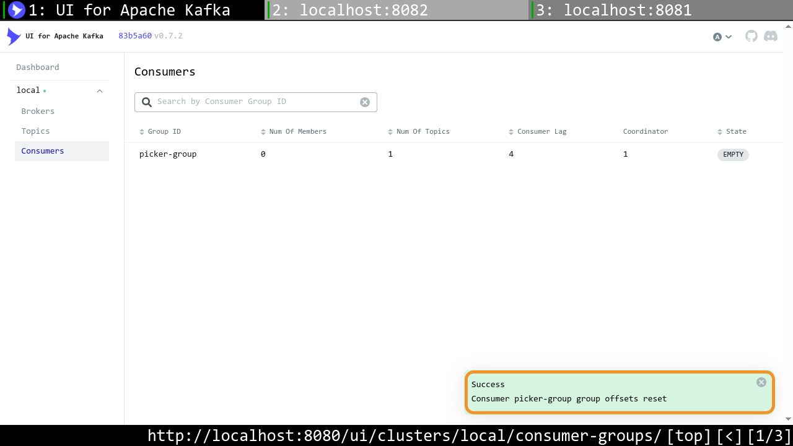 

Снова ребалансировка. При повторном подключении `picker-service` к группе происходит ребалансировка, как и при обычном перезапуске потребителя, брокер заново назначает партиции живым участникам, прежде чем начнётся чтение.

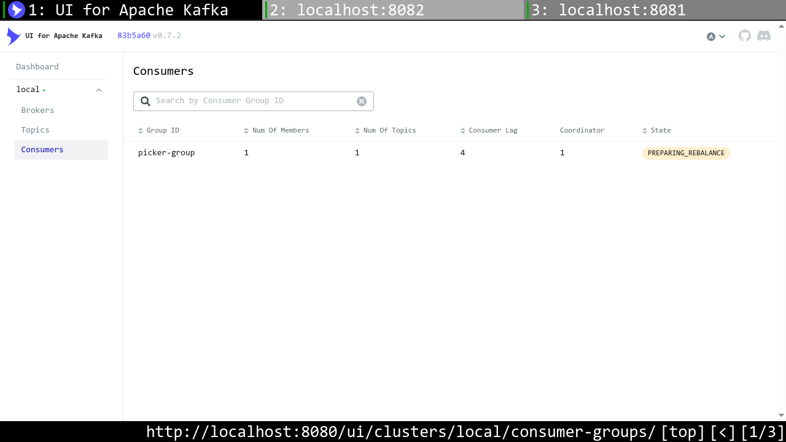


В `picker1` появились все заказы заново, с самого начала (offset 0).
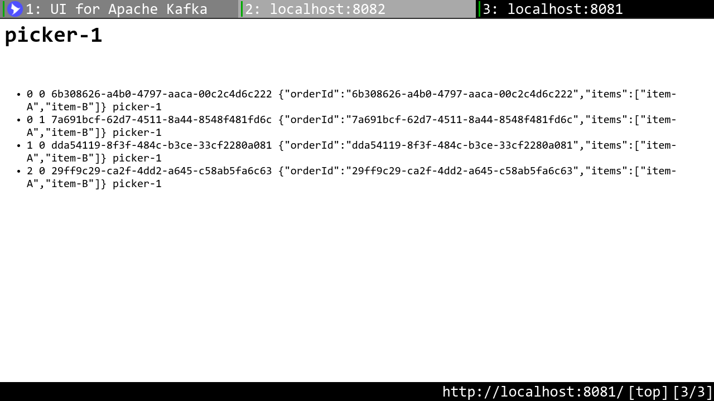 

Это возможно потому, что в Kafka сообщение не удаляется из топика после того, как его прочитал потребитель, оно остаётся на диске до истечения retention, независимо от того, сколько раз и сколько разных consumer-групп его уже прочитали. Kafka хранит только указатель committed offset отдельно для каждой consumer-группы, и именно этот указатель определяет, откуда группа продолжит чтение. Сброс offset'а это просто изменение указателя назад, а не восстановление удалённых данных, потому что данные никуда и не исчезали.

В классической очереди сообщений сообщение обычно удаляется из очереди сразу после подтверждения обработки, второй раз прочитать его нельзя, потому что физически его больше нет, очередь не хранит историю, только текущее незавершённое содержимое. Поэтому переиграть историю с начала в классической очереди невозможно в принципе, а в Kafka стандартная операция, потому что модель хранения там принципиально другая, а именно лог сообщений и независимые указатели чтения, а не расходуемая очередь.

--- 

Зашел в настройки в Kafka UI. Через веб-интерфейс Kafka UI параметр `retention.ms` в списке `Custom parameters` оказался недоступен для выбора, поэтому изменение конфигурации топика было выполнено через `kafka-configs.sh`. Изначальная попытка через `kafka-topics.sh --alter --config` завершилась ошибкой, так как начиная с определённой версии Kafka изменение конфигов существующего топика через `kafka-topics.sh` устарело в пользу более универсального `kafka-configs.sh`, который умеет менять конфигурацию не только топиков, но и брокеров, клиентов и других сущностей через единый интерфейс `--entity-type`/`--entity-name`/`--add-config`.

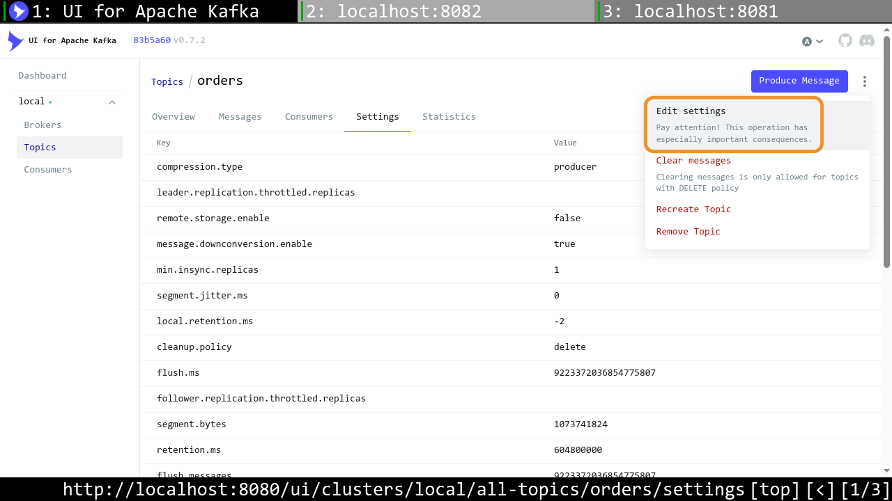

Я установил `retention.ms` в 1 минуту командой:

```bash
$ docker compose exec kafka /opt/kafka/bin/kafka-configs.sh --alter \
  --bootstrap-server kafka:9092 \
  --entity-type topics \
  --entity-name orders \
  --add-config retention.ms=60000
Completed updating config for topic orders.

$ docker compose exec kafka /opt/kafka/bin/kafka-configs.sh --describe \
  --bootstrap-server kafka:9092 \
  --entity-type topics \
  --entity-name orders
Dynamic configs for topic orders are:
  retention.ms=60000 sensitive=false synonyms={DYNAMIC_TOPIC_CONFIG:retention.ms=60000}
```

Вывод `--describe` подтверждает, что настройка применилась именно как динамическая конфигурация топика, то есть переопределяет дефолтное значение `retention.ms` брокера конкретно для топика `orders`, не затрагивая остальные топики кластера.

Затем я добавил еще записей через `userService`. "Message Count" увеличился. Новые заказы записались в топик как обычно. Cама запись не зависит от значения retention, оно влияет только на то, как долго сообщение хранится после записи.


Через время, чуть большее `retention.ms`, "Message Count" стал нулевым:

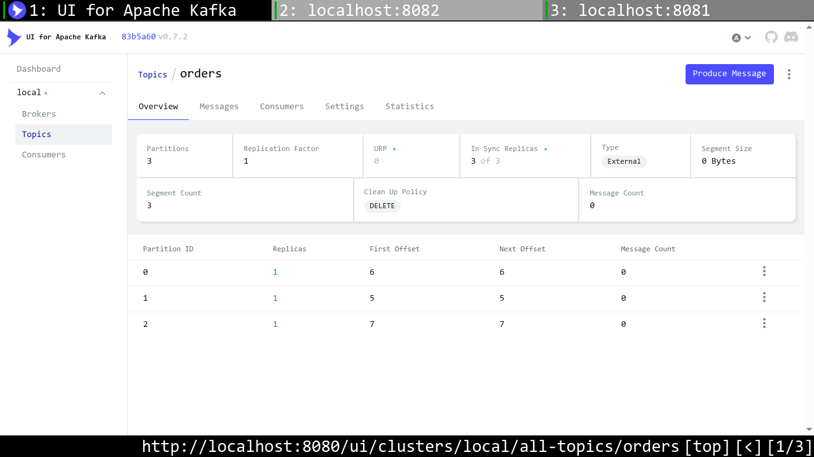

Спустя время, превышающее заданный `retention.ms`, брокер удалил все сообщения из топика, включая те, что были уже прочитаны consumer-группой `picker-group`. Это ключевое отличие от логики "удалить после прочтения": Kafka чистит данные исключительно по истечении срока хранения (или превышении лимита размера сегмента), совершенно не интересуясь тем, дочитала ли их какая-либо consumer-группа. Такая модель — намеренный компромисс: она позволяет нескольким независимым consumer-группам читать один и тот же топик с разной скоростью и разными задержками (как в ситуации 5 с пересчётом истории), но требует явно настраивать retention так, чтобы он не был меньше, чем реально нужное окно доступности данных для всех потребителей.

Также стоит учитывать, что фактическое удаление сегментов происходит не мгновенно по истечении `retention.ms`, а по расписанию — брокер периодически (по умолчанию раз в 5 минут, параметр `log.retention.check.interval.ms`) проверяет, какие сегменты истекли, и удаляет их. Поэтому эффект отложенный: сообщение считается "просроченным" сразу по истечении retention, но физически исчезает из топика при следующей плановой проверке.

---

Kafka сама не отдаёт метрики в формате Prometheus, а только через JMX. Поэтому в контейнер `kafka` подключен JMX Prometheus Exporter как Java-агент, конвертирующий JMX-метрики брокера в формат, понятный Prometheus.

[Файл агента](monitoring/jmx_prometheus_javaagent.jar) и [конфигурация](monitoring/kafka-jmx-exporter.yml) экспортируемых метрик подключены в контейнер через `volumes`, а сам агент активируется через переменную `KAFKA_JVM_PERFORMANCE_OPTS`:

```yaml
environment:
  - KAFKA_JVM_PERFORMANCE_OPTS=-javaagent:/opt/jmx-exporter/jmx_prometheus_javaagent.jar=7071:/opt/jmx-exporter/kafka-jmx-exporter.yml
volumes:
  - ./monitoring/jmx_prometheus_javaagent.jar:/opt/jmx-exporter/jmx_prometheus_javaagent.jar
  - ./monitoring/kafka-jmx-exporter.yml:/opt/jmx-exporter/kafka-jmx-exporter.yml
ports:
  - "7071:7071"
```

Изначально агент подключался через переменную `KAFKA_OPTS`, что стандартно для многих Kafka-образов, но не сработало для официального образа `apache/kafka`, так как его стартовый скрипт (`/etc/kafka/docker/launch`) не использует `KAFKA_OPTS` вовсе, а собирает JVM-опции через `KAFKA_JVM_PERFORMANCE_OPTS`, которую передаёт в `kafka-server-start.sh`. После замены переменной агент подключился, что подтвердилось наличием `-javaagent:...` в командной строке процесса Java внутри контейнера.

Я добавил в композ `prometheus` и `grafana`:

```yml
  prometheus:
    image: prom/prometheus:latest
    volumes:
      - ./monitoring/prometheus.yml:/etc/prometheus/prometheus.yml
    ports:
      - "9090:9090"
    depends_on:
      - kafka

  grafana:
    image: grafana/grafana:latest
    ports:
      - "3000:3000"
    environment:
      - GF_SECURITY_ADMIN_PASSWORD=admin
    depends_on:
      - prometheus
```

Экспортёр публикует метрики на `http://kafka:7071/metrics`. Их собирает Prometheus, конфигурация которого просто указывает scrape-таргет:

```yaml
scrape_configs:
  - job_name: "kafka"
    static_configs:
      - targets: ["kafka:7071"]
```

На дашборде Grafana выведены следующие метрики топика `orders`:
- Messages/sec in orders (`kafka_server_brokertopicmetrics_messagesinpersec_topic_orders_oneminuterate`) — скорость поступления новых заказов в топик, показывает текущую нагрузку от `user-service`.
- Bytes in/sec orders (`..._bytesinpersec_topic_orders_oneminuterate`) — объём входящего трафика, полезен для оценки нагрузки на диск и сеть брокера.
- Failed produce requests/sec (`..._failedproducerequestspersec_oneminuterate`) — количество неудачных попыток записи, индикатор проблем на стороне брокера.

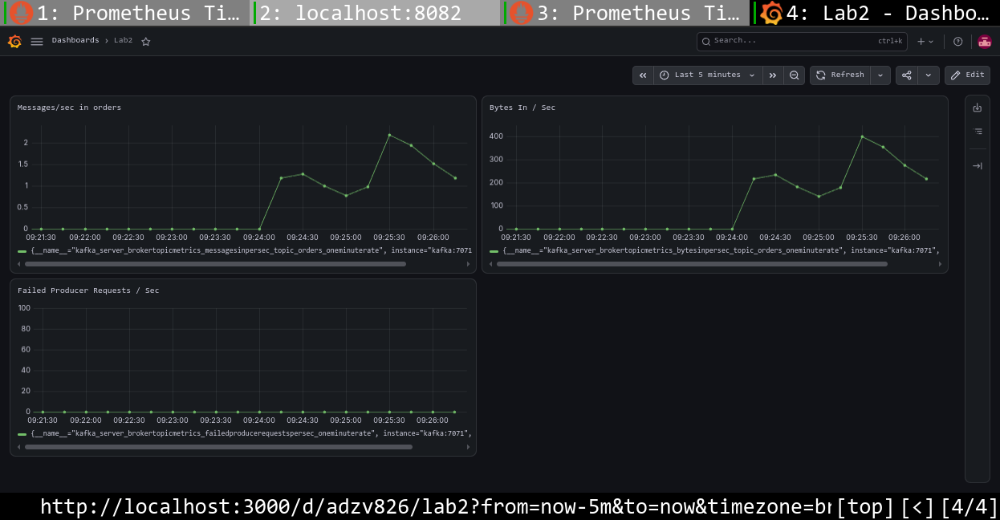

На графиках виден всплеск активности, соответствующий моменту создания серии заказов через `user-service`: одновременный рост `Messages/sec` и `Bytes In/sec`, с постепенным затуханием после прекращения новых запросов. `Failed Producer Requests/sec` держится на нуле на всём периоде наблюдения, потому что записи в топик проходили без ошибок.

--- 

Метрики для алертов

1. `kafka_controller_kafkacontroller_activecontrollercount != 1` отсутствие или дублирование активного контроллера кластера. В норме должен быть ровно один. Eсли контроллера нет вообще, кластер не может обрабатывать изменения метаданных.

2. `kafka_server_replicamanager_underreplicatedpartitions > 0` партиции, у которых число реплик в ISR меньше заданного replication factor, то есть часть реплик отстаёт или недоступна. Eсли это продолжается долго, а затем упадёт ещё и лидер такой партиции, данные партиции можно частично или полностью потерять. Репликация является основной защитой от потери данных при отказе брокера, и её деградация означает, что эта защита сейчас не работает.

Стоит отметить, что метрика `underreplicatedpartitions` в текущем демо-окруженииникогда не примет значение больше 0, так как она приведена как пример правильного выбора алерта для промышленного кластера с несколькими брокерами, а не как рабочий алерт в этой конкретной конфигурации.

3. `rate(kafka_server_brokertopicmetrics_failedproducerequestspersec_count[5m]) > 0` рост числа неудачных попыток записи со стороны продюсеров. Это прямой сигнал, что часть бизнес-событий не сохраняется в Kafka вообще, то есть теряется на этапе публикации, ещё до того, как дойдёт до брокера. Необработанный отказ здесь означает потерянные заказы, а не просто задержку обработки.


