# Лабораторная работа №3. Репликация базы данных

> [!IMPORTANT]
> Стенд запускается одной командой.
> ```bash
> docker compose up -d --build
> ```
> После первого запуска необходимо один раз вручную инициализировать набор реплик (см. часть 1).
> Сервис доступен по адресу `http://localhost:8080`, Prometheus по адресу `http://localhost:9090`, Grafana по адресу `http://localhost:3000` (логин и пароль `admin`).

## Используемые термины

В тексте встречаются английские названия, которые используются в самой СУБД и в документации. При первом упоминании рядом дано пояснение.

| Термин | Определение |
|---|---|
| Репликация | автоматическое копирование данных с одного узла базы на другие |
| Набор реплик (replica set) | группа узлов MongoDB, которые хранят одни и те же данные |
| Основной узел (primary) | единственный узел набора, который принимает запись |
| Вторичный узел (secondary) | узел, который копирует данные с основного и может отвечать на чтение |
| Отставание реплики (replication lag) | время, на которое вторичный узел отстаёт от основного |
| Журнал операций (oplog) | список изменений, по которому вторичные узлы догоняют основной |
| Выборы (election) | голосование узлов, в результате которого выбирается новый основной узел |
| Переключение при отказе (failover) | передача роли основного узла другому узлу после выхода из строя прежнего |
| Большинство (majority) | более половины узлов набора, то есть два из трёх |
| Согласованность (C) | все читатели видят одни и те же актуальные данные |
| Доступность (A) | система отвечает на каждый запрос, даже если данные могут быть устаревшими |

---

## Часть 0. Выбор СУБД

Выбрана MongoDB. Репликация встроена в саму базу, а при отказе основного узла новый выбирается автоматически голосованием оставшихся узлов, поэтому нет необходимости вручную повышать резервный узел до основного, и внимание можно сосредоточить на двух настройках. Первая определяет, с каких узлов читать (`readPreference`), вторая определяет, сколько узлов должны подтвердить запись (`writeConcern`).

---

## Часть 1. Настройка репликации через конфигурацию

Три узла `mongod` запускаются через `docker compose` ([`compose.yaml`](compose.yaml)). Все они стартуют с одним и тем же именем набора `rs0`.

```yaml
  mongo1:
    image: mongo:8.0
    container_name: mongo1
    command: ["mongod", "--replSet", "rs0", "--bind_ip_all"]
    ports: ["27017:27017"]
    volumes: [mongo1_data:/data/db]
    networks: [lab-net]
  # mongo2 (порт 27018) и mongo3 (порт 27019) настраиваются по аналогии
```

Единственное действие, выполняемое вручную, это инициализация набора. Без неё узлы не знают друг о друге. В поле `host` указаны имена контейнеров и внутренний порт, так как сервис работает внутри docker-сети.

```bash
docker compose up -d mongo1 mongo2 mongo3
docker exec -it mongo1 mongosh
```
```js
rs.initiate({
  _id: "rs0",
  members: [
    { _id: 0, host: "mongo1:27017" },
    { _id: 1, host: "mongo2:27017" },
    { _id: 2, host: "mongo3:27017" }
  ]
})
```

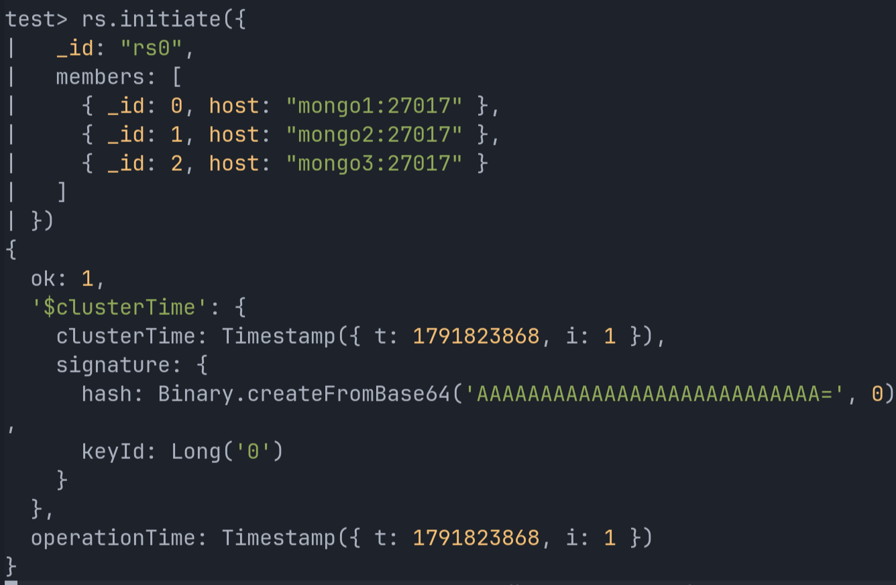

Сразу после инициализации все три узла имели состояние `SECONDARY`, так как шли выборы. Через несколько секунд основным стал узел `mongo1`.

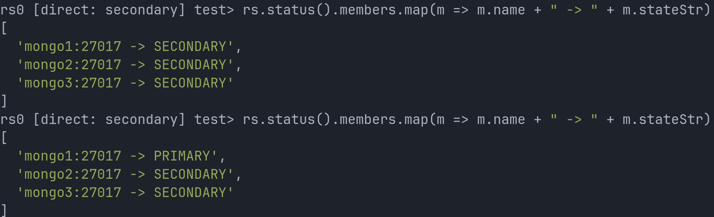

### Проверка репликации

Запись выполнена на основном узле (`mongo1`).

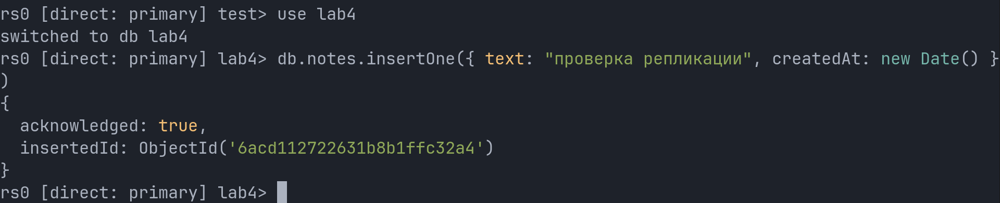

Чтение выполнено на вторичном узле (`mongo2`) с включённым `setReadPref("secondary")`. Без этой настройки вторичный узел отвечает ошибкой `not primary and secondaryOk=false`. Идентификатор документа совпадает, значит, данные реплицируются.

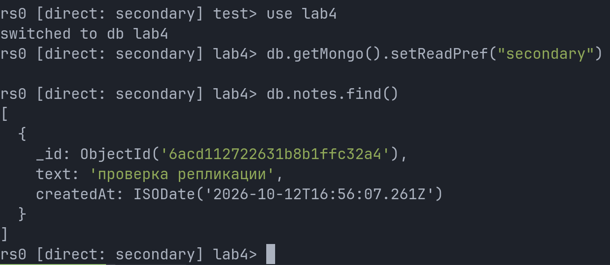

---

## Часть 2. Сервис с разделением чтения и записи

Сервис написан на Java как сервлет, работающий под Tomcat. В репозитории находятся [`NotesServlet.java`](src/main/java/NotesServlet.java), страница [`index.html`](src/main/webapp/index.html) и [`Dockerfile`](Dockerfile), в котором сборка `.war` выполняется в два этапа через Maven.

Кнопки на странице работают следующим образом.

- Кнопка «create note» отправляет `POST /api/notes`. Запись идёт через клиента `writeClient` на основной узел (переменная `MONGO_PRIMARY_URI`).
- Кнопка «reload list» отправляет `GET /api/notes`. Чтение идёт через клиента `readClient` с режимом чтения из переменной `READ_PREFERENCE` (по умолчанию `secondary`, адрес в `MONGO_REPLICA_URI`).
- Кнопка «high load (500 notes)» отправляет `POST /api/load` и создаёт 500 записей подряд. Каждая пачка получает собственный номер (`high load <номер> #<i>`), чтобы по последней записи было видно, какая часть пачки уже дошла до читателя.

```java
writeClient = MongoClients.create(primaryUri);

MongoClientSettings readSettings = MongoClientSettings.builder()
    .applyConnectionString(new ConnectionString(replicaUri))
    .readPreference(ReadPreference.valueOf(
        System.getenv().getOrDefault("READ_PREFERENCE", "secondary")))
    .build();
readClient = MongoClients.create(readSettings);
```

В ответ на чтение добавлен заголовок `X-Served-By` с адресом узла, который фактически обработал запрос. Ошибки MongoDB перехватываются, и сервис возвращает JSON с кодом `503` (сервис временно недоступен). Благодаря этому страница получает понятное сообщение об ошибке, а не HTML-страницу с кодом 500.

Адреса узлов вынесены в переменные окружения.

```yaml
  app:
    build: { context: ., dockerfile: Dockerfile }
    ports: ["8080:8080"]
    environment:
      MONGO_PRIMARY_URI: "mongodb://mongo1:27017,mongo2:27017,mongo3:27017/?replicaSet=rs0&serverSelectionTimeoutMS=5000"
      MONGO_REPLICA_URI: "mongodb://mongo1:27017,mongo2:27017,mongo3:27017/?replicaSet=rs0&readConcernLevel=majority&serverSelectionTimeoutMS=5000"
      READ_PREFERENCE: "primary"
```

В опытах из части 3 значение `READ_PREFERENCE` было `secondary`, а в части 4 оно изменено на `primary`.

Страница сервиса. Список прочитан со вторичного узла, что видно в строке состояния.

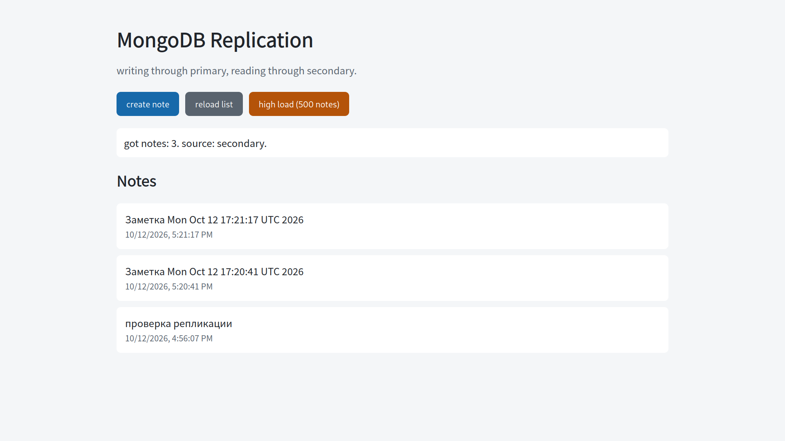

### Проблема сериализации

Первая версия сервиса использовала библиотеку Gson. Она выдавала идентификатор `ObjectId` в виде набора внутренних полей (`timestamp`, `counter`, `randomValue1`, `randomValue2`), а дату в локализованной текстовой форме.

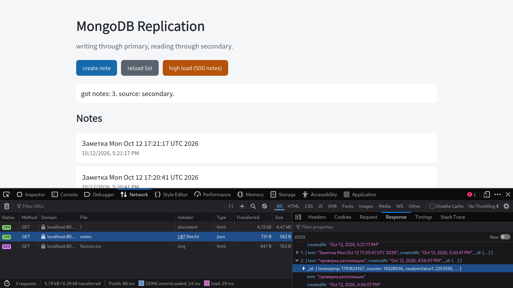

Сервлет был изменён. Теперь идентификатор отдаётся строкой в шестнадцатеричном виде, а дата в формате ISO 8601.

### Проблема сети и Tailscale

После запуска страница не открывалась. Соединение с `127.0.0.1:8080` устанавливалось, но ответ не приходил, хотя изнутри контейнера приложение отвечало кодом `200`. Команда `ip route get` показала, что трафик к контейнеру направляется в интерфейс `tailscale0`, поскольку был включён выходной узел (exit node) Tailscale. Проблема исчезла после его отключения командой `tailscale set --exit-node=`. Кроме того, подсеть docker-сети задана явно, чтобы она не пересекалась с подсетями из tailnet.

```yaml
networks:
  lab-net:
    driver: bridge
    ipam:
      config:
        - subnet: 10.250.0.0/24
```

---

## Часть 3. Отставание реплики

В локальной docker-сети отставание составляет миллисекунды, поэтому для наблюдения его пришлось создать искусственно. У узла `mongo3` включена задержка применения операций на 10 секунд, и ему запрещено становиться основным (`priority = 0`).

```bash
docker exec mongo1 mongosh --quiet --eval \
  'c = rs.conf(); c.members[2].priority = 0; c.members[2].secondaryDelaySecs = 10; rs.reconfig(c)'
```

При режиме `readPreference=secondary` драйвер сам выбирает подходящий вторичный узел. В проведённом тесте он постоянно выбирал `mongo2`, что видно по заголовку `X-Served-By`, поэтому отстающий узел не попадался. Причину такого выбора установить не удалось :(. Чтобы показать отставание через приложение, чтение было временно закреплено за `mongo3` настройкой `MONGO_REPLICA_URI=mongodb://mongo3:27017/?directConnection=true&readPreference=secondary`. Такой вариант не имеет переключения при отказе, поэтому применялся только для демонстрации.


1. В браузере сразу после нажатия «high load (500 notes)» вверху списка оказалась запись `high load note #78`, хотя основной узел уже принял все 500 записей.

   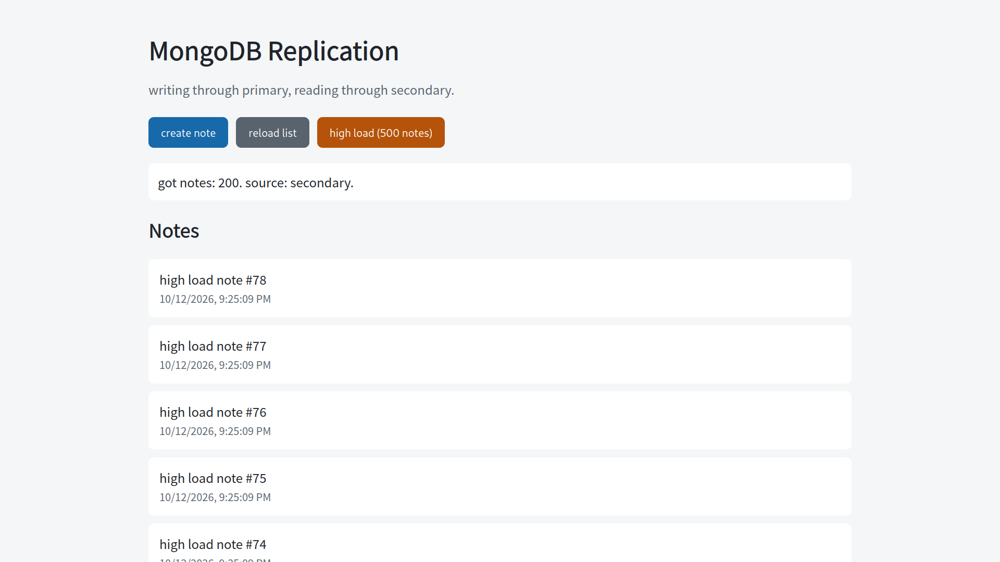

2. Подсчёт документов показал разницу. Сразу после нагрузки на `mongo2` было 2003 документа, а на `mongo3` 1503. Разница равна только что созданным 500 записям.

   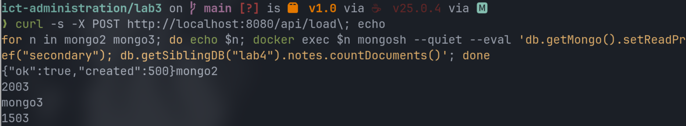

3. При использовании пронумерованных пачек чтение сразу после нагрузки вернуло `high load 5817 #122`, а через 12 секунд вернуло `high load 5817 #499`.

   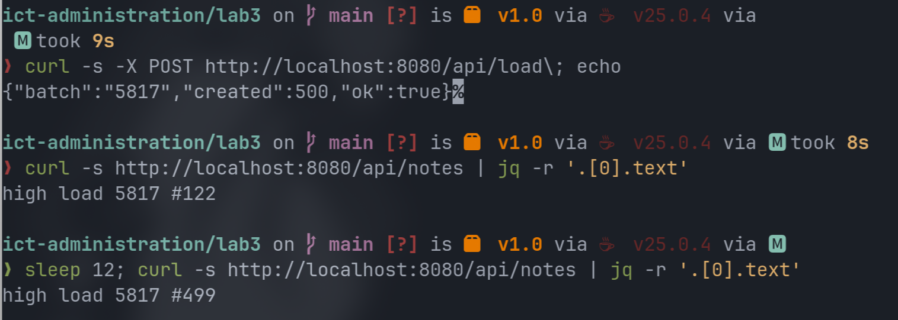


Репликация в MongoDB асинхронная. Основной узел принимает запись и подтверждает её клиенту, не дожидаясь копирования на все остальные узлы. Вторичные узлы забирают изменения из журнала операций с некоторой задержкой. Читатель, обратившийся к отстающему узлу, видит состояние базы на более раннее время. В проведённом опыте задержка была искусственной (`secondaryDelaySecs`), а в реальной эксплуатации она возникает из-за высокой нагрузки, медленных дисков или перегруженной сети.

Это может быть опасно тем, что:

- Нарушается правило, по которому пользователь сразу видит собственные изменения. Он создал запись, а в списке её нет.
- Счётчики и отчёты, построенные по вторичному узлу, расходятся с реальными данными.
- Решения, принятые на основе устаревших данных, могут оказаться неверными.
- При переключении на другой узел последние записи, которые он не успел получить, могут быть потеряны.

Размер отставания показывает команда `rs.printSecondaryReplicationInfo()`. Для `mongo2` отставание равно 0 секунд, для `mongo3` оно составило 12 секунд, то есть 10 секунд заданной задержки и небольшой естественный сдвиг.

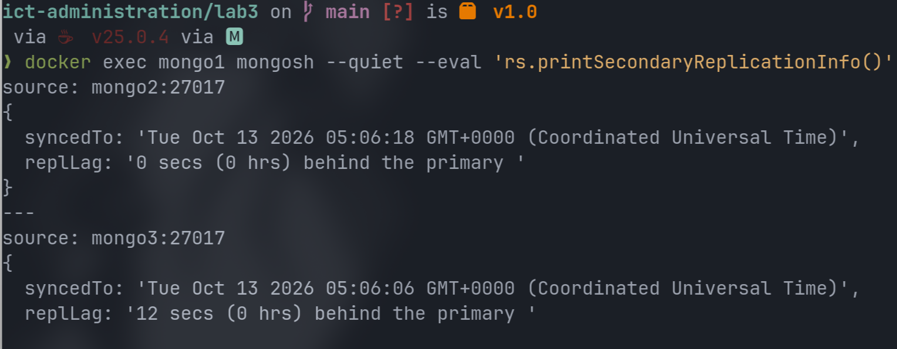

В промышленной эксплуатации это значение должно собираться автоматически. Для этого в части 6 используется метрика `mongodb_members_optimeDate`.

---

## Часть 4. Теорема CAP


Теорема CAP утверждает, что распределённая система при сбое связи между узлами не может одновременно сохранять согласованность данных (C) и доступность (A). Приходится жертвовать одним из этих свойств.

Чтение с `mongo3` всегда завершалось ответом, но ответ содержал устаревшие данные. Для сравнения было выполнено чтение через основной узел с уровнем `readConcern: "linearizable"` (самые свежие подтверждённые данные). Оно сразу после нагрузки вернуло актуальную запись `high load 99298 #132`. Нагрузка в этот момент ещё продолжалась, поэтому номер меньше 499. Чтение с `mongo3` вернуло запись предыдущей пачки `high load 77658 #499`.

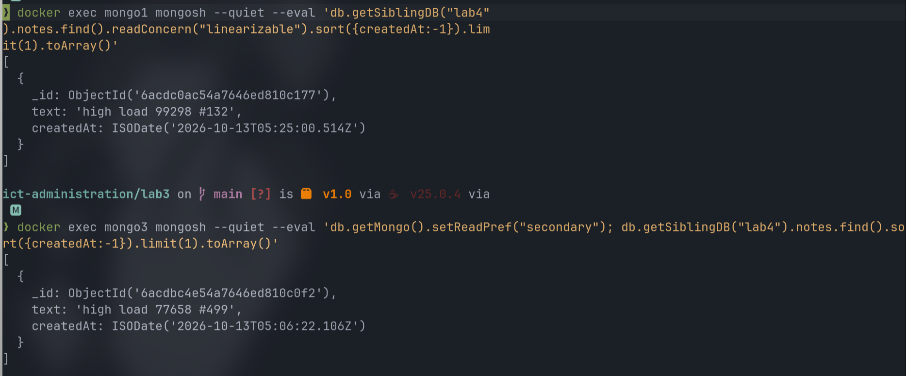

Настройка с `readPreference=secondary` склоняется к доступности (A). Любой живоц вторичный узел отвечает, даже если он отстаёт. Система выбирает вариант «ответить любыми данными» вместо варианта «ответить точными данными или не отвечать вовсе». Асинхронная реплика с устаревшими чтениями представляет собой именно такой выбор. 

Чтобы сместиться к согласованности, необходимо читать с основного узла (`READ_PREFERENCE=primary`) и использовать `readConcern=majority`, при котором возвращаются только данные, подтверждённые большинством узлов. Запись при этом должна подтверждаться большинством (`w: majority`). В MongoDB версии 5.0 и новее это значение стоит по умолчанию. Для ещё более строгой гарантии существует уровень `linearizable`.

```yaml
MONGO_REPLICA_URI: "mongodb://mongo1:27017,mongo2:27017,mongo3:27017/?replicaSet=rs0&readConcernLevel=majority&serverSelectionTimeoutMS=5000"
READ_PREFERENCE: "primary"
```

После изменения чтение идёт с основного узла. К этому моменту основным был `mongo2`, так как роль сменилась после ранее случившихся выборов. Сразу после нагрузки вверху списка всегда находится последняя запись `#499`.

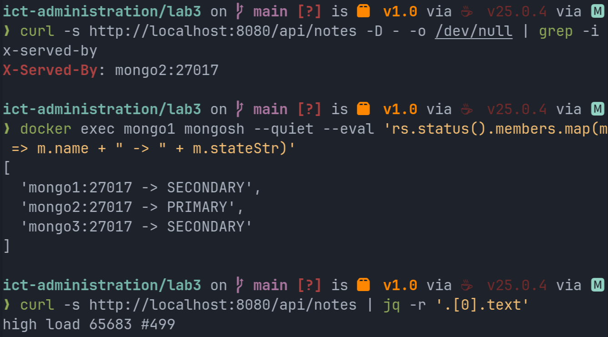

- Запись выполняется медленнее. При `w: majority` запись считается выполненной, когда её получили два узла из трёх. Когда был остановлен `mongo2`, вторым подтверждающим узлом остался `mongo3` с задержкой 10 секунд. В результате каждая запись заняла около 10 секунд (`201 9.44s`).

  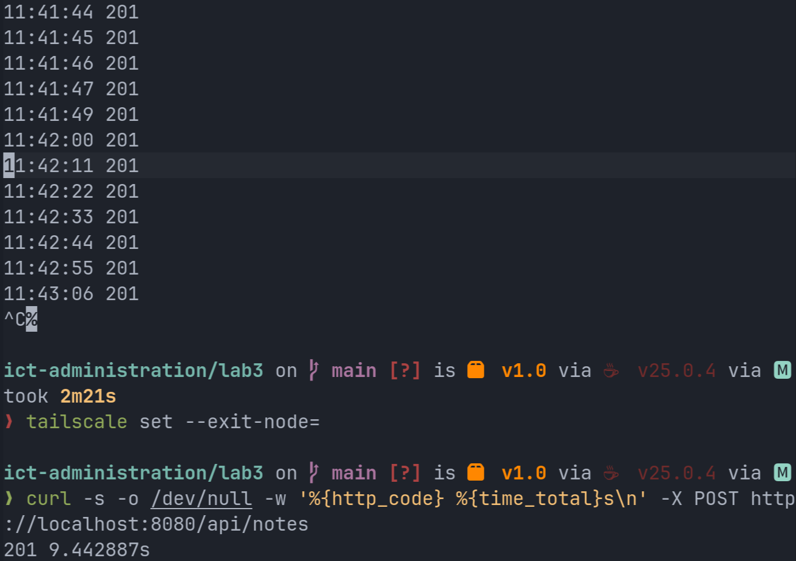

- Нагрузка на основной узел растёт, так как все чтения идут через него, а вторичные узлы для чтения не используются.
- При потере большинства узлов запись и чтение через основной узел становятся невозможны (см. часть 5).

---

## Часть 5. Переключение при отказе

В MongoDB переключение происходит автоматически. Оставшиеся узлы сами проводят выборы и назначают новый основной узел, вмешательство человека не требуется.

### Опыт 1. Остановка основного узла командой `docker stop`

Во время опыта в цикле раз в секунду выполнялась запись. Остановлен основной узел `mongo2`. Выборы заняли около 2 секунд (последняя быстрая запись в 11:41:47, следующая в 11:41:49). Вероятно, при штатной остановке узел сам передаёт роль другому, поэтому выборы прошли быстро. После этого записи выполнялись примерно раз в 11 секунд, но причиной были не выборы, а ожидание подтверждения от отстающего `mongo3` (см. часть 4).

### Опыт 2. Аварийное завершение основного узла командой `docker kill`

Эта команда имитирует внезапный сбой. Запись остановилась в 11:46:37, а новый основной узел (`mongo2`) был выбран к 11:46:48. Выборы заняли около 11 секунд, что близко к стандартному времени, через которое узлы признают соседа недоступным (10 секунд). Ответов с ошибкой `503` в цикле не было. Драйвер ожидал появления нового основного узла, поэтому один запрос выполнялся дольше обычного, а затем завершился кодом `201`.

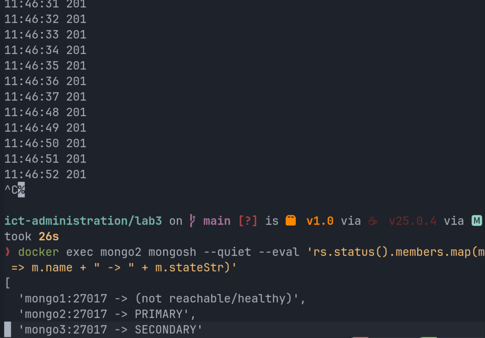

### Состояние записи и чтения

- Запись во время выборов невозможна, поскольку основного узла нет.
- Чтение со вторичных узлов продолжает работать, если оно не требует основного узла.
- После выборов запись и чтение работают через нового основного без участия человека, драйвер переподключается самостоятельно.

### Возвращение прежнего основного узла

Узел `mongo1` был запущен снова командой `docker start mongo1`. Он вернулся как вторичный и не забрал роль обратно. Основным остался `mongo2`. Вернувшийся узел узнаёт, что за время его отсутствия начался новый срок с другим основным, и начинает догонять набор.

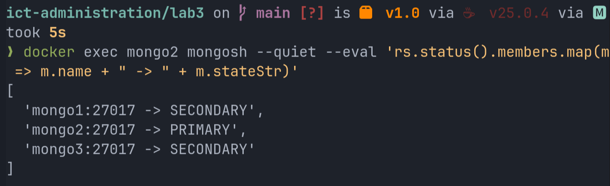

Потери данных не произошло. На `mongo2` и на вернувшемся `mongo1` находится по 5052 документа.

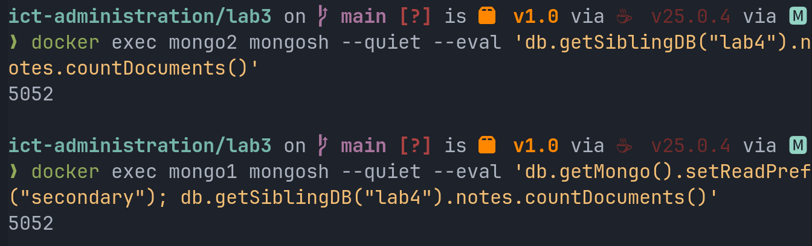

### Оставшийся один узел из трёх

Остановлены `mongo1` и `mongo3`, остался только `mongo2`. Он остался без большинства и перешёл в состояние `SECONDARY`, так как выбрать основной узел некому.

- Запись не завершилась. Команда вернула `000 15.002s`, то есть ответа не было и сработал клиентский таймаут `curl -m 15`.
- Чтение вернуло `503 5.005s`. Сработал перехват ошибок в сервисе и ограничение `serverSelectionTimeoutMS=5000`.

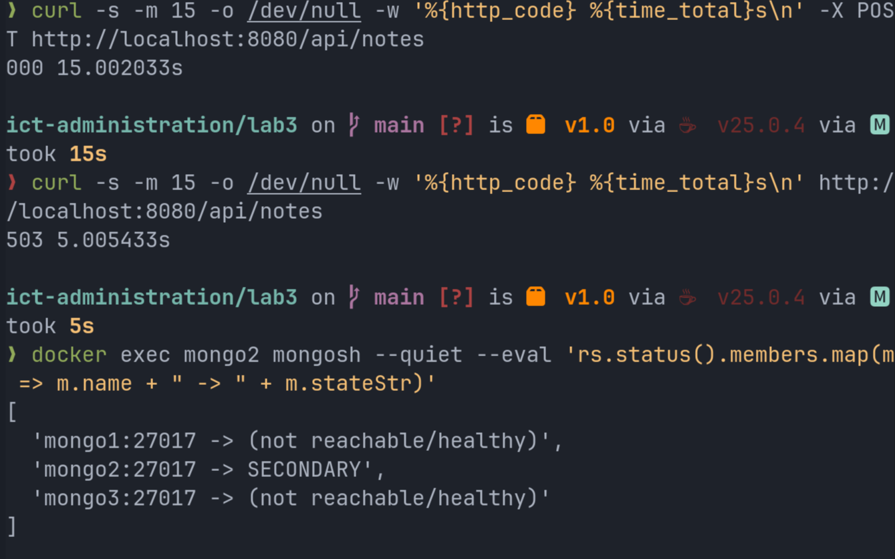

Основной узел выбирается голосованием. Выбранным становится узел, получивший голоса большинства, то есть в наборе из трёх узлов не менее двух. Нечётное число исключает ничью. Оно также исключает ситуацию, когда сеть разделилась на две равные половины и каждая считает себя главной (так называемое «разделение мозга», split-brain). Добавление четвёртого узла не повышает отказоустойчивость, поскольку большинство из четырёх составляет три узла, а значит, по-прежнему допустим отказ только одного узла.

При потере большинства MongoDB выбирает согласованность (C) и жертвует доступностью (A). Уцелевший узел мог бы отдавать данные, но запись он не принимает, чтобы не разойтись с остальными узлами.

---

## Часть 6. Мониторинг

MongoDB сама не отдаёт метрики в формате Prometheus, поэтому подключён отдельный экспортер Percona mongodb_exporter. Prometheus периодически собирает эти метрики и хранит их, а Grafana строит по ним графики.

```yaml
  mongo-exporter:
    image: percona/mongodb_exporter:0.40
    command:
      - "--mongodb.uri=mongodb://mongo1:27017,mongo2:27017,mongo3:27017/?replicaSet=rs0"
      - "--collect-all"
      - "--compatible-mode"
    ports: ["9216:9216"]
    networks: [lab-net]

  prometheus:
    image: prom/prometheus:latest
    volumes:
      - ./prometheus.yml:/etc/prometheus/prometheus.yml:ro
      - ./alerts.yml:/etc/prometheus/alerts.yml:ro
    ports: ["9090:9090"]

  grafana:
    image: grafana/grafana:latest
    ports: ["3000:3000"]
```

Конфигурация Prometheus хранится в файле [`prometheus.yml`](prometheus.yml) , правила оповещений находятся в файле [`alerts.yml`](alerts.yml). Источник данных в Grafana добавлен по адресу `http://prometheus:9090`, а не `localhost`, поскольку Grafana работает в контейнере и для неё `localhost` означает её саму.

### Дашборд

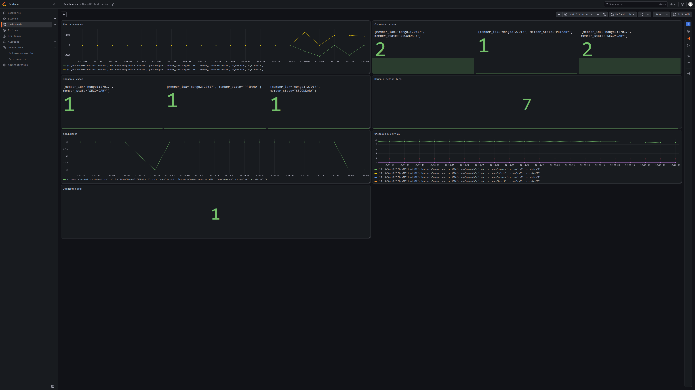

| Панель | Метрика | Что показывает |
|---|---|---|
| Лаг репликации | `mongodb_members_optimeDate`, разница между самым свежим узлом и остальными | отставание вторичных узлов. На снимке во время нагрузки виден рост примерно до 10000 мс, это задержка узла `mongo3`. На этой панели значения даны в миллисекундах |
| Состояние узлов | `mongodb_rs_members_state` | значение 1 означает основной узел, значение 2 означает вторичный |
| Здоровье узлов | `mongodb_members_health` | значение 1 означает исправный узел, значение 0 означает недоступный |
| Номер срока выборов | `mongodb_electionParticipantMetrics_electionTerm` | растёт при каждых выборах, то есть считает смены основного узла (сейчас 7) |
| Соединения | `mongodb_ss_connections{conn_type="current"}` | число текущих подключений |
| Операции в секунду | `rate(mongodb_ss_opcounters[1m])` | нагрузка по видам операций |
| Экспортер жив | `mongodb_up` | значение 1 означает, что экспортер видит базу |

Счётчики соединений и операций экспортер берёт у того узла, который ему ответил, а не обязательно у основного. Поэтому счётчик вставок может не расти.

### Три метрики для оповещений

| № | Условие срабатывания | Что обнаруживает | Чем грозит |
|---|---|---|---|
| 1 | отставание больше 5 секунд в течение 30 секунд (по `mongodb_members_optimeDate`) | вторичный узел не успевает за основным | устаревшие чтения, а при переключении возможна потеря последних записей |
| 2 | `count(mongodb_members_health == 1) < 3` в течение 30 секунд | хотя бы один узел недоступен | остаётся запас всего в один узел. Потеря ещё одного означает потерю большинства и остановку записи, что и наблюдалось в опыте с одним узлом |
| 3 | `changes(mongodb_electionParticipantMetrics_electionTerm[10m]) > 0` | прошли выборы и основной узел сменился | произошёл отказ или нестабильна сеть, запись на время останавливалась |

Выбраны метрики трёх разных уровней. Первая отвечает за свежесть данных, вторая за запас отказоустойчивости, третья за сам факт сбоя. Правила записаны в файле [`alerts.yml`](alerts.yml).

```yaml
groups:
  - name: mongo
    rules:
      - alert: MongoReplicationLagHigh
        expr: (scalar(max(mongodb_members_optimeDate)) - mongodb_members_optimeDate) / 1000 > 5
        for: 30s
        labels: { severity: warning }
      - alert: MongoNotAllMembersHealthy
        expr: count(mongodb_members_health == 1) < 3
        for: 30s
        labels: { severity: critical }
      - alert: MongoElectionHappened
        expr: changes(mongodb_electionParticipantMetrics_electionTerm[10m]) > 0
        labels: { severity: warning }
```

Пока у `mongo3` включена задержка, оповещение об отставании сначала переходит в состояние ожидания (`Pending`), затем в состояние срабатывания (`Firing`).

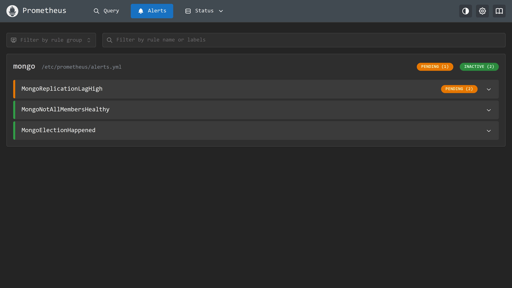

При остановленном узле оповещение `MongoNotAllMembersHealthy` перешло в состояние ожидания. До срабатывания оно в рамках опыта не дошло. Оповещение `MongoReplicationLagHigh` в этот момент уже сработало.

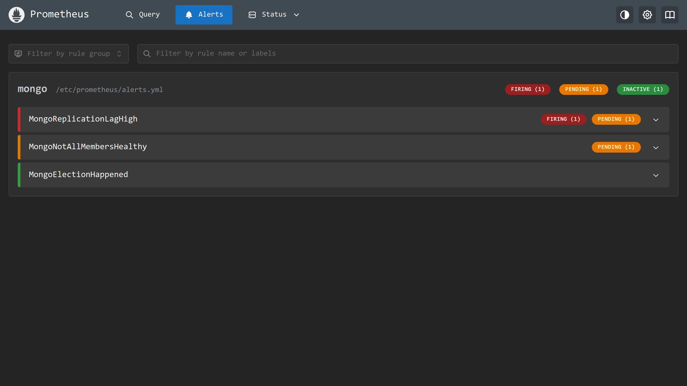

## Выводы

В работе собран набор из трёх узлов MongoDB и сервис с раздельным путём записи и чтения, после чего изучено поведение системы при отставании реплики и при отказах. Репликация асинхронная, поэтому чтение с вторичного узла может вернуть устаревшие данные. При искусственной задержке в 10 секунд отставание составило 12 секунд, и после записи 500 документов читатель видел лишь часть из них. Чтение с основного узла с подтверждением большинством даёт актуальные данные, но замедляет запись, так что выбор настроек определяется тем, что важнее для приложения, свежесть данных или скорость и доступность. При отказе основного узла новый выбирается автоматически за 2 секунды при штатной остановке и за 11 секунд при аварийном завершении, а вернувшийся узел становится вторичным и догоняет остальных без потери данных. Когда остался один узел из трёх, запись остановилась, так как система предпочла согласованность доступности, поэтому для отказоустойчивости важно большинство узлов, а не их общее число. Мониторинг с тремя оповещениями позволил заметить все эти события без ручной проверки. Причину, по которой драйвер не выбирал отстающий узел сам, установить не удалось, поэтому для демонстрации чтение закреплялось за ним вручную.
