# Лабораторная работа №4. Развёртывание ELK и работа с журналами приложения

> [!IMPORTANT]
> Стенд запускается одной командой.
> ```bash
> docker compose up -d
> ```
> Перед первым запуском на Linux нужно увеличить лимит отображений памяти командой `sudo sysctl -w vm.max_map_count=262144`.
> Elasticsearch доступен по адресу `http://localhost:9200`, Kibana по адресу `http://localhost:5601`.

## Используемые термины

В тексте встречаются английские названия, которые используются в самих программах. При первом упоминании рядом дано пояснение.

| Термин | Определение |
|---|---|
| Elasticsearch | база данных, рассчитанная на быстрый поиск по тексту и подсчёт статистики |
| Kibana | веб-интерфейс для просмотра данных Elasticsearch и построения графиков |
| Индекс (index) | набор однотипных документов, аналог таблицы в обычной базе |
| Документ (document) | одна запись в индексе, здесь одна строка журнала |
| Маппинг (mapping) | описание полей индекса и их типов |
| Шард (shard) | часть индекса, которую Elasticsearch хранит и обрабатывает отдельно |
| Реплика (replica) | копия шарда, которая хранится на другом узле и нужна для надёжности |
| Статус кластера | сводная оценка состояния, зелёный (green), жёлтый (yellow) или красный (red) |
| Массовая загрузка (bulk API) | способ отправить много документов одним запросом |
| Агрегация (aggregation) | расчёт статистики по документам, например число записей по каждому уровню |
| ILM (Index Lifecycle Management) | управление жизненным циклом индекса, то есть автоматические действия по мере его старения |
| Ротация индекса (rollover) | создание нового индекса, когда текущий достиг заданного предела |
| Псевдоним (alias) | постоянное имя, за которым скрывается один или несколько индексов |
| Шаблон индекса (index template) | набор настроек, которые получает каждый новый индекс с подходящим именем |

---

## Часть 1. Развёртывание Elasticsearch и Kibana

Использован одноузловой кластер из двух контейнеров. Версии Elasticsearch и Kibana одинаковые (8.15.0), так как Kibana работает только с совпадающей версией. Файл конфигурации находится в [`docker-compose.yml`](docker-compose.yml).

```yaml
services:
  elasticsearch:
    image: docker.elastic.co/elasticsearch/elasticsearch:8.15.0
    container_name: elasticsearch
    environment:
      - discovery.type=single-node
      - xpack.security.enabled=false
      - ES_JAVA_OPTS=-Xms1g -Xmx1g
    ports:
      - "9200:9200"
    volumes:
      - es_data:/usr/share/elasticsearch/data

  kibana:
    image: docker.elastic.co/kibana/kibana:8.15.0
    container_name: kibana
    environment:
      - ELASTICSEARCH_HOSTS=http://elasticsearch:9200
      - XPACK_ENCRYPTEDSAVEDOBJECTS_ENCRYPTIONKEY=doschennikov-lab-kibana-encryption-key-2026
    ports:
      - "5601:5601"
    depends_on:
      - elasticsearch

volumes:
  es_data:
```

Параметр `discovery.type=single-node` запускает кластер из одного узла. Параметр `xpack.security.enabled=false` отключает пароли и шифрование соединений, чтобы не усложнять лабораторную работу. В реальной эксплуатации так делать нельзя. Ключ шифрования Kibana нужен для подсистемы оповещений (см. часть 4), и значение в файле подходит только для учебного стенда. Том `es_data` хранит данные между перезапусками, поэтому для остановки следует использовать `docker compose down` без параметра `-v`, который удаляет тома вместе с данными.

### Статус кластера

```bash
curl -s 'http://localhost:9200/_cluster/health?pretty'
```

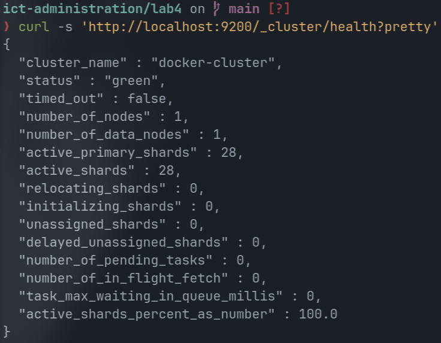

Статус зелёный. В кластере один узел, 28 активных шардов и ни одного неназначенного (`unassigned_shards` равно 0). Все эти шарды принадлежат служебным индексам Kibana, а у них реплик нет, поэтому размещать копии не нужно.

Kibana открылась по адресу `http://localhost:5601`.


### Почему на одном узле статус бывает жёлтым

Чтобы проверить это, создан тестовый индекс с одним шардом и одной репликой.

```bash
curl -s -X PUT 'http://localhost:9200/test-index' -H 'Content-Type: application/json' \
  -d '{"settings":{"number_of_shards":1,"number_of_replicas":1}}'
```

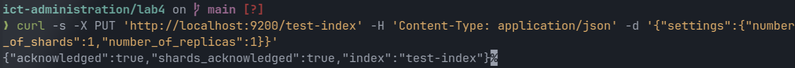

После этого статус стал жёлтым, а число неназначенных шардов выросло до одного.

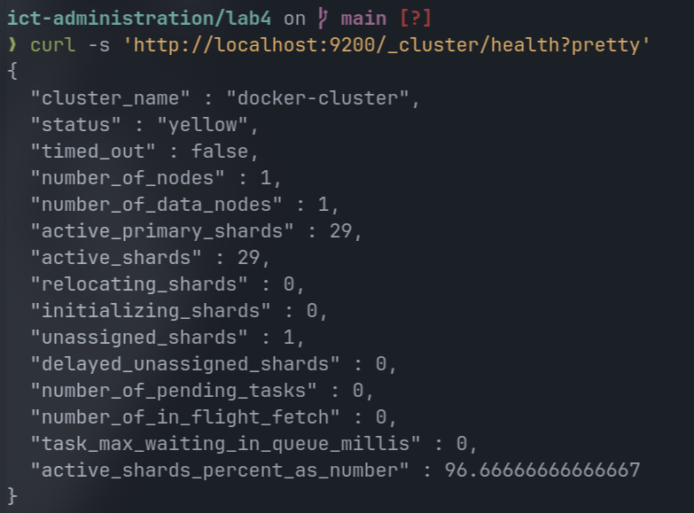

Команда `_cat/shards` показывает причину. Основной шард (`p`) запущен (`STARTED`), а его реплика (`r`) не размещена (`UNASSIGNED`).

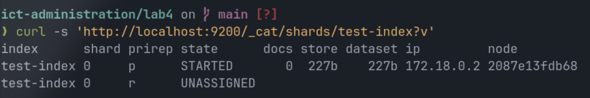

Реплика является копией основного шарда и нужна для того, чтобы данные пережили потерю узла. Если бы копия лежала на том же узле, при его отказе пропали бы оба экземпляра, и смысла в ней не было бы. Поэтому Elasticsearch не размещает реплику рядом с основным шардом, и на единственном узле ей некуда встать.

Чтобы статус снова стал зелёным, есть два пути. Первый путь состоит в добавлении второго узла, и тогда реплика разместится на нём. Второй путь состоит в отказе от реплик. Использован второй вариант.

```bash
curl -s -X PUT 'http://localhost:9200/test-index/_settings' -H 'Content-Type: application/json' \
  -d '{"index":{"number_of_replicas":0}}'
```

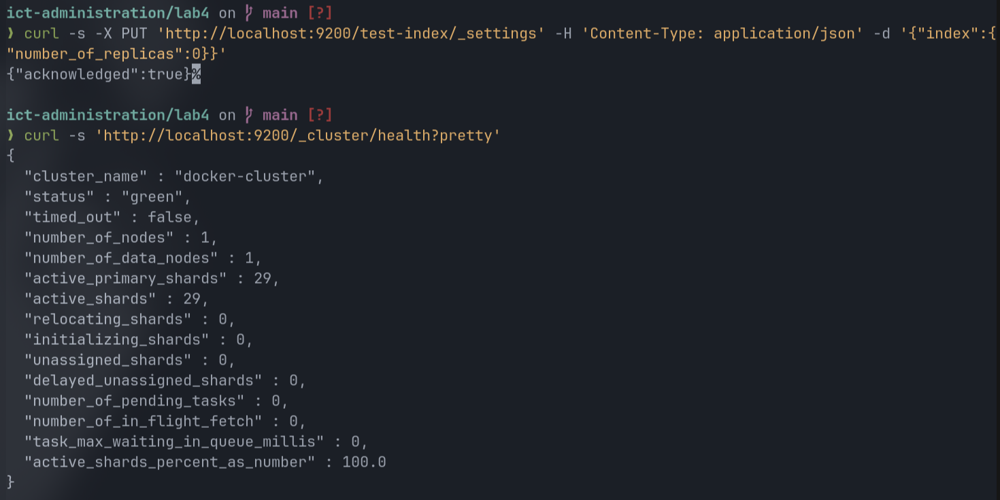

---

## Часть 2. Данные, индекс и поиск

### Генерация журналов

Журналы создаёт скрипт [`generate_logs.py`](generate_logs.py). Он формирует 30 записей интернет-магазина с интервалом семь минут, начиная с 15 октября 2026 года, 08:00 по UTC. Для воспроизводимости задано фиксированное начальное значение генератора случайных чисел (`random.seed(42)`). Пять записей добавлены принудительно с типичными ошибками сервисов. Результат записывается в файл [`bulk.ndjson`](bulk.ndjson), где на каждый документ приходится две строки, служебная и с самими данными.

```bash
python generate_logs.py
wc -l bulk.ndjson
```

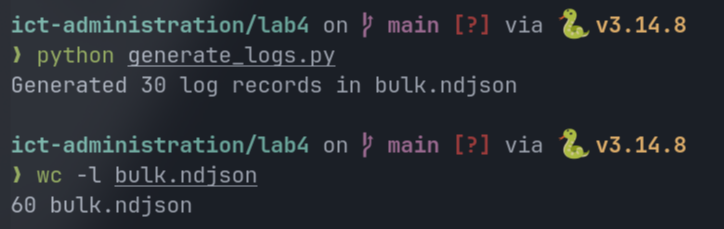

Получено 30 записей и 60 строк в файле. Поля каждой записи совпадают с требованиями задания: `timestamp`, `level`, `service`, `message`, `trace_id`.

### Индекс с маппингом

```bash
curl -s -X PUT 'http://localhost:9200/app-logs' -H 'Content-Type: application/json' -d '{
  "settings": { "number_of_shards": 1, "number_of_replicas": 0 },
  "mappings": {
    "properties": {
      "timestamp": {"type": "date"},
      "level":     {"type": "keyword"},
      "service":   {"type": "keyword"},
      "message":   {"type": "text"},
      "trace_id":  {"type": "keyword"}
    }
  }
}'
```

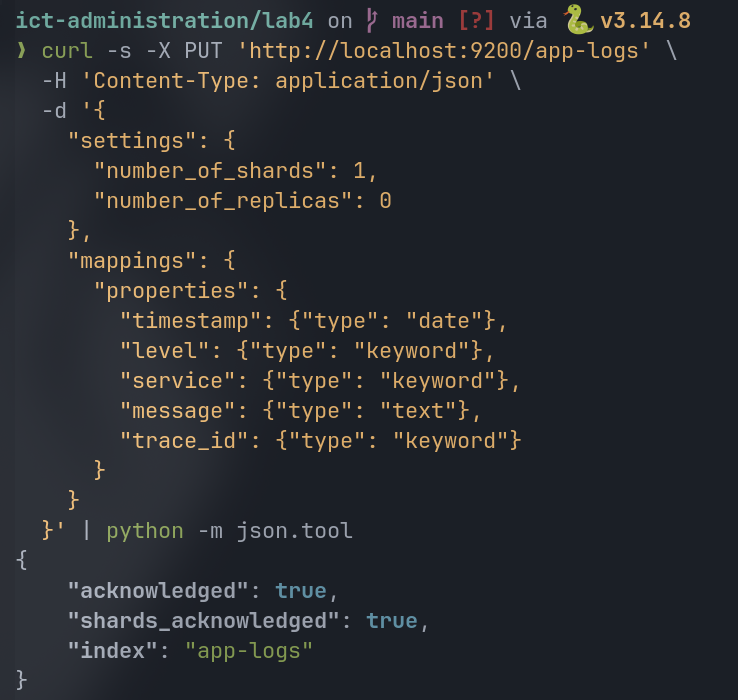

Типы выбраны по тому, как поле будет использоваться. Тип `keyword` хранит значение целиком и подходит для точного сравнения и подсчёта, поэтому он назначен уровню, сервису и идентификатору трассировки. Тип `text` разбивает строку на слова и позволяет искать по смыслу, поэтому он назначен сообщению. Тип `date` нужен для отбора по времени.

### Загрузка и проверка

```bash
curl -s -X POST 'http://localhost:9200/_bulk' -H 'Content-Type: application/x-ndjson' --data-binary @bulk.ndjson
curl -s 'http://localhost:9200/app-logs/_count?pretty'
```

В ответе массовой загрузки поле `errors` равно `false`. Счётчик подтверждает, что в индексе 30 документов.

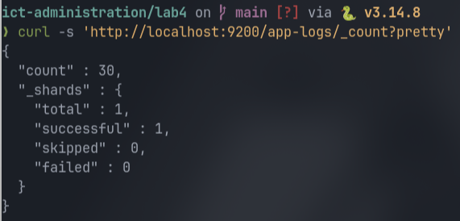

### Поисковые запросы

Полнотекстовый поиск по сообщению. Запрос `match` разбивает фразу на слова и ищет документы, где встречается хотя бы одно из них. Найдено 5 документов. Среди них есть записи уровня INFO с текстом «Payment transaction failed», так как уровень в сообщении никак не учитывается.

```bash
curl -s -X POST 'http://localhost:9200/app-logs/_search?pretty' -H 'Content-Type: application/json' \
  -d '{"query":{"match":{"message":"payment transaction"}}}'
```

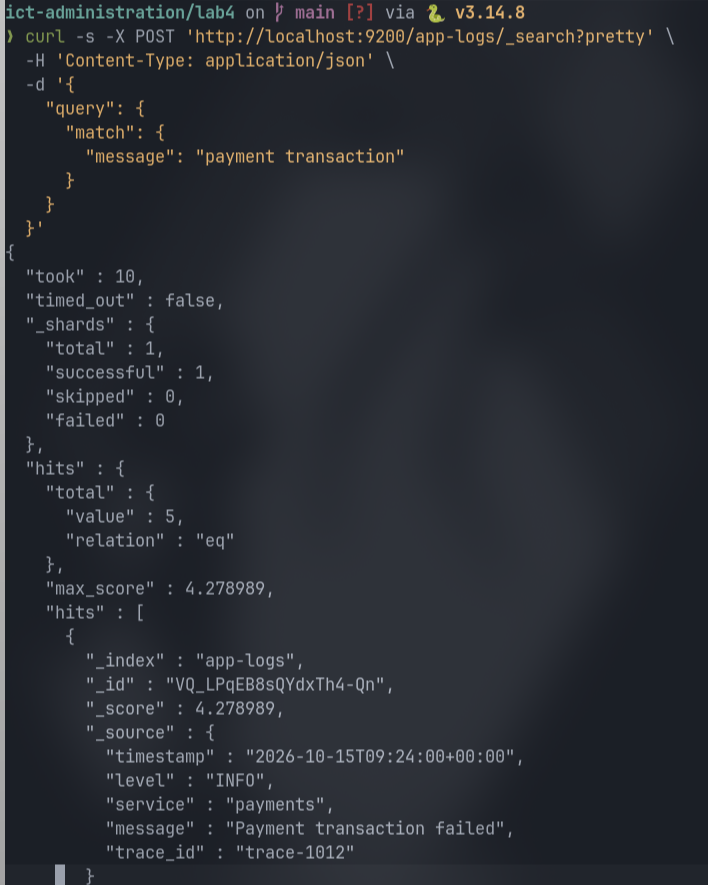

Ошибки за указанный период. Условие `term` отбирает точное значение уровня, а `range` ограничивает время. Оба условия размещены в блоке `filter`, который не считает релевантность, поэтому в результатах `_score` равен нулю. Найдено 7 документов уровня ERROR.

```bash
curl -s -X POST 'http://localhost:9200/app-logs/_search?pretty' -H 'Content-Type: application/json' -d '{
  "query": { "bool": { "filter": [
    {"term":  {"level": "ERROR"}},
    {"range": {"timestamp": {"gte": "2026-10-15T08:00:00Z", "lte": "2026-10-15T12:00:00Z"}}}
  ]}}
}'
```

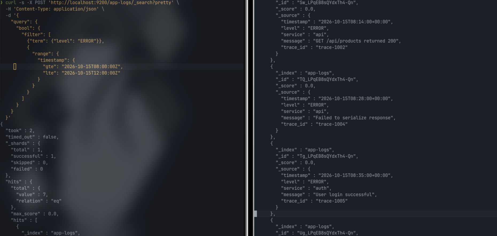

Поиск по идентификатору трассировки. Идентификатор связывает все события одного запроса, поэтому по нему удобно находить цепочку записей в разных сервисах. Найден 1 документ.

```bash
curl -s -X POST 'http://localhost:9200/app-logs/_search?pretty' -H 'Content-Type: application/json' \
  -d '{"query":{"term":{"trace_id":"trace-1004"}}}'
```

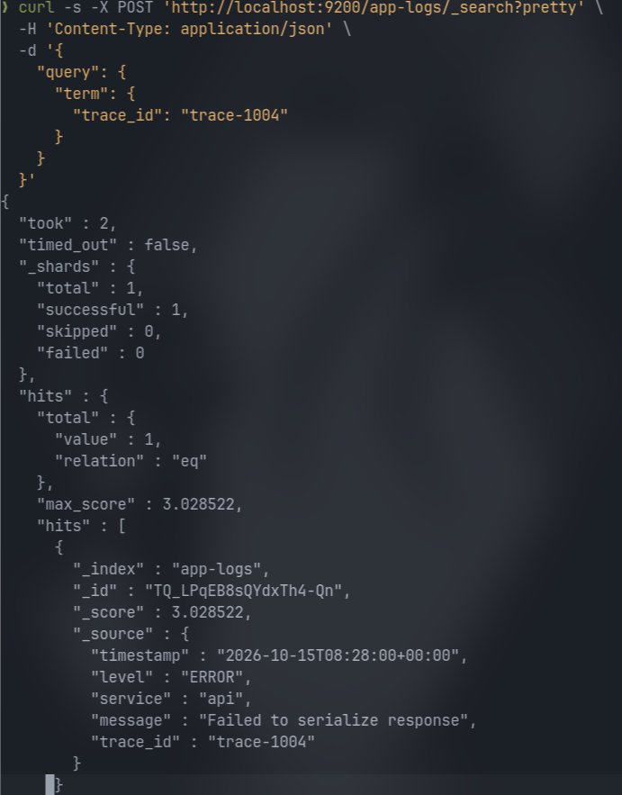

### Агрегация

Подсчитано число записей по каждому уровню журналирования.

```bash
curl -s -X POST 'http://localhost:9200/app-logs/_search?pretty' -H 'Content-Type: application/json' \
  -d '{"size":0,"aggs":{"logs_by_level":{"terms":{"field":"level"}}}}'
```

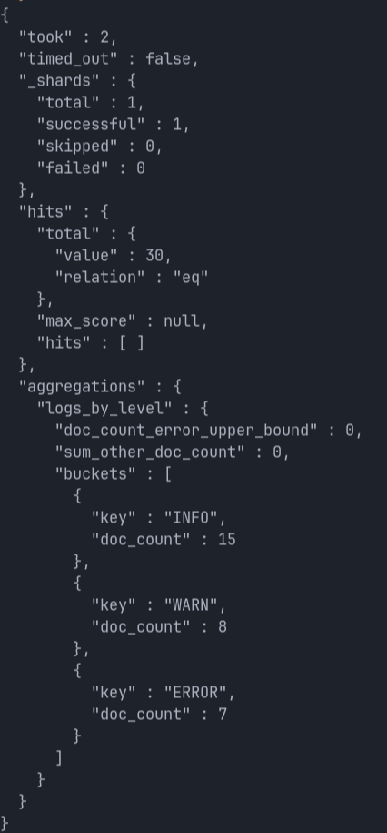

Получено 15 записей INFO, 8 записей WARN и 7 записей ERROR. Сумма равна 30, то есть учтены все документы. Параметр `size: 0` отключает вывод самих документов, поэтому в ответе остаётся только статистика.

### Работа в Kibana

Сначала создано представление данных (Data View). Оно сообщает Kibana, какие индексы показывать и какое поле считать временем. В качестве временного поля выбрано `timestamp`.

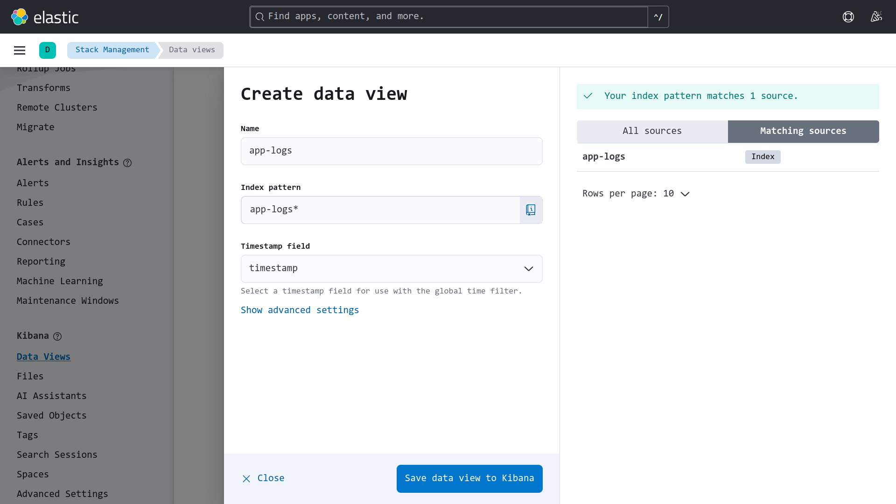

В разделе Discover видны все 30 записей за период 15 октября 2026 года.

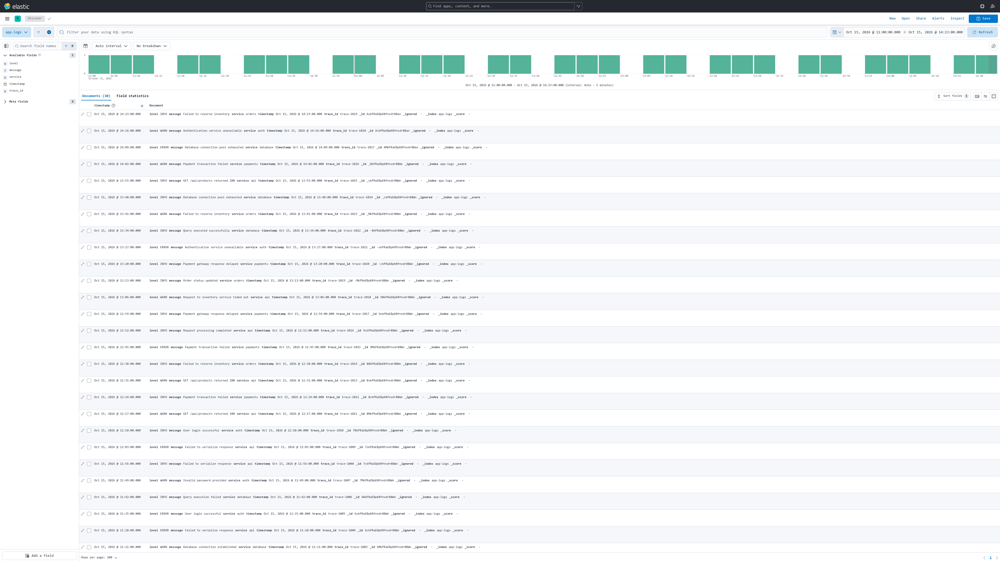

Запросы на языке KQL дают те же результаты, что и запросы к Elasticsearch. Поиск `level : "ERROR"` оставляет только ошибки.

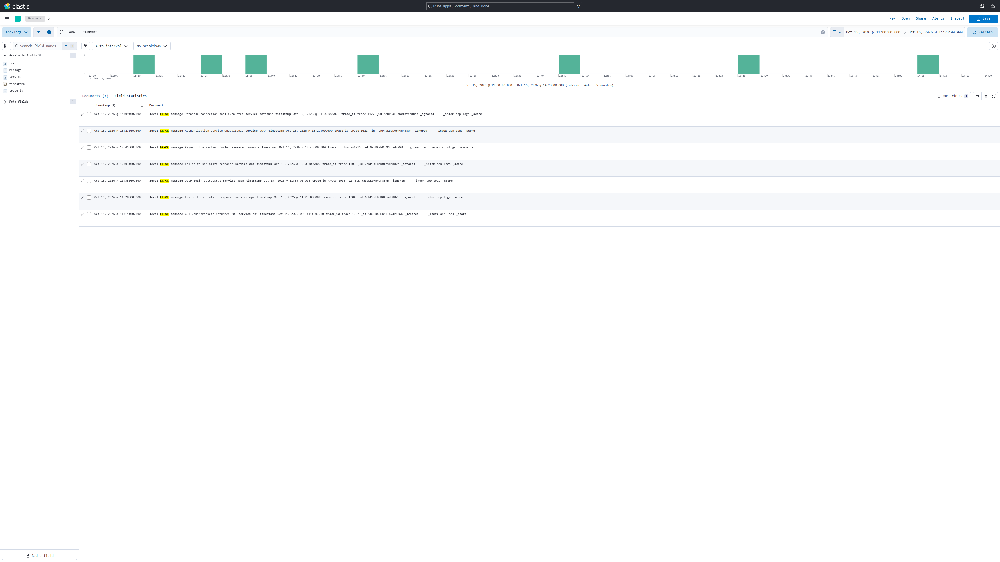

Поиск `message : "payment"` находит 5 сообщений об оплате, а выбранные слова подсвечены.

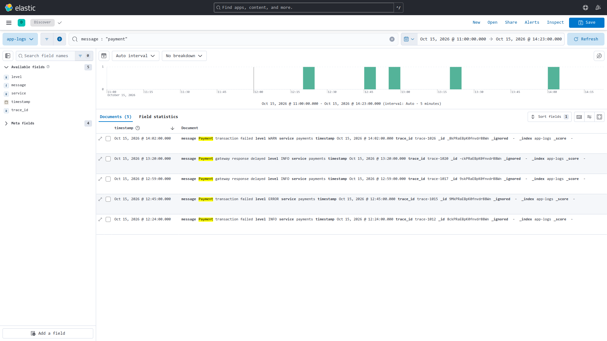

Поиск `trace_id : "trace-1004"` возвращает единственную запись.

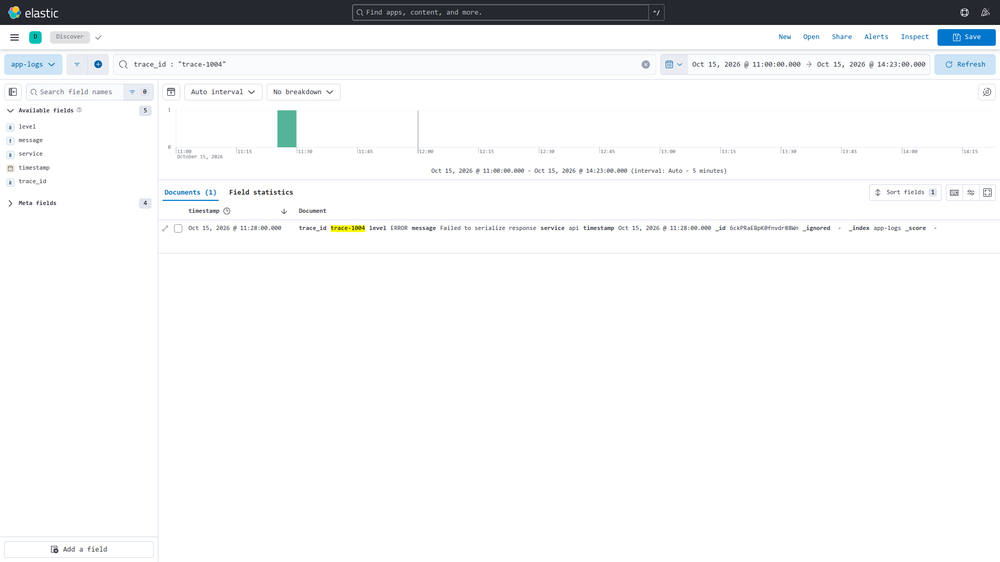

Та же агрегация выполнена в консоли разработчика Kibana. Слева виден запрос, справа ответ с тремя группами.

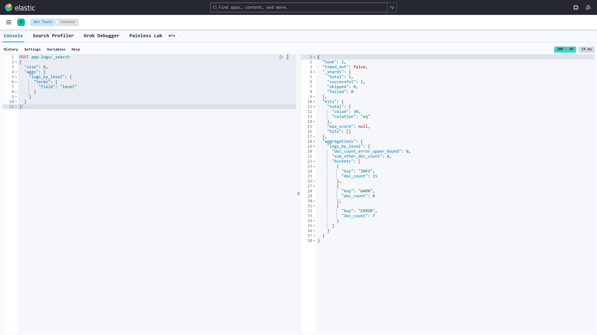

Для наглядности построена столбчатая диаграмма в Lens. По горизонтали отложены уровни, по вертикали число записей. Диаграмма сохранена под именем `Logs by level`.

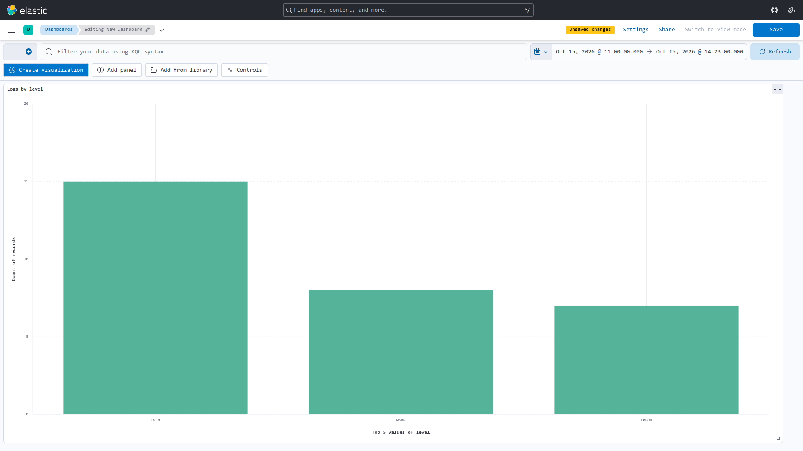

Диаграмма размещена на дашборде `Application Logs Overview`.

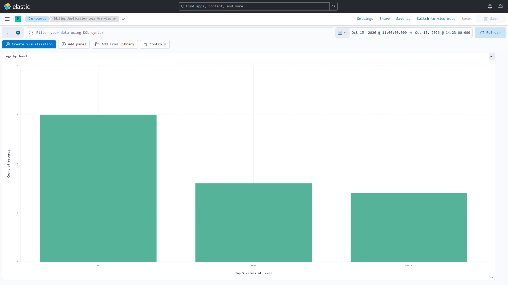

---

## Часть 3. Ротация индексов через ILM

Задача состоит в том, чтобы индекс не рос бесконечно. Когда он достигает заданного предела, система сама создаёт новый, а старые индексы со временем удаляет. Запись при этом всегда идёт в псевдоним, а не в конкретный индекс, поэтому приложению не нужно знать, какой индекс сейчас актуален.

Исходный индекс `app-logs` оставлен без изменений, чтобы не потерять данные и не нарушить работу дашборда. Для обычного индекса нельзя завести псевдоним с тем же именем, поэтому ротация настроена на отдельной серии индексов `app-logs-rollover-*`.

### Политика

Предельные значения выбраны небольшими, чтобы результат можно было получить за время демонстрации. Ротация происходит, когда выполнено любое из трёх условий.

```
PUT _ilm/policy/app-logs-policy
{
  "policy": {
    "phases": {
      "hot": {
        "actions": {
          "rollover": {
            "max_docs": 10,
            "max_age": "1d",
            "max_primary_shard_size": "50mb"
          }
        }
      }
    }
  }
}
```

### Шаблон индекса и псевдоним

Шаблон срабатывает для всех индексов с именем `app-logs-rollover-*`. Он подключает политику, указывает псевдоним для ротации и задаёт тот же маппинг, что и в части 2.

```
PUT _index_template/app-logs-template
{
  "index_patterns": ["app-logs-rollover-*"],
  "template": {
    "settings": {
      "index.lifecycle.name": "app-logs-policy",
      "index.lifecycle.rollover_alias": "app-logs-write",
      "number_of_shards": 1,
      "number_of_replicas": 0
    },
    "mappings": {
      "properties": {
        "timestamp": { "type": "date" },
        "level":     { "type": "keyword" },
        "service":   { "type": "keyword" },
        "message":   { "type": "text" },
        "trace_id":  { "type": "keyword" }
      }
    }
  },
  "priority": 200
}
```

Первый индекс серии создан вручную, и ему назначен псевдоним для записи (`is_write_index: true`).

```
PUT app-logs-rollover-000001
{ "aliases": { "app-logs-write": { "is_write_index": true } } }
```

Проверка показывает, что индексу назначены политика и псевдоним.

```
GET app-logs-rollover-000001/_settings?filter_path=*.settings.index.lifecycle
GET _cat/aliases/app-logs-write?v
```

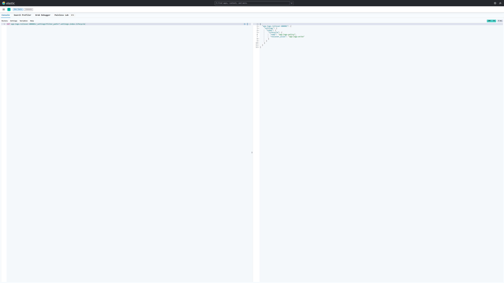


### Демонстрация ротации

В псевдоним `app-logs-write` записано десять тестовых документов, что равно порогу `max_docs`.

```
POST app-logs-write/_bulk
{"index":{}}
{"timestamp":"2026-10-16T12:00:00Z","level":"INFO","service":"rollover-demo","message":"Rollover test 1","trace_id":"rollover-1"}
...
```

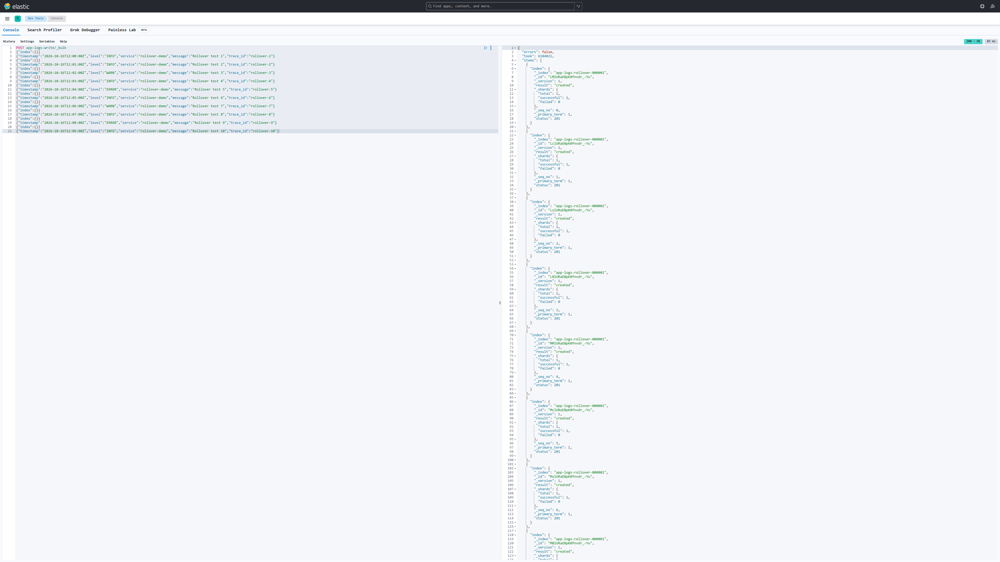

Затем выполнен запрос ротации с тем же условием.

```
POST app-logs-write/_rollover
{ "conditions": { "max_docs": 10 } }
```

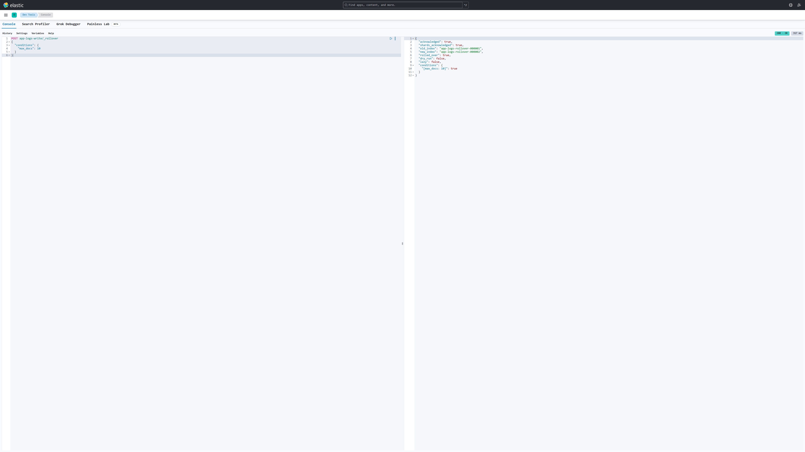

Список индексов (`GET _cat/indices/app-logs-rollover-*?v`) показывает, что появился новый индекс `app-logs-rollover-000002`. В старом 10 документов, в новом ни одного.


Псевдоним `app-logs-write` теперь записывает в новый индекс (`is_write_index` равно `true`), а у старого этот признак сброшен.

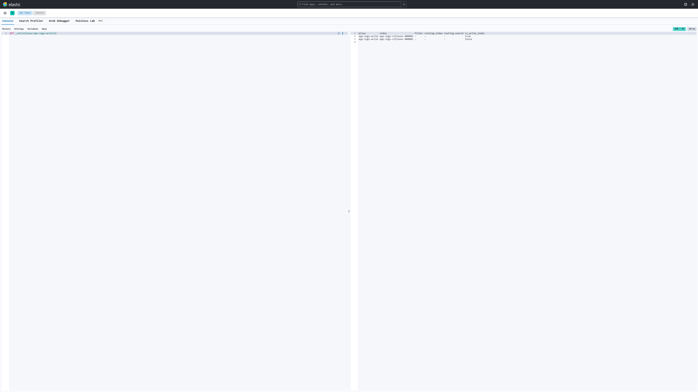

Команда `_ilm/explain` показывает, что оба индекса находятся под управлением политики. У первого индекса действие ротации завершено (`complete`).

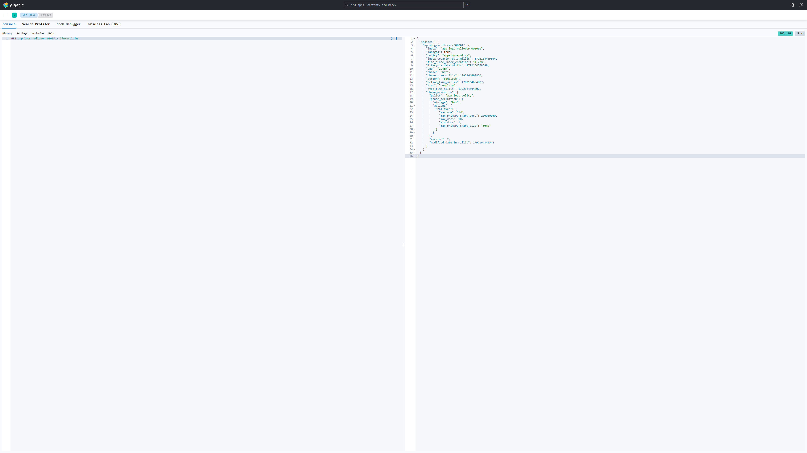

У второго индекса выполняется шаг `check-rollover-ready`, то есть система периодически проверяет, не достигнут ли порог.

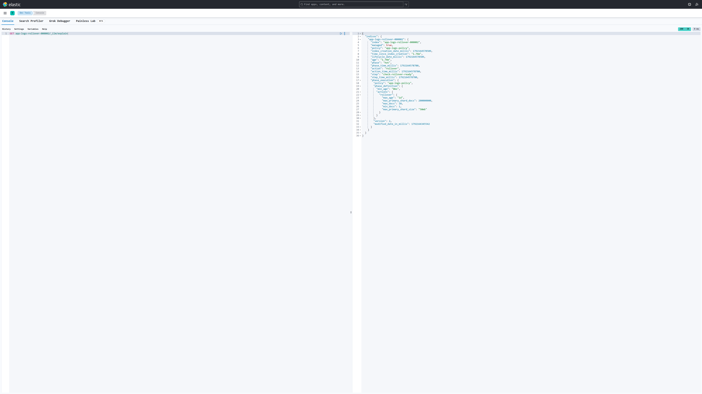

Ротация в этом опыте была запущена запросом, а не самой политикой. Запрос использует то же условие, что и политика, поэтому он подтверждает корректность псевдонима, шаблона и переключения записи. Самостоятельные проверки политика выполняет сама с интервалом, который по умолчанию равен десяти минутам (параметр `indices.lifecycle.poll_interval`). Состояние `check-rollover-ready` у нового индекса означает, что система ждёт, пока в нём накопится десять документов.

### Удаление старых индексов

Политика дополняется фазой `delete`. Срок отсчитывается с момента ротации индекса, для демонстрации выбрано 10 минут.

```
PUT _ilm/policy/app-logs-policy
{
  "policy": {
    "phases": {
      "hot": {
        "actions": {
          "rollover": {
            "max_docs": 10,
            "max_age": "1d",
            "max_primary_shard_size": "50mb"
          }
        }
      },
      "delete": {
        "min_age": "10m",
        "actions": { "delete": {} }
      }
    }
  }
}
```

Чтобы не ждать долго, интервал проверок ILM можно временно уменьшить.

```
PUT _cluster/settings
{ "persistent": { "indices.lifecycle.poll_interval": "1m" } }
```

После этого индекс `app-logs-rollover-000001`, прошедший ротацию, должен исчезнуть из вывода `GET _cat/indices/app-logs-rollover-*?v` примерно через десять минут.

---

## Часть 4. Мониторинг

Использован встроенный мониторинг Kibana (Stack Monitoring). Он не требует отдельного экспортера, поскольку Elasticsearch сам собирает собственные метрики. Сбор включён параметром `xpack.monitoring.collection.enabled` через интерфейс Kibana. Elasticsearch сообщает, что этот параметр устарел и будет удалён в будущих версиях, но в версии 8.15.0 он работает. Данные записываются в служебные индексы `.monitoring-*`.

```bash
curl -s 'http://localhost:9200/_cat/indices/.monitoring-*?v'
```

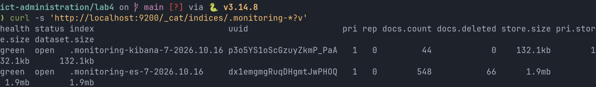

Для работы подсистемы оповещений Kibana потребовала ключ шифрования. Он задан переменной `XPACK_ENCRYPTEDSAVEDOBJECTS_ENCRYPTIONKEY` в файле `docker-compose.yml` (см. часть 1), после чего контейнер Kibana был пересоздан командой `docker compose up -d --force-recreate kibana`.

### Обзор кластера

На общей странице видны состояние кластера (Healthy), версия 8.15.0, один узел, 33 индекса, доступное место на диске (92,35 %, то есть 439,5 из 475,9 ГБ) и использование памяти JVM. JVM выделяет под Elasticsearch область памяти, которая называется кучей (heap). На момент снимка занято 63,02 % кучи объёмом 1 ГБ.

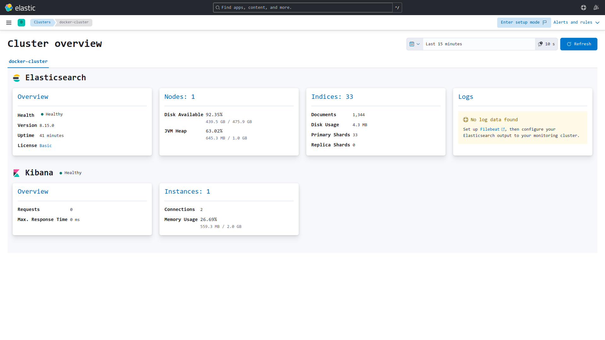

### Графики по узлу

Страница узла содержит графики за последние 15 минут. Для дашборда выбраны следующие показатели.

| Показатель | Что показывает |
|---|---|
| Использование кучи JVM | сколько памяти занято из выделенного объёма |
| Загрузка процессора | насколько занят процессор узла |
| Длительность и частота сборки мусора (GC) | как часто и как долго Java освобождает память, во время такой работы узел отвечает медленнее |
| Скорость и задержка индексации | как быстро принимаются новые документы |
| Скорость и задержка поиска | как быстро выполняются запросы |
| Свободное место на диске | сколько места осталось до заполнения |
| Состояние кластера и число неназначенных шардов | все ли данные размещены |

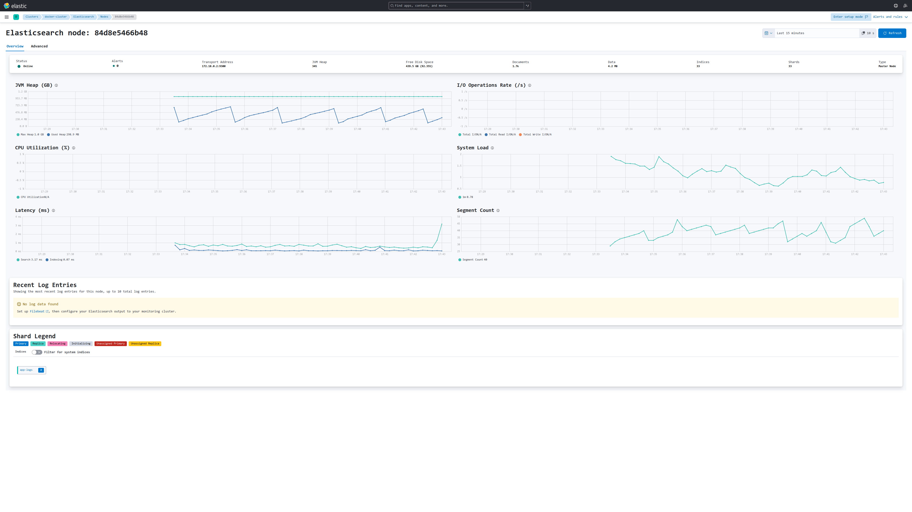

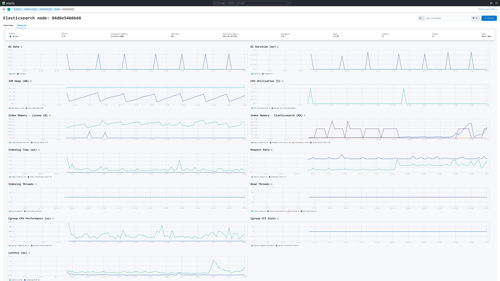

На графике кучи видна характерная пила. Память постепенно заполняется, затем сборщик мусора освобождает её. Это нормальное поведение. Тревожным признаком был бы рост нижней границы пилы или полное заполнение кучи.

### Три метрики для оповещений

Созданы три правила оповещения типа Stack Monitoring, все со стандартным интервалом проверки в одну минуту.

| № | Правило | Условие срабатывания | Что обнаруживает | Чем грозит |
|---|---|---|---|---|
| 1 | Lab - Cluster Health | изменение состояния кластера | потеря шарда или реплики, кластер стал жёлтым или красным | часть данных недоступна или остаётся без копии, и потеря следующего узла приведёт к необратимой потере данных |
| 2 | Lab - JVM Heap Usage | использование кучи выше 80 % | узлу не хватает памяти | сборщик мусора работает всё чаще и дольше, запросы замедляются, а при полном заполнении узел останавливается с ошибкой нехватки памяти |
| 3 | Lab - CPU Usage | загрузка процессора выше 80 % | узел перегружен запросами или фоновой работой | растут задержки поиска и индексации, запросы могут отклоняться, и записи начинают теряться |

Выбраны метрики трёх разных уровней. Первая отвечает за целостность и доступность данных, вторая за запас памяти, третья за вычислительную нагрузку. Первая метрика полезна ещё и тем, что объединяет другие признаки сбоев размещения. Её изменение мы наблюдали в части 1, когда статус стал жёлтым из-за неназначенной реплики. Порог 80 % оставляет время на реакцию до исчерпания ресурса. При обычной работе стенда куча занята на 15 до 63 %, поэтому ложных срабатываний на таком пороге нет.

Заполнение диска также важно, так как при нехватке места Elasticsearch сначала запрещает создание новых шардов, а затем переводит индексы в режим только для чтения. В этой работе оно вынесено на дашборд, а отдельное правило не создавалось, поскольку на стенде свободно более 90 % диска.

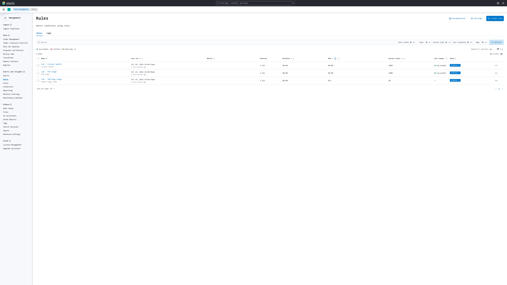

## Вывод

Развёрнут одноузловой кластер Elasticsearch с Kibana, и на примере тестового индекса показано, почему на одном узле статус становится жёлтым и как вернуть зелёный. В индекс с явным маппингом загружены 30 записей, выполнены полнотекстовый поиск, фильтр по уровню и времени, поиск по идентификатору трассировки и агрегация, а результаты показаны в Kibana. Настроена ротация индексов через ILM с псевдонимом для записи, показано переключение на новый индекс. Включён мониторинг кластера и созданы три правила оповещения по состоянию кластера, памяти JVM и нагрузке на процессор.
