# Лабораторная работа №5. Внутренний GitLab: единый вход, nginx в роли рубежа и раннеры

> [!IMPORTANT]
> Стенд запускается одной командой после подготовки.
> ```bash
> docker compose up -d
> ```
> Перед первым запуском нужно:
> 1. Добавить в `/etc/hosts` строку `127.0.0.1 keycloak.local gitlab.local grafana.local registry.gitlab.local`.
> 2. Создать сертификат командой из части 2.
> 3. Создать кластер `kind` и сеть, так как сервис `runner-k8s` подключается к внешней сети `kind`.
>
> GitLab доступен по адресу `https://gitlab.local`, Keycloak по адресу `http://keycloak.local:8080`, Grafana по адресу `http://grafana.local:3000`, Prometheus по адресу `http://localhost:9090`.

## Используемые термины

В тексте встречаются английские названия, которые используются в самих программах. При первом упоминании рядом дано пояснение.

| Термин | Определение |
|---|---|
| Keycloak | сервер, который проверяет учётные данные пользователей и выдаёт приложениям подтверждение входа |
| Realm | изолированное пространство внутри Keycloak со своими пользователями, клиентами и настройками |
| Client (клиент) | запись в realm, описывающая приложение, которому Keycloak разрешает проверять вход пользователей |
| OIDC (OpenID Connect) | протокол, по которому приложение поручает проверку входа внешнему серверу и получает данные о пользователе |
| SSO | вход один раз под одним логином сразу в несколько приложений |
| TLS-терминация | расшифровка защищённого соединения на прокси, дальше внутрь трафик идёт без шифрования |
| Container registry | хранилище образов контейнеров, встроенное в GitLab |
| Pipeline | набор задач, который GitLab запускает после изменения кода |
| Stage | группа задач пайплайна, которые могут идти параллельно, следующая стадия ждёт успеха предыдущей |
| Job | одна единица работы в пайплайне, например проверка стиля или сборка образа |
| Runner | программа, которая получает задачи от GitLab и выполняет их |
| Статический раннер | раннер, который запущен постоянно и выполняет задачи в одном и том же окружении |
| Динамический раннер | раннер, который создаёт для каждой задачи новое окружение и удаляет его после завершения |
| Executor | способ, которым раннер запускает задачу: в контейнере Docker или в поде Kubernetes |
| Тег раннера | метка, по которой задача выбирает раннер |
| Pod | минимальная единица запуска в Kubernetes, здесь одно окружение под одну задачу |
| kind | инструмент, который разворачивает кластер Kubernetes в контейнерах Docker на одной машине |
| `stub_status` | встроенная страница nginx с минимальной статистикой по соединениям |

---

## Часть 1. Единый вход в GitLab и Grafana через Keycloak

Все сервисы описаны в [`docker-compose.yml`](docker-compose.yml). Каждому сервису дано собственное имя (`keycloak.local`, `gitlab.local`, `grafana.local`). Эти имена должны одинаково разрешаться и в браузере, и внутри контейнеров, иначе браузер перейдёт по одному адресу, а GitLab будет проверять вход по другому. В браузере эти имена берутся из файла `hosts`, а внутри сети Docker для Keycloak задан сетевой псевдоним `keycloak.local` на том же порту 8080. Поэтому один и тот же адрес работает в обоих случаях.

### Realm и клиенты

Realm, два клиента и тестовый пользователь создаются при запуске Keycloak импортом из файла [`keycloak/realm-lab.json`](keycloak/realm-lab.json), без ручной настройки в интерфейсе.

Realm называется `devplatform`. Он содержит пользователя `doschennikov` с паролем `doschennikov123`. Клиент `gitlab` описывает GitLab. Допустимый адрес возврата после входа: `https://gitlab.local/users/auth/openid_connect/callback`. Клиент `grafana` описывает Grafana. Допустимый адрес возврата: `http://grafana.local:3000/login/generic_oauth`.

Оба клиента закрытые (`publicClient: false`), то есть у каждого есть секрет, который приложение предъявляет Keycloak при обмене кода на токен. Адреса возврата ограничены явным списком, чтобы Keycloak не отправлял пользователя на посторонний сайт.

Проверка того, что realm поднялся. Каталог настроек OIDC содержит адреса всех конечных точек, которые затем использует GitLab и Grafana.

```bash
curl -s http://keycloak.local:8080/realms/devplatform/.well-known/openid-configuration | head -c 400
```

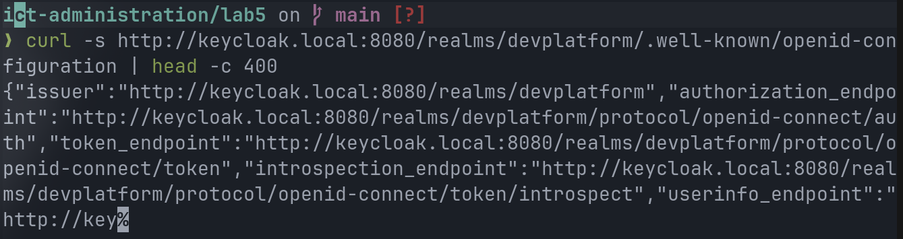

### Как приложения доверяют Keycloak

GitLab и Grafana не хранят пароль пользователя. Приложение перенаправляет пользователя в Keycloak, а он после проверки пароля возвращает одноразовый код. Приложение само, напрямую, обменивает этот код на токены, предъявляя секрет клиента. Доверие строится на том, что обмен кода на токен возможен только при знании секрета и только для зарегистрированного адреса возврата.

Настройка GitLab находится в переменной `GITLAB_OMNIBUS_CONFIG` (внешний провайдер OmniAuth OpenID Connect, доступный в бесплатной редакции). Настройка Grafana задана переменными `GF_AUTH_GENERIC_OAUTH_*`. Для Grafana роль `Admin` назначается всем вошедшим через выражение `'Admin'`, иначе пользователь получил бы роль наблюдателя и не смог бы собирать дашборды.

### Последовательность шагов при входе

1. Пользователь нажимает кнопку "Keycloak" на странице входа GitLab. Браузер обращается к `/users/auth/openid_connect` на GitLab.
2. GitLab отвечает перенаправлением (код 302) на конечную точку авторизации Keycloak и передаёт идентификатор клиента, адрес возврата и проверочное значение PKCE.
3. Keycloak показывает форму входа. Если сессия Keycloak уже есть, пароль не запрашивается, это и есть единый вход.
4. После проверки пароля Keycloak перенаправляет браузер на адрес возврата GitLab с параметром `code`.
5. GitLab обращается к Keycloak напрямую, без участия браузера, передаёт код и секрет клиента и получает токены.
6. GitLab читает из токена имя и адрес почты пользователя, создаёт учётную запись и открывает сессию.

Для Grafana цепочка та же, различаются только адреса. Вход в оба приложения выполнен одним пользователем `doschennikov` без локальных учётных записей.

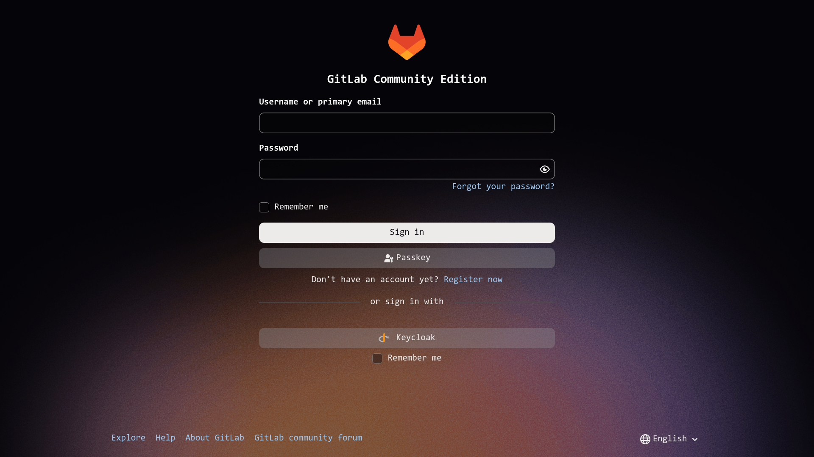

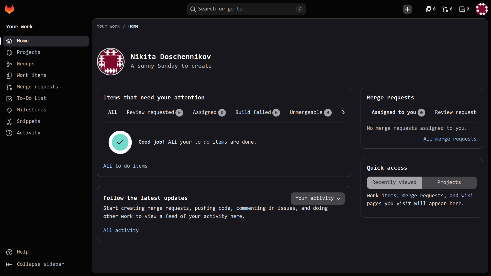

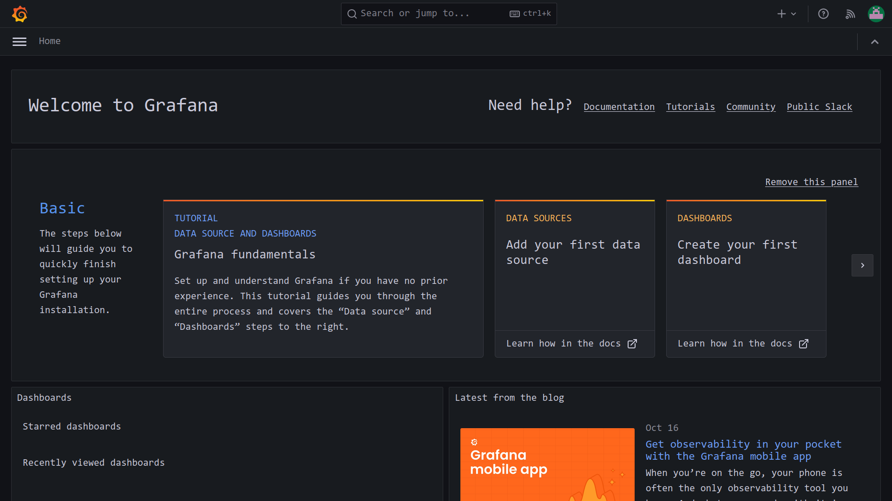

### Особенность настройки GitLab

Сначала вход в GitLab завершался ошибкой `Ssl connect returned=1 ... wrong version number`. Библиотека OmniAuth при поиске настроек принудительно использует HTTPS, а Keycloak в стенде работает по HTTP. Параметры `scheme` и `port` в `client_options` не помогли. Решение состоит в отключении поиска настроек (`discovery: false`) и явном указании адресов `authorization_endpoint`, `token_endpoint`, `userinfo_endpoint` и `jwks_uri`. Grafana этой проблемы не имела, так как ей адреса были заданы явно с самого начала.

---

## Часть 2. nginx в роли рубежа перед GitLab

nginx стал единственной точкой входа на портах 80 и 443. Публикация порта GitLab 8929 убрана, наружу у GitLab остался только SSH для git на порту 2222. Конфигурация находится в [`nginx/conf.d/gitlab.conf`](nginx/conf.d/gitlab.conf) и [`nginx/conf.d/proxy.inc`](nginx/conf.d/proxy.inc).

### TLS и перенаправление

Сертификат самоподписанный, действует год и содержит имена `gitlab.local` и `registry.gitlab.local`.

```bash
openssl req -x509 -nodes -newkey rsa:2048 -days 365 \
  -keyout nginx/certs/gitlab.local.key \
  -out nginx/certs/gitlab.local.crt \
  -subj "/CN=gitlab.local" \
  -addext "subjectAltName=DNS:gitlab.local,DNS:registry.gitlab.local"
```

Закрытый ключ внесён в [`.gitignore`](.gitignore). TLS завершается на nginx, а встроенный nginx GitLab слушает обычный HTTP на порту 80 внутри сети. Об исходном протоколе GitLab узнаёт из заголовков `X-Forwarded-Proto` и `X-Forwarded-Ssl`, поэтому в ссылках и перенаправлениях используется `https`. Реестр образов вынесен на отдельное имя `registry.gitlab.local` и порт 5050 внутри сети. К ответам добавлен заголовок `Strict-Transport-Security`, который сообщает браузеру, чтобы он обращался только по HTTPS.

Запросы на порт 80 получают ответ 301 с адресом на HTTPS, обычные страницы открываются как прежде.

```bash
curl -sI http://gitlab.local/ | head -3
curl -skI https://gitlab.local/users/sign_in | head -1
```

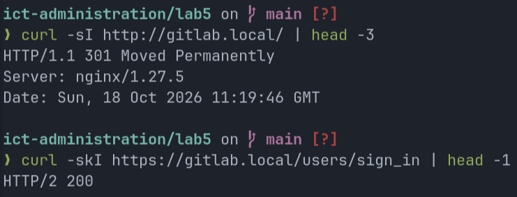

### Правила доступа

Выбрано три правила.

1) Административная зона только с доверенного адреса. Блок `geo` задаёт список разрешённых адресов (`127.0.0.1` и шлюз сети Docker `172.30.0.1`, через который приходят запросы с хост-машины). Для запросов к `/admin` с остальных адресов nginx возвращает 403 и до GitLab запрос не доводит.

Административная зона даёт полный контроль над платформой. Даже при утечке пароля администратора зайти в неё из чужой сети нельзя. Это второй рубеж помимо проверки пароля.

С хоста ответ даёт сам GitLab. Неавторизованному пользователю он отвечает 404 и тем самым скрывает существование админки. Из контейнера, то есть с чужого адреса, ответ 403 даёт nginx. По размеру ответа они различаются: страница GitLab весит 2613 байт, заглушка nginx 153 байта.

```bash
curl -sk -o /dev/null -w "host -> %{http_code}\n" https://gitlab.local/admin
docker run --rm --network lab5_default curlimages/curl \
  -sk -o /dev/null -w "container -> %{http_code}\n" https://gitlab.local/admin
```

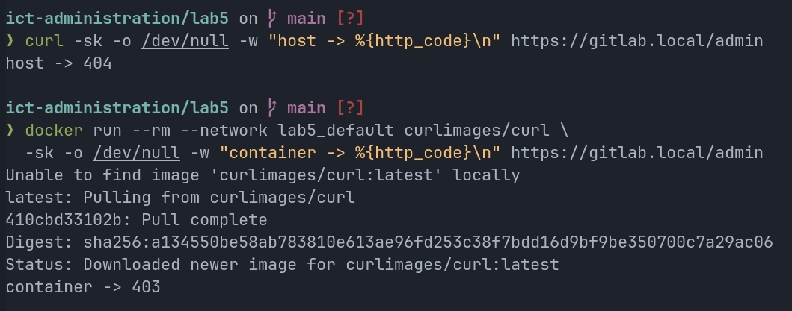

Тело ответа 403 содержит подпись `nginx/1.27.5`, то есть отказ дан именно на рубеже.

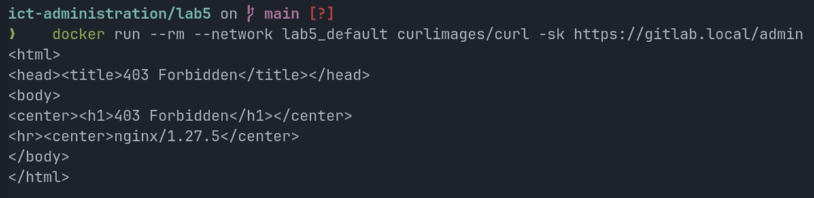

2) Ограничение частоты на попытки входа. Для запросов `POST` к `/users/sign_in` действует лимит 5 запросов в минуту с одного адреса с запасом в 5 запросов. Превышение получает ответ 429. Запросы `GET` не учитываются, так как ключ для них пустой, и обычное открытие страницы не ограничивается.

Правило защищает от перебора паролей и подстановки украденных пар "логин и пароль". Ограничение только на `POST` не мешает обычным пользователям.

В проверке отправлено 12 запросов подряд. Первые шесть дошли до GitLab и были им отклонены кодом 422 (нет токена защиты от подделки запросов), остальные шесть остановлены на nginx кодом 429.

```bash
for i in $(seq 1 12); do
  curl -sk -o /dev/null -w "%{http_code} " -X POST https://gitlab.local/users/sign_in
done; echo
```

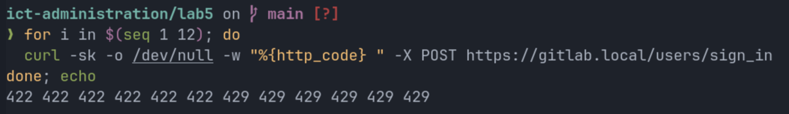

3) Закрытие служебных адресов. Адреса `/-/metrics`, `/-/readiness` и `/-/liveness` возвращают 404. Они раскрывают внутреннее состояние системы и нужны только мониторингу внутри сети.

```bash
curl -sk -o /dev/null -w "%{http_code}\n" https://gitlab.local/-/metrics
curl -skI https://gitlab.local/users/sign_in | head -1
```

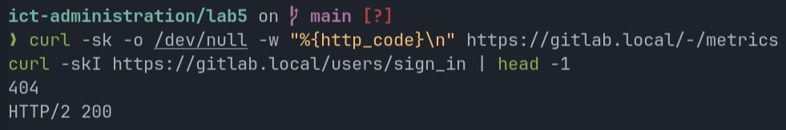

Прямой порт GitLab 8929 закрыт, соединение не устанавливается.

```bash
curl -s -m 3 -o /dev/null -w "%{http_code}\n" http://gitlab.local:8929/
```

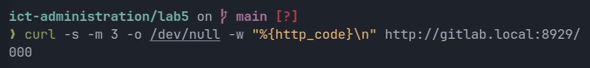

---

## Часть 3. CI/CD: статический и динамический раннеры

### Сервис

Сервис небольшой, на Flask. Он нужен только как объект, проходящий через конвейер. Код лежит в каталоге [`service/`](service/), состав: [`app.py`](service/app.py), [`test_app.py`](service/test_app.py), [`Dockerfile`](service/Dockerfile), [`requirements.txt`](service/requirements.txt), [`.gitlab-ci.yml`](service/.gitlab-ci.yml). Локальная проверка собранного образа вернула ожидаемый ответ `{"result":5}`.

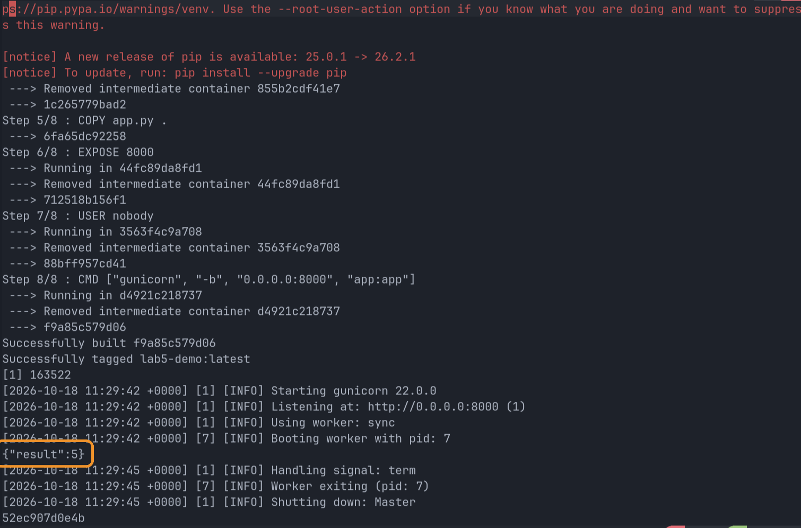

В GitLab создан закрытый проект `devplatform-service`, код отправлен командой `git push`. Флаг `http.sslVerify=false` нужен из-за самоподписанного сертификата.

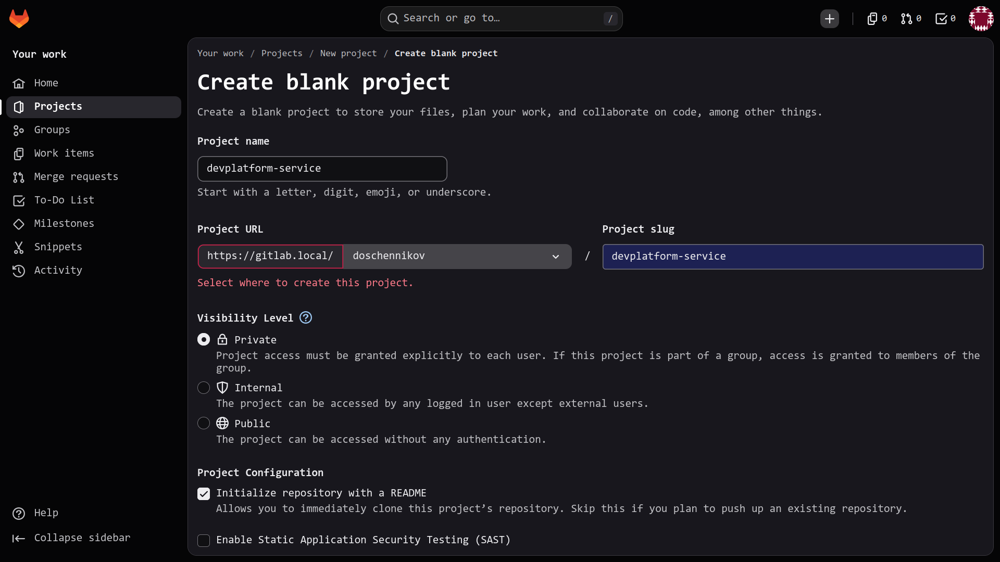

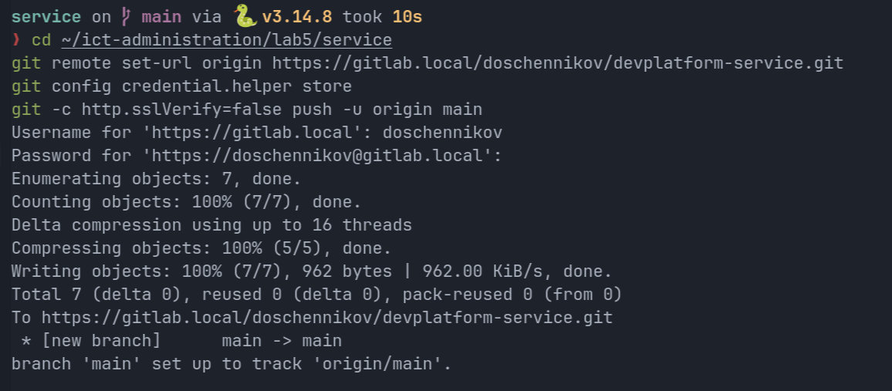

### Регистрация раннеров

1) Статический раннер. Сервис `runner-static` запущен постоянно, исполнитель `docker`. Ему передан сокет Docker хоста и сертификат GitLab в каталог `runners/static/certs/`. Раннер сначала создаётся в интерфейсе с тегом `static`, затем регистрируется командой. Сеть `lab5_default` задана для того, чтобы задачи видели имя `gitlab.local`.

```bash
docker compose exec runner-static gitlab-runner register \
  --non-interactive --url https://gitlab.local --token <я не покажу вам токен> \
  --executor docker --docker-image alpine:3.20 \
  --docker-network-mode lab5_default \
  --docker-volumes /var/run/docker.sock:/var/run/docker.sock \
  --description static-docker
```

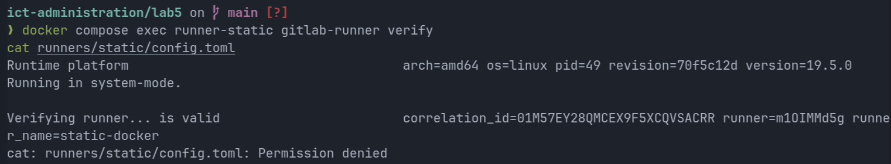

Чтобы Docker хоста доверял реестру образов, сертификат положен в каталог `/etc/docker/certs.d/registry.gitlab.local/`.

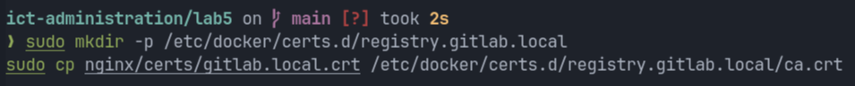

Пробный пайплайн из одной задачи с тегом `static` прошёл успешно.

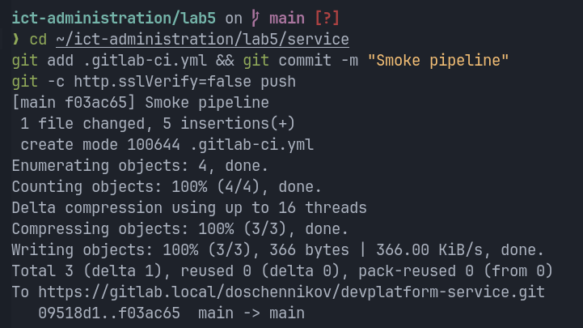

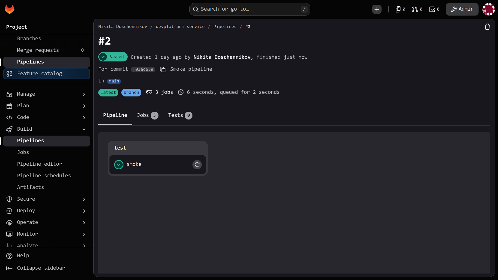

2) Динамический раннер. Выбран исполнитель `kubernetes` на кластере `kind` из двух узлов ([`runners/k8s/kind-config.yaml`](runners/k8s/kind-config.yaml)). Сервис `runner-k8s` работает в Docker и создаёт поды в кластере. Для этого потребовалось:

1. Подключить узлы кластера к сети compose, чтобы они видели nginx. Для nginx зафиксирован адрес `172.30.0.10`.
2. Подключить `runner-k8s` к сети `kind` и выдать ему файл доступа к кластеру с внутренним адресом API.
3. Записать в `config.toml` раннера `concurrent = 10` и соответствие имён `gitlab.local` и `registry.gitlab.local` адресу nginx, так как внутри подов имена из сети Docker недоступны.

```bash
kind create cluster --name ci --config runners/k8s/kind-config.yaml
docker network connect lab5_default ci-control-plane
docker network connect lab5_default ci-worker
kind get kubeconfig --name ci --internal > runners/k8s/kubeconfig
kubectl create namespace gitlab-runner
```

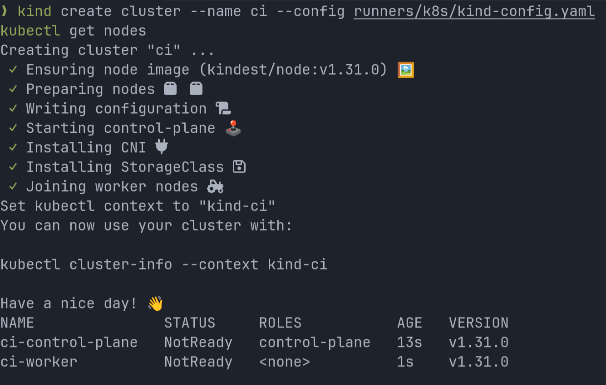

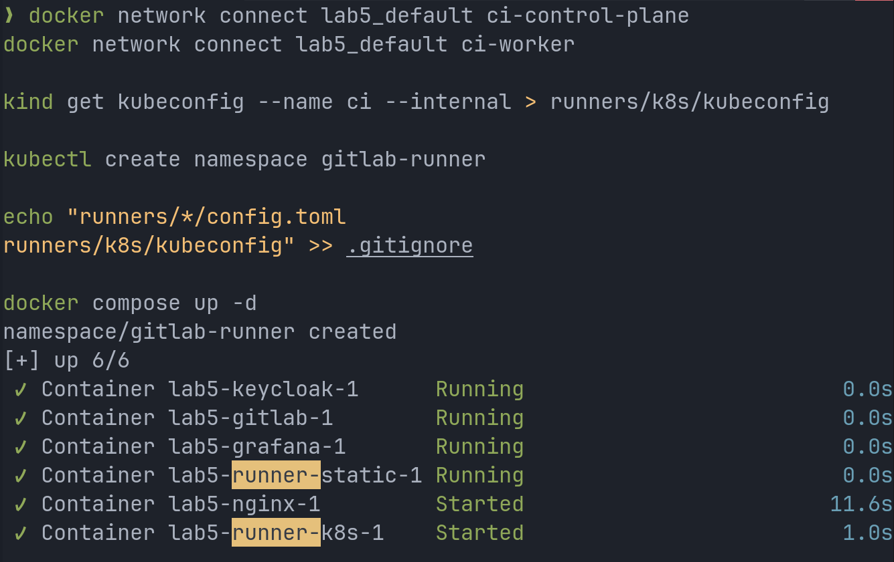

Проверка того, что узел кластера достаёт nginx по зафиксированному адресу:

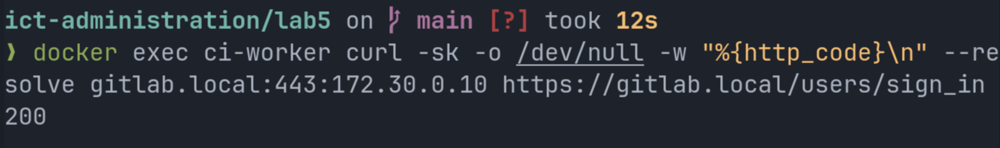

Жизненный цикл пода под задачу виден командой `kubectl get pods -n gitlab-runner -w`. Под создаётся, проходит состояния `Pending`, `Init`, `PodInitializing`, `Running`, затем завершается и удаляется. После окончания пайплайна пространство имён пусто.

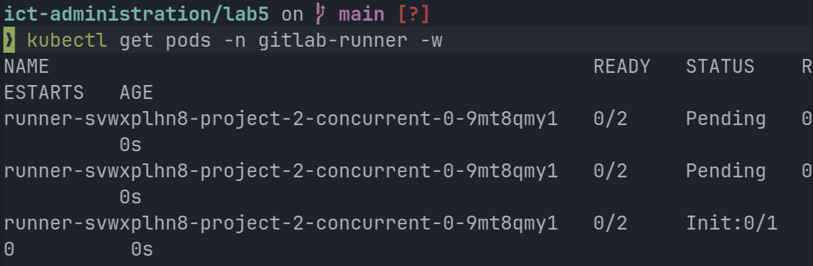

### Шаг 2. Распределение задач

У статического раннера нет задержки на запуск, но он всегда занимает ресурсы, а его окружение сохраняется между задачами. Динамический раннер стартует не мгновенно, зато масштабируется под нагрузку, даёт чистое окружение на каждую задачу и не простаивает.

| Задача                                        | Раннер       | Обоснование                                                                                                                                                                                                |
| --------------------------------------------- | ------------ | ---------------------------------------------------------------------------------------------------------------------------------------------------------------------------------------------------------- |
| `build` (сборка образа и публикация в реестр) | статический  | Нужен Docker. У статического раннера есть сокет Docker хоста и кеш слоёв между запусками, пересборка идёт быстро. В поде пришлось бы поднимать Docker внутри Docker с повышенными правами и холодным кешем |
| `lint` (проверка стиля)                       | динамический | Короткая и независимая задача, нужна чистая среда. Задержка старта для неё допустима                                                                                                                       |
| `test` (Python 3.11, 3.12, 3.13)              | динамический | Три задачи должны идти одновременно, каждой нужна своя чистая среда с нужной версией Python                                                                                                                |
| `audit` (проверка зависимостей на уязвимости) | динамический | Независимая проверка, кеш не нужен, чистая среда желательна                                                                                                                                                |
| `load-dynamic`, `load-static`                 | оба          | Ручные задачи для эксперимента по нагрузке                                                                                                                                                                 |

Cтатическому раннеру отданы задачи, которым нужен Docker и кеш, динамическим отданы короткие, параллельные и изолированные задачи.

### Шаг 3. Pipeline

Файл [`service/.gitlab-ci.yml`](service/.gitlab-ci.yml) содержит 3 стадии. Стадия `check` включает `lint`, три задачи `test` и `audit`, все с тегом `dynamic`. Стадия `build` содержит одну задачу с тегом `static`, которая собирает образ и публикует его в реестр GitLab с тегами `latest` и коротким хешем коммита. Стадия `load` состоит из ручных задач `load-dynamic` и `load-static`, по 6 параллельных копий каждойй.

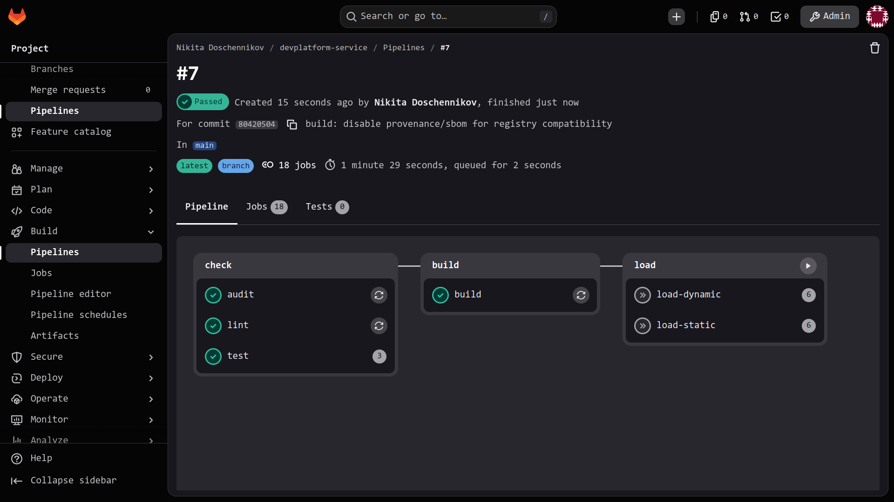

Во время стадии `check` одновременно создаются пять подов: `lint`, 3 `test` и `audit`.

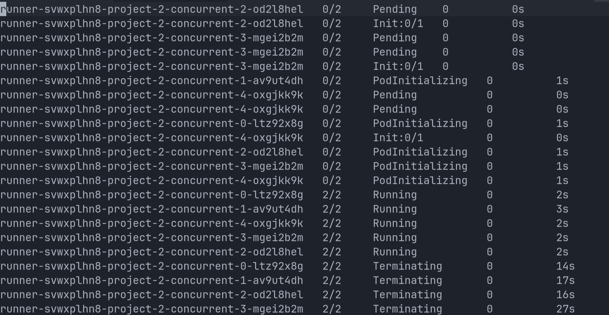

Для сокращения холодного старта образы `python:3.11-slim`, `python:3.12-slim`, `python:3.13-slim` и `alpine:3.20` заранее загружены в узел кластера командой `crictl pull`. Штатная команда `kind load docker-image` не сработала из-за нового хранилища образов Docker.

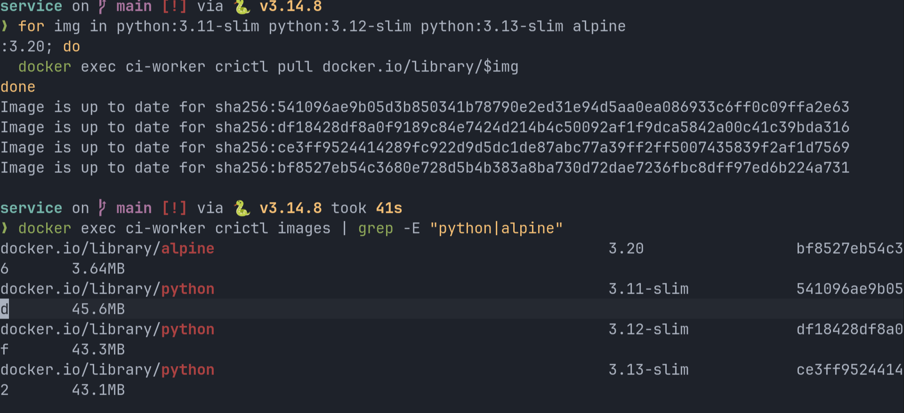

### Шаг 4. Проверка на практике

Нагрузка создавалась запуском стадии `load` целиком. Запустились 12 задач: 6 на динамическом раннере (`concurrent = 10`) и 6 на статическом (`concurrent = 1`). Каждая задача ждёт 30 секунд.

Динамический раннер запустил все 6 задач одновременно, счётчик подов достиг шести.

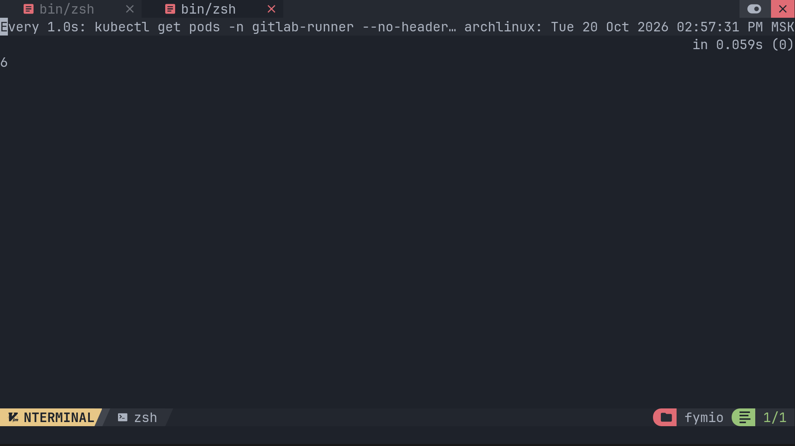

Статический раннер выполнял задачи по одной. На снимке выполняется первая задача, остальные ожидают очереди.

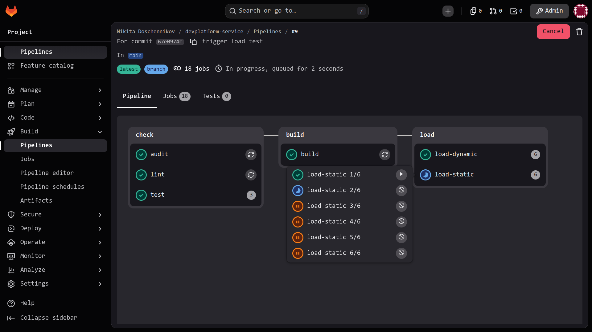

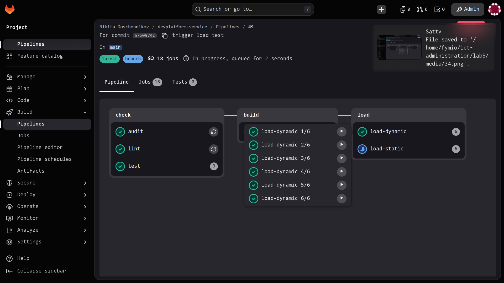

Длительность отдельных задач взята из интерфейса GitLab.

| Задача | Длительность |
|---|---|
| `load-dynamic` 1/6 | 35 с |
| `load-dynamic` 6/6 | 35 с |
| `load-static` 1/6 | 37 с |
| `load-static` 6/6 | 37 с |

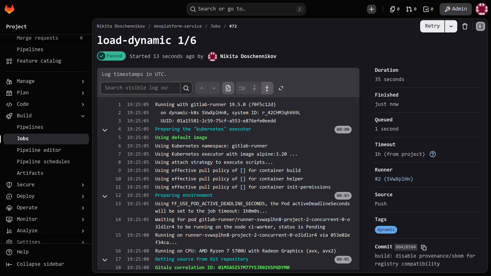

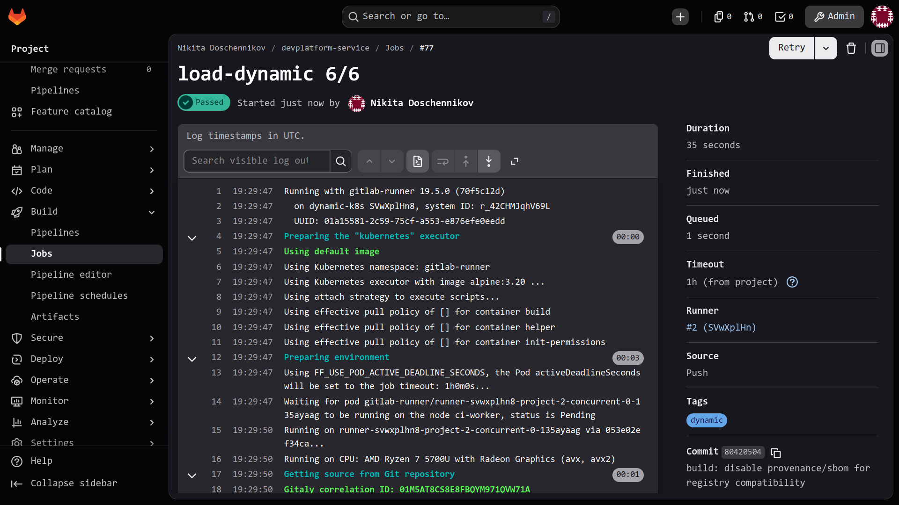


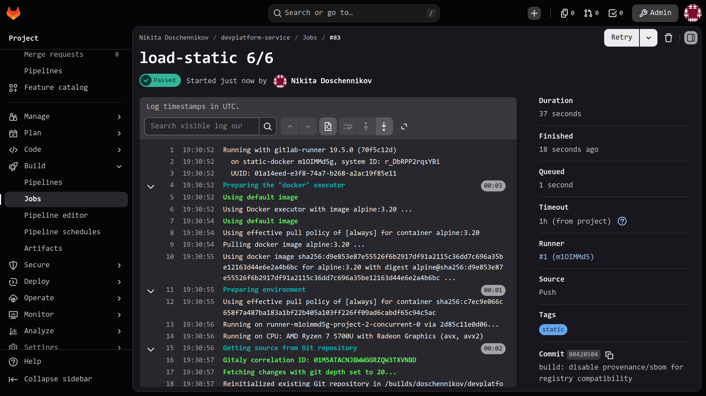

Из этих данных следует, что длительность одной задачи у обоих раннеров практически одинакова. Оба раннера работали на одном процессоре, поэтому сравнивается архитектура, а не мощность. Динамические задачи выполнялись одновременно, поэтому время группы равно времени самой долгой задачи, то есть около 36 секунд. Статические задачи выполняются строго по очереди. Расчётное время группы составляет 6 x 37 с, около 3 минут 42 секунд. Холодный старт динамического раннера зависит от загрузки образа. Пробная задача без образа на узле дошла до состояния `Running` за 35 секунд, а с образом, заранее загруженным в узел, под начал работу за 3 секунды. Окружение статического раннера сохраняется между задачами. В журнале задачи есть строка `Reinitialized existing Git repository`, то есть репозиторий остался от предыдущей задачи. В журнале динамической задачи было `Initialized empty Git repository`, окружение каждый раз чистое.

### Сравнение

| Показатель | Динамический раннер | Статический раннер |
|---|---|---|
| Запуск шести задач по 30 с | одновременно, около 36 с на группу | по очереди, около 3 мин 42 с |
| Старт задачи | с прогретым образом около 3 с, без него около 35 с | 1-4 с на подготовку исполнителя |
| Окружение | чистое для каждой задачи | сохраняется между задачами |
| Простой ресурсов | поды удаляются после задачи | контейнер раннера работает постоянно |
| Изоляция | задача в отдельном поде | задача получает доступ к Docker хоста через сокет, фактически права администратора |
| Кеш между задачами | нет без дополнительной настройки | есть (слои образов, загруженные образы) |

Время группы определяется лимитом параллелизма, а не типом раннера. Статический раннер с `concurrent`, равным 6, справился бы с этой нагрузкой за то же время. Принципиальные различия лежат в изоляции, чистоте окружения и расходе ресурсов в простое.

Статический раннер выгоден для задач, которым нужен кеш и доступ к Docker, например для сборки образов, и при ровной постоянной нагрузке. Динамический раннер выгоднее для коротких независимых задач, при пиковой нагрузке и когда важна чистота окружения.

### Найденные проблемы

1) Проверка `audit` остановила пайплайн, так как `pip-audit` нашёл в `flask` уязвимость `PYSEC-2026-2151`. Версия обновлена до 3.1.3, а `gunicorn` до 23.0.0.
2) При публикации образа реестр отвечал `blob unknown to registry`. Docker хоста собирал образ со списком манифестов и дополнительным манифестом происхождения, которые встроенный реестр GitLab не принял. Помогла сборка с параметрами `--provenance=false --sbom=false --platform linux/amd64`.
3) При первом запуске GitLab не создал администратора и часть начальных настроек. Начальный пароль `Admin12345!Lab` был отклонён проверкой на слабые пароли. Из-за этого задачи зависали с ошибкой 500 и сообщением `CI job token signing key is not set`. Начальное наполнение выполнено вручную командой `gitlab-rake db:seed_fu`, права администратора выданы вошедшему через Keycloak пользователю вручную.

---

## Часть 4. Мониторинг nginx

Для мониторинга выбран nginx, так как через него идёт весь доступ к GitLab, и при его отказе платформа недоступна пользователям.

### Схема

nginx сма не отдает метрики в формате Prometheus не отдаётц. В [`nginx/conf.d/status.conf`](nginx/conf.d/status.conf) включена страница `stub_status` на отдельном порту 8081. Доступ разрешён только из сети compose, порт наружу не публикуется. Экспортер `nginx-prometheus-exporter` читает эту страницу и отдаёт метрики на порту 9113. Prometheus ([`monitoring/prometheus.yml`](monitoring/prometheus.yml)) опрашивает экспортер каждые 10 секунд. Grafana получает источник данных из файла [`monitoring/datasource.yml`](monitoring/datasource.yml).

Цель `nginx` в Prometheus находится в состоянии `UP`.

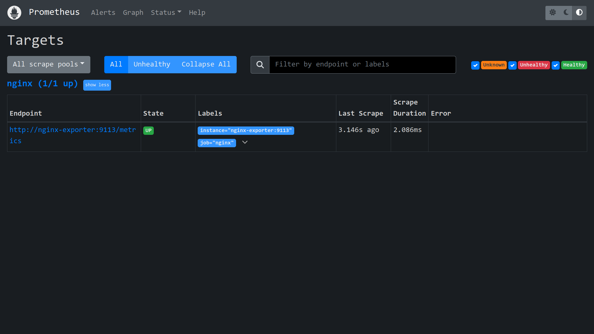

### Dashboard

Дашборд сохранён в [`monitoring/dashboard-nginx.json`](monitoring/dashboard-nginx.json), находится в Grafana, вход в которую выполняется через Keycloak. Состав панелей выбран по тому, что `stub_status` способен показать.

| Панель | Запрос | Что показывает |
|---|---|---|
| NGINX up | `nginx_up` | доступность nginx и экспортера |
| Запросов в секунду | `rate(nginx_http_requests_total[1m])` | нагрузку на рубеж |
| Активные соединения | `nginx_connections_active` | число соединений, открытых прямо сейчас |
| Разбивка соединений | `nginx_connections_reading`, `..._writing`, `..._waiting` | чтение запроса, отправку ответа и ожидание в неактивном соединении |
| Принято vs обработано | `rate(nginx_connections_accepted[1m])`, `rate(nginx_connections_handled[1m])` | расхождение показывает потерянные соединения |
| Отброшенные соединения | `nginx_connections_accepted - nginx_connections_handled` | число соединений, принятых, но не обработанных |

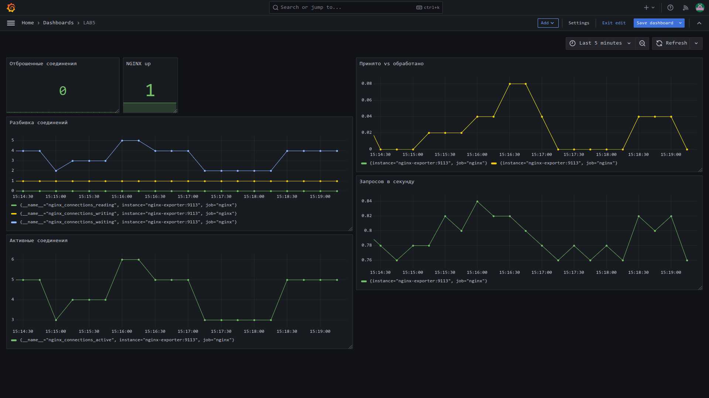

`stub_status` в бесплатной версии nginx не содержит кодов ответов. Поэтому отказы 403 и 429 из части 2 на дашборде не видны, видны только соединения и общее число запросов.

### Метрики для оповещений

Были выбраны следующие:

1) `nginx_up == 0` в течение минуты. Метрика равна нулю, если nginx или экспортер недоступны. nginx является единственной точкой входа, поэтому его отказ означает, что GitLab недоступен всем пользователям и раннерам, а они обращаются к `gitlab.local` через тот же nginx.

2) `nginx_connections_active` выше 80 % от `worker_connections`. В образе nginx по умолчанию `worker_connections` равно 1024, порог составляет около 820 соединений. В обычном состоянии на дашборде активных соединений несколько. Рост до порога означает перегрузку, медленных клиентов или попытку исчерпать соединения. После достижения предела nginx перестаёт принимать новые соединения, и пользователи получают отказ. Оповещение даёт время вмешаться до этого момента.

3) `nginx_connections_accepted - nginx_connections_handled > 0`. В исправной работе значения равны. Положительная разница означает, что nginx принял соединение, но не смог обработать его из-за достигнутых лимитов.

---

## Ручные действия

Конфигурация задаёт всё, кроме перечисленного ниже.

| Действие | Причина |
|---|---|
| `gitlab-rake db:seed_fu` в контейнере GitLab | при первом запуске не создались начальные настройки и ключи подписи токенов задач |
| `gitlab-rails runner` для назначения прав администратора | пользователь root не был создан |
| `gitlab-ctl restart puma` | применение настроек после начального наполнения |
| создание раннера в интерфейсе и `gitlab-runner register` для обоих раннеров | токен выдаётся один раз через интерфейс |
| правка `config.toml` динамического раннера (`concurrent`, `host_aliases`) | параметры не задаются при регистрации |
| `kind create cluster`, `docker network connect`, создание пространства имён | кластер находится вне compose |
| копирование сертификата в `/etc/docker/certs.d/registry.gitlab.local/` | доверие Docker хоста к реестру |
| `crictl pull` в узле кластера | предварительная загрузка образов |
| создание проекта и первый `git push` | проект создаётся в интерфейсе |

---

# Выводы

Пока делал эту работу, я понял, что большинство проблем возникают на стыке, а не внутри отдельных сервисов. Я и ранее, в рамках своих экспериментов, поднимал все эти вещи по отдельности. Но чтобы заставить все это работать вместе пришлось помучаться. В частности из-за не самого очевидного соответствия текста ошибок их причине. Например, wrong version number в keycloack оказалось не означает мисматч версий, а ощначает мисматч протоколов. Та же история в gitlab, который выдавал мне полотна исключений о правах токена, но в итоге оказалось, что все дело в ненадежном пароле. В целом работа была очень полезной и ее было приятно делать, так как все сервисы имеют обширную документацию, как официальную, так и пользовательскую на просторах различных форумов и сообществ.
