# Лабораторная работа №6/7. Автоматизация разбора упавших пайплайнов CI с помощью n8n и ИИ агента

> [!IMPORTANT]
> Стенд запускается одной командой после подготовки.
> ```bash
> docker compose up -d --build
> ```
> Перед первым запуском необходимо выполнить следующие действия.
> 1. Скачать модель командой `docker exec -it ollama ollama pull qwen2.5:7b`.
> 2. Создать в n8n учётную запись владельца и credential Ollama с адресом `http://ollama:11434`.
> 3. Импортировать в n8n оба файла из каталога `workflow/` и опубликовать их.
> 4. Проверить адрес сервера `runbook-mcp` в соответствующей ноде.
>
> n8n доступен по адресу `http://localhost:5678`, Prometheus по адресу `http://localhost:9090`, Grafana по адресу `http://localhost:3000` (логин и пароль `admin`).

## Используемые термины

В тексте встречаются английские названия, которые используются в самих программах. При первом упоминании рядом дано пояснение.

| Термин | Определение |
|---|---|
| n8n | платформа, в которой процесс собирается из блоков, соединённых в схему, без написания отдельного приложения |
| workflow | схема процесса в n8n, то есть набор нод и связей между ними |
| node | один блок workflow, выполняющий отдельное действие |
| webhook | адрес, на который внешняя система отправляет запрос, чтобы запустить процесс |
| payload | тело запроса с данными о событии |
| runbook | инструкция, которая описывает, что делать при известной проблеме |
| on-call | дежурный инженер, который отвечает за сервис в данный момент |
| flaky-тест | тест, который периодически падает без изменений в коде |
| ollama | программа для локального запуска открытых языковых моделей |
| qwen2.5:7b | открытая модель с 7 миллиардами параметров, используемая в работе |
| ai agent | нода n8n, в которой модель сама выбирает, какие инструменты вызвать и в каком порядке, чтобы получить ответ |
| tool | функция, которую агент может вызвать для получения данных или выполнения действия |
| toolkit | набор инструментов, доступных агенту |
| tool calling | способность модели оформить вызов инструмента с нужными аргументами |
| skill | описанное знание агента, то есть порядок действий и правила, по которым он работает |
| system message | инструкция, которая передаётся модели перед каждым запросом и задаёт её поведение |
| mcp | открытый протокол, по которому модель получает доступ к внешним системам и данным через единообразный интерфейс |
| mcp-сервер | программа, которая предоставляет по протоколу MCP набор инструментов |
| streamable http | способ передачи данных по протоколу MCP поверх обычных HTTP запросов |
| prometheus | система, которая периодически собирает числовые метрики и хранит их |
| grafana | система построения графиков и дашбордов по данным Prometheus |
| blackbox exporter | экспортёр, который проверяет доступность сервисов снаружи, не требуя от них собственных метрик |
| `probe_success` | метрика blackbox exporter, равная 1 при успешной проверке и 0 при неудачной |

---

## Часть 1. Описание кейса

### Контекст

 

Компания ShipLoop представляет собой b2b saas стартап на 40 человек. Продукт является платформой планирования доставок. Код хранится в монорепозитории на python и ts, сборка и тесты выполняются в gitlab ci. Автоматизацию выполняет инженер devops для команд разработки.

Автоматизация помогает разработчикам. Падение пайплайна на основной ветке или на релизной ветке блокирует всю команду, и разобраться в нём нужно быстро.

Когда пайплайн падает, разработчик открывает логи, листает их и пытается понять, к какому типу относится сбой. Это может быть ошибка в коде, проблема инфраструктуры или флейк. Затем нужно найти подозрительный коммит, вспомнить, есть ли для такого случая инструкция, и выяснить, кому писать. По оценке команды это занимает от 10 до 15 минут на каждый сбой. Ручной разбор неудобен тем, что информация разбросана по четырём местам, а решение зависит от типа сбоя. Для сбоя инфраструктуры откат коммита вреден, а для сбоя кода он может быть правильным.

### Что делает автоматизация

1. Триггер. gitlab отправляет событие "пайплайн упал" на webhook n8n.
2. Проверка и фильтрация. Код проверяет обязательные поля, вычисляет важность (`high` для веток `release/*`, `medium` для `main`) и пропускает дальше только упавшие пайплайны на `main` и `release/*`.
3. Разбор. Агент по своему набору инструментов получает упавшие задачи, журнал задачи, коммиты, подходящие инструкции и владельца сервиса, определяет категорию сбоя и пишет отчёт.
4. Сохранение. Отчёт оформляется в markdown, записывается в файл на диск и сообщение со ссылкой на файл отправляется в чат.
5. Результат. Файл `reports/triage-<pipeline_id>.md` и сообщение разработчикам в канал `#ci-alerts`.

---

## Часть 2. Устройство workflow

workflow называется `ci failure triage` и хранится в [`workflow/ci-failure-triage.json`](workflow/ci-failure-triage.json). Получатель сообщений находится в отдельном workflow `mock chat` ([`workflow/mock-chat.json`](workflow/mock-chat.json)), который заменяет настоящий мессенджер.

| node | тип | использует ии | назначение |
|---|---|---|---|
| webhook | триггер | нет | принимает `POST /webhook/ci-failure` |
| normalize payload | code | нет | проверяет поля, вычисляет `severity` и признак `relevant` |
| relevant branch? | if | нет | пропускает только упавшие пайплайны на `main` и `release/*` |
| ai agent | агент | да | расследует сбой и пишет отчёт |
| ollama chat model | модель | да | `qwen2.5:7b`, температура 0.1, контекст 8192 токена |
| ci-mcp, runbook-mcp | MCP Client Tool | нет | подключают агента к двум mcp-серверам |
| build report | code | нет | собирает markdown из данных пайплайна и ответа агента |
| convert to file | файл | нет | превращает текст в файл |
| read/write files from disk | файл | нет | записывает `reports/triage-<id>.md` |
| notify chat | http request | нет | отправляет сообщение в `mock chat` |

Ветка if "false" намеренно оставлена пустой. Пайплайны с прочих веток (например, `feature/*`) игнорируются без запуска модели.

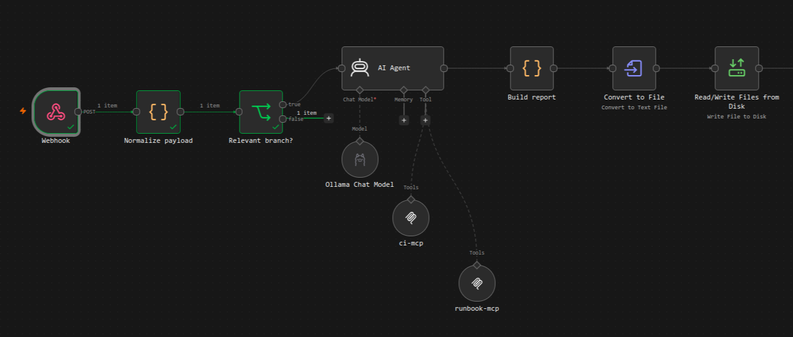

### Соответствие требованиям

| требование | как выполнено |
|---|---|
| триггер | webhook `ci-failure` |
| ии и обычные шаги | один шаг с моделью, 7 шагов без ии (проверка, фильтр, сборка отчёта, конвертация, запись, уведомление) |
| не менее двух mcp-серверов | `ci-mcp` и `runbook-mcp` |
| toolkit из 3 и более инструментов | 5 инструментов, описаны ниже |
| описанные навыки | 3 навыка в [`skills/triage-skills.md`](skills/triage-skills.md) |
| конкретный результат | файл отчёта и сообщение в чат |

### mcp-серверы

Серверы написаны на python с помощью библиотеки `mcp` и работают по протоколу streamable http. Они используют моковые данные, то есть заранее заготовленные пайплайны, журналы, инструкции и список сервисов. Код находится в каталоге [`mcp/`](mcp/).

| cервер | файл | адрес в сети compose |
|---|---|---|
| `ci-mcp` (имитация gitlab) | [`mcp/ci_server.py`](mcp/ci_server.py) | `http://ci-mcp:8001/mcp` |
| `runbook-mcp` (база инструкций и владельцев) | [`mcp/runbook_server.py`](mcp/runbook_server.py) | `http://runbook-mcp:8002/mcp` |

Скрипт [`mcp/check_mcp.py`](mcp/check_mcp.py) позволяет проверить серверы до подключения к n8n. Оба сервера вернули ожидаемые списки инструментов.

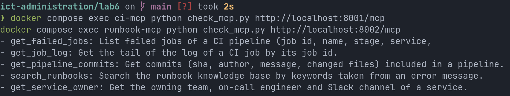

### toolkit агента

| инструмент | сервер | что принимает | что делает |
|---|---|---|---|
| `get_failed_jobs` | `ci-mcp` | `pipeline_id` (int) | возвращает упавшие задачи пайплайна с именем, стадией, сервисом и числом падений за последние 20 запусков |
| `get_job_log` | `ci-mcp` | `job_id` (int) | возвращает хвост журнала задачи |
| `get_pipeline_commits` | `ci-mcp` | `pipeline_id` (int) | возвращает коммиты пайплайна с автором, сообщением и изменёнными файлами |
| `search_runbooks` | `runbook-mcp` | `query` (string) | возвращает до трёх подходящих инструкций с категорией и шагами |
| `get_service_owner` | `runbook-mcp` | `service` (string) | возвращает команду, дежурного и канал Slack |

Ниже показан пример прямого вызова инструментов.

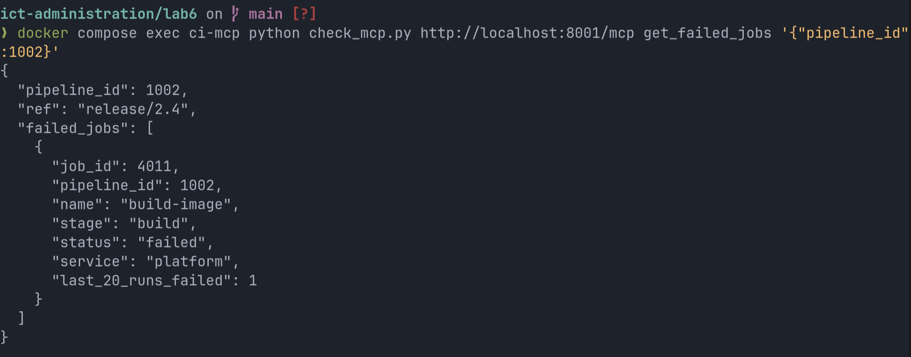

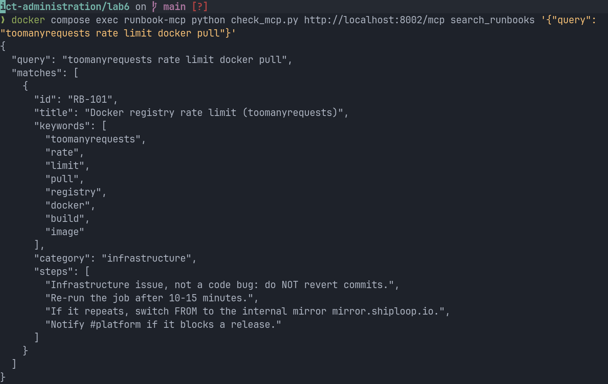

### Skills

Полный текст находится в файле [`skills/triage-skills.md`](skills/triage-skills.md) и вставлен в поле system message nodes ai agent. Файл описывает 3 навыки.

| skill | содержание |
|---|---|
| порядок расследования | фиксированная последовательность из пяти вызовов инструментов, затем отчёт. повторные вызовы с теми же аргументами запрещены |
| правила классификации | выбор ровно одной категории. `CODE` означает ошибку, указывающую на изменённые файлы. `INFRASTRUCTURE` означает лимиты, сеть, диск и раннеры. `FLAKY` означает 3 и более падения из последних 20 запусков при ошибке по таймауту или селектору. При нехватке данных агент пишет `UNCERTAIN` |
| правила и формат отчёта | запрет выдумывать коммиты, идентификаторы и владельцев. откат допускается только для `CODE` на `main` и `release/*` и только если об этом говорит инструкция. отчёт состоит ровно из 5 разделов |

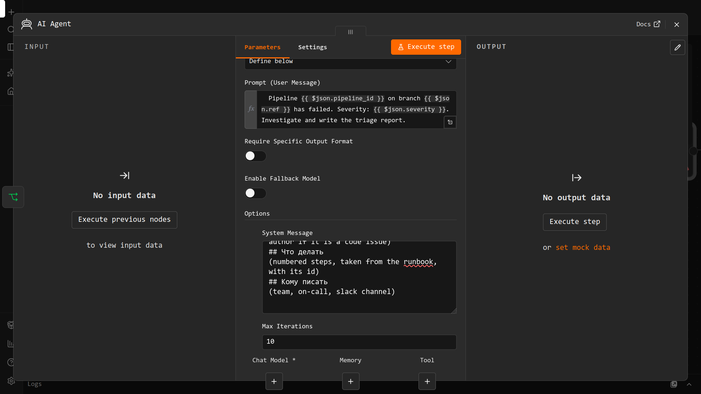

---

## Часть 3. Локальный запуск

### Состав стенда

Все сервисы описаны в [`docker-compose.yml`](docker-compose.yml).

| cервис | образ | порт | назначение |
|---|---|---|---|
| `n8n` | `n8nio/n8n` | 5678 | выполнение workflow, отдаёт метрики на `/metrics` |
| `ollama` | `ollama/ollama` | 11434 | локальная модель |
| `ci-mcp` | собирается из `mcp/` | 8001 | моковый gitlab |
| `runbook-mcp` | собирается из `mcp/` | 8002 | база инструкций |
| `prometheus` | `prom/prometheus` | 9090 | сбор метрик и правила алертов |
| `blackbox` | `prom/blackbox-exporter` | внутренний | проверка доступности зависимостей |
| `grafana` | `grafana/grafana` | 3000 | дашборд |

Каталог `reports/` смонтирован в контейнер n8n как `/files/reports`, поэтому отчёты появляются на хосте. Доступ нод к файловой системе ограничен этим каталогом переменной `N8N_RESTRICT_FILE_ACCESS_TO`.

Ниже показаны журнал запуска n8n и состояние контейнеров после сборки.

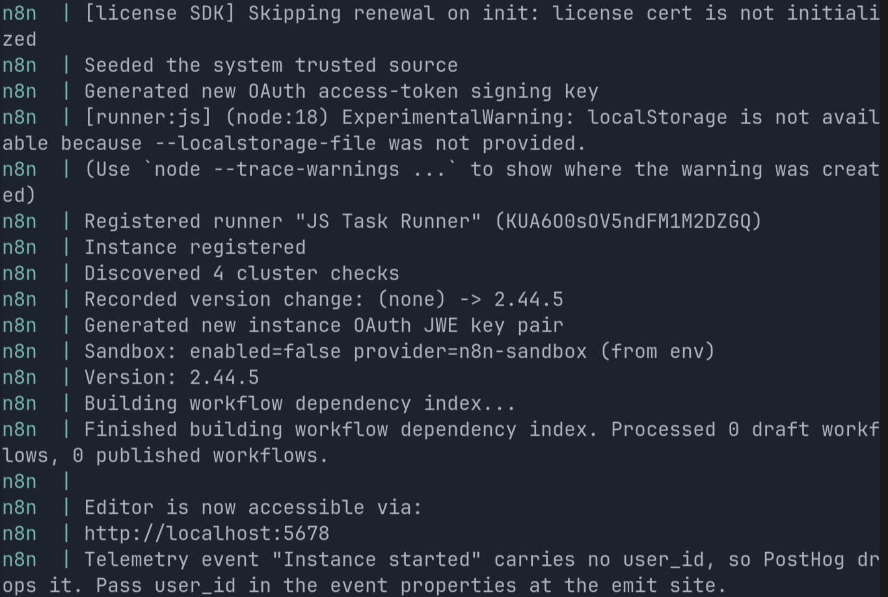

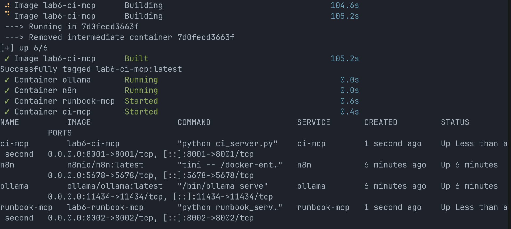

### Модель

Выбрана бесплатная локальная модель `qwen2.5:7b`, так как для агента важна поддержка вызова инструментов. Перед использованием выполнена проверка, что модель возвращает блок `tool_calls` с нужным именем функции и аргументом `job_id` равным 42.

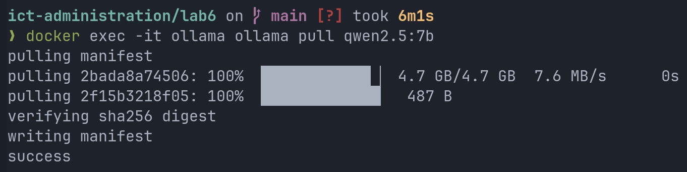

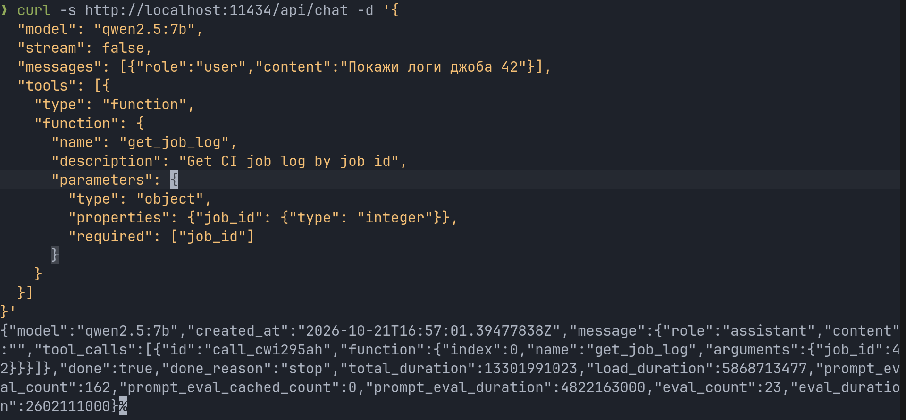

В n8n создан credential ollama, соединение проверено успешно.

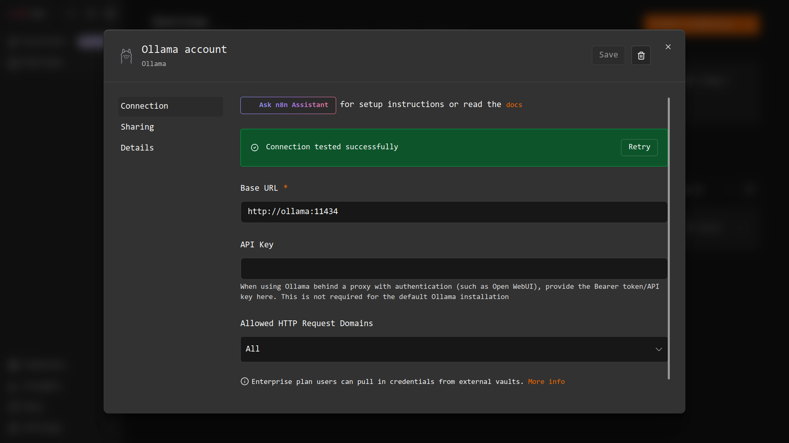

Для ноды модели заданы температура 0.1 и контекст 8192 токена. Контекст нужен потому, что стандартных 4096 токенов не хватает на инструкции, описания инструментов и журнал.

### Тестовые данные

В моковых данных три пайплайна, каждый соответствует отдельному типу сбоя.

| пайплайн | ветка | сбой | ожидаемая категория | ожидаемая инструкция |
|---|---|---|---|---|
| 1001 | `main` | упал unit-тест после смены округления в биллинге | `CODE` | `RB-103` |
| 1002 | `release/2.4` | сборка образа остановлена лимитом реестра | `INFRASTRUCTURE` | `RB-101` |
| 1003 | `main` | e2e-тест оформления заказа упал по таймауту, 6 падений из 20 | `FLAKY` | `RB-102` |

### Тестовые запросы

```bash
curl -X POST http://localhost:5678/webhook/ci-failure \
  -H "Content-Type: application/json" \
  -d '{"pipeline_id":1001,"project":"shiploop/monorepo","ref":"main","status":"failed","triggered_by":"dmitry.v","web_url":"https://gitlab.shiploop.io/shiploop/monorepo/-/pipelines/1001"}'
```

Для остальных пайплайнов меняются `pipeline_id` (1002, 1003), `ref` (`release/2.4` для 1002) и `triggered_by`. Запрос с веткой `feature/new-ui` должен быть отфильтрован до запуска агента. Ответ webhook приходит сразу, а агент работает около одной или двух минут.

### Результаты

Для каждого пайплайна получен файл отчёта в каталоге [`reports/`](reports/).

| пайплайн | ожидаемая категория | фактическая категория | отчёт |
|---|---|---|---|
| 1001 | `CODE` | `CODE`, указан коммит `a1b2c3d` автора `dmitry.v` | [`triage-1001.md`](reports/triage-1001.md) |
| 1002 | `INFRASTRUCTURE` | `INFRASTRUCTURE`, откат не рекомендован | [`triage-1002.md`](reports/triage-1002.md) |
| 1003 | `FLAKY` | `FLAKY`, указаны 6 падений из 20 | [`triage-1003.md`](reports/triage-1003.md) |

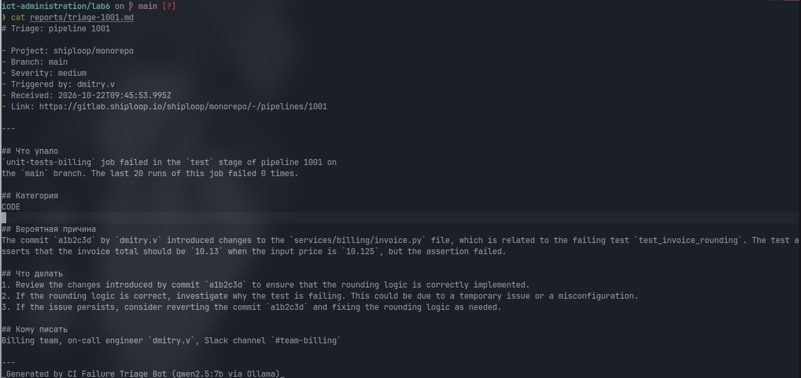

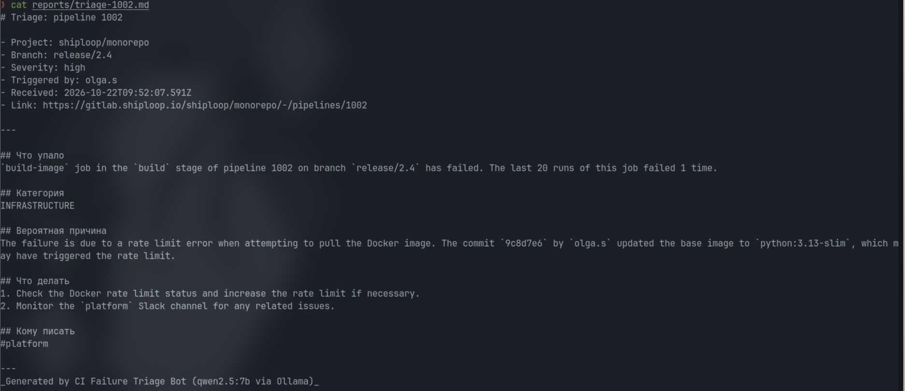

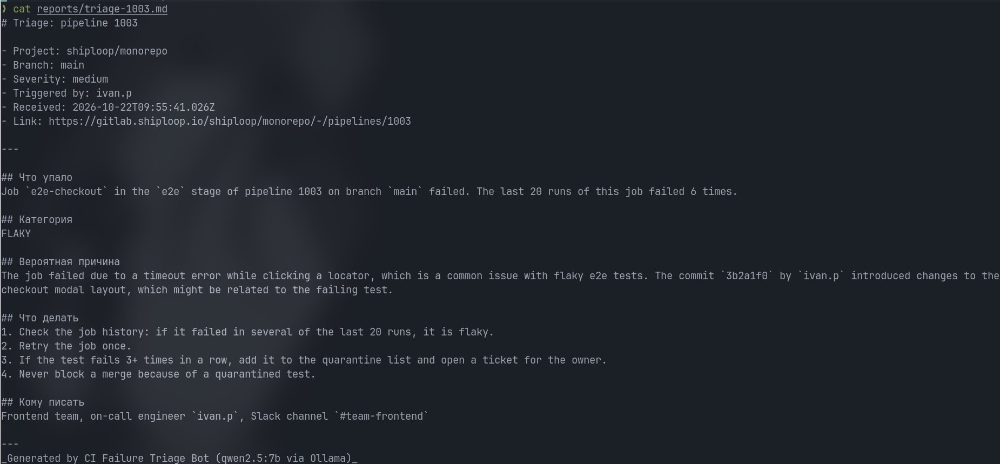

Во всех 3-х случаях категория определена верно, а имена владельцев, коммиты и числа соответствуют данным инструментов. Выдуманных данных в отчётах нет.

### Ограничения модели

Сравнение отчётов с правилами из skills показало расхождения, связанные с небольшим размером модели.

| правило из skills | наблюдение |
|---|---|
| отчёт на русском языке | заголовки разделов на русском, но текст на английском во всех 3-х отчётах |
| iаги в разделе "Что делать" берутся из инструкции с указанием её идентификатора | идентификаторы `RB-...` не приведены ни в одном отчёте. в отчёте 1003 шаги скопированы из `RB-102`. в отчёте 1001 шаги составлены самой моделью, они близки по смыслу к `RB-103`, но не скопированы из него. в отчёте 1002 шаги не совпадают с `RB-101` |
| не выдумывать связи | в отчёте 1002 модель предположила, что лимит реестра мог вызвать коммит с обновлением базового образа. инструкция `RB-101` прямо называет сбой инфраструктурным |
| в разделе "Кому писать" указываются команда, дежурный и канал | для пайплайна 1002 указан только канал `#platform`, дежурный `olga.s` не назван |

Правило запрета отката для `INFRASTRUCTURE` и `FLAKY` выполнено в обоих случаях.

В каталоге `reports/` также лежит файл [`incident-1002.json`](reports/incident-1002.json). Это ответ первого прототипа workflow. Ответ прототипа написан на русском языке и содержит идентификатор `RB-101` и шаги из инструкции. Это показывает, что качество выполнения формата зависит от формулировки инструкции и от самой модели.

### Найденные проблемы

1. Тестовый и боевой адреса webhook различаются. Кнопка execute workflow ожидает запрос на `/webhook-test/ci-failure`, а опубликованный workflow принимает запросы на `/webhook/ci-failure`. Запрос на неверный адрес остаётся без реакции.
2. В пути файла в ноде записи остались 2 пробела в начале, из-за чего n8n искал каталог `"  /files/reports"` и возвращал ошибку `ENOENT`. Пробелы удалены.
3. node `runbook-mcp` не могла подключиться по имени хоста и возвращала `fetch failed`, хотя `ci-mcp` с тем же типом настроек работал. Проверка из контейнера n8n показала, что сеть исправна и сервер отвечает. Проблема решена указанием ip-адреса контейнера (`172.18.0.2`) в поле endpoint. Этот адрес может измениться после пересоздания контейнеров, поэтому при ошибке `fetch failed` его нужно проверить командой `docker inspect runbook-mcp --format '{{range .NetworkSettings.Networks}}{{.IPAddress}}{{end}}'`. В экспортированном workflow сохранён именно ip-адрес.
4. Контейнер `blackbox` постоянно перезапускался из-за опечатки в `monitoring/blackbox.yml` (первая строка `odules:` вместо `modules:`), поэтому prometheus не находил его по имени. После исправления файла все цели перешли в состояние `UP`.

---

## Часть 4. Мониторинг

### Схема

n8n отдаёт метрики в формате prometheus сам на адресе `/metrics`, для этого в `docker-compose.yml` включена переменная `N8N_METRICS`. mcp-серверы и ollama собственных метрик не отдают, поэтому для них используется blackbox exporter. Он каждые 15 секунд проверяет, принимает ли порт соединения, и отдаёт метрики `probe_success` и `probe_duration_seconds`. prometheus ([`monitoring/prometheus.yml`](monitoring/prometheus.yml)) опрашивает n8n и 3 цели blackbox. Источник данных grafana создаётся из файла [`monitoring/grafana-datasource.yml`](monitoring/grafana-datasource.yml). Конфигурация blackbox находится в [`monitoring/blackbox.yml`](monitoring/blackbox.yml).

Все 4 цели prometheus находятся в состоянии `UP`.

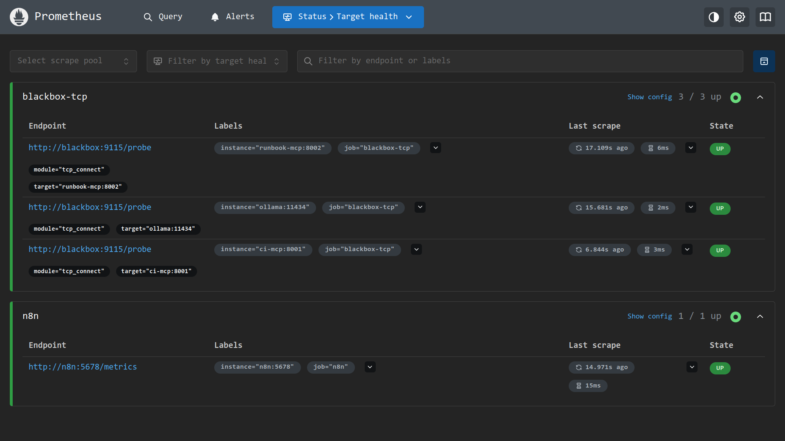

### Dashboard

Дашборд называется `LAB6` и сохранён в [`monitoring/dashboard.json`](monitoring/dashboard.json). Он состоит из 4-х панелей, период просмотра 15 минут.

| панель | запрос | что показывает |
|---|---|---|
| выполнения workflow | `increase(n8n_workflow_started_total[5m])`, `increase(n8n_workflow_success_total[5m])`, `increase(n8n_workflow_failed_total[5m])` | число начатых, успешных и неуспешных запусков за 5 минут |
| ресурсы n8n | `n8n_process_resident_memory_bytes`, `rate(n8n_process_cpu_seconds_total[1m])` | потребление памяти и процессора процессом n8n |
| время отклика зависимостей | `probe_duration_seconds` | время установки соединения с mcp-серверами и ollama |
| доступность зависимостей | `probe_success` | 1 означает, что зависимость доступна, 0 означает, что недоступна |

Выполнения workflow.

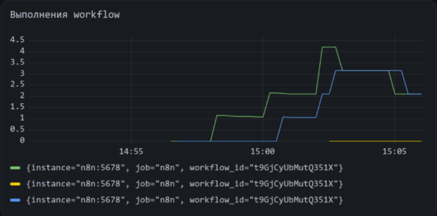

Рост линий соответствует серии тестовых запросов. В легенде 3 ряда имеют одинаковые метки, поэтому в сданной версии нужно ориентироваться на порядок запросов в таблице выше. Значение алерта на снимке ниже (0,75) согласуется с тем, что верхняя линия показывает начатые запуски, а средняя линия показывает неуспешные.

Ресурсы n8n.

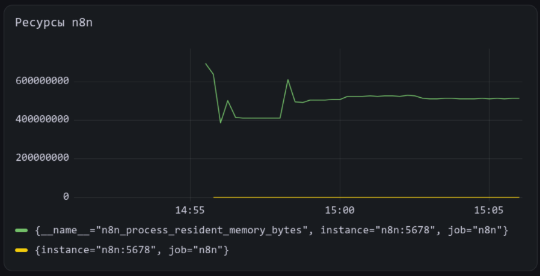

Память процесса n8n держится в диапазоне примерно от 400 до 700 МБ и после запуска стабилизируется около 510 МБ. Нагрузка на процессор близка к нулю, так как основную работу выполняет модель в отдельном контейнере.

Время отклика зависимостей.

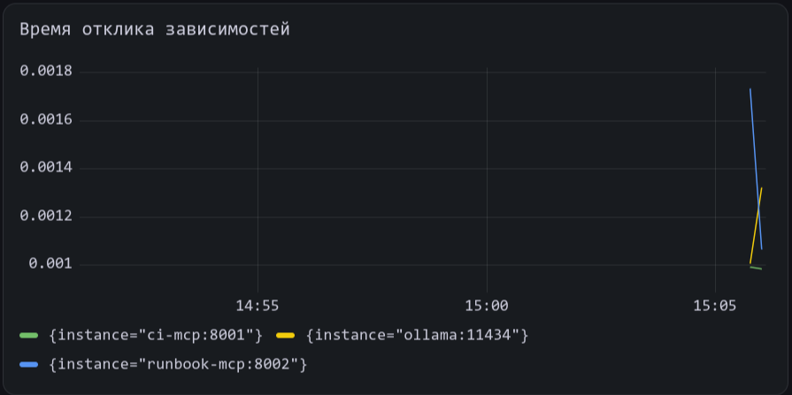

Соединение с зависимостями устанавливается за 1 или 2 мс. Это ожидаемо для сервисов в одной сети docker.

Доступность зависимостей.

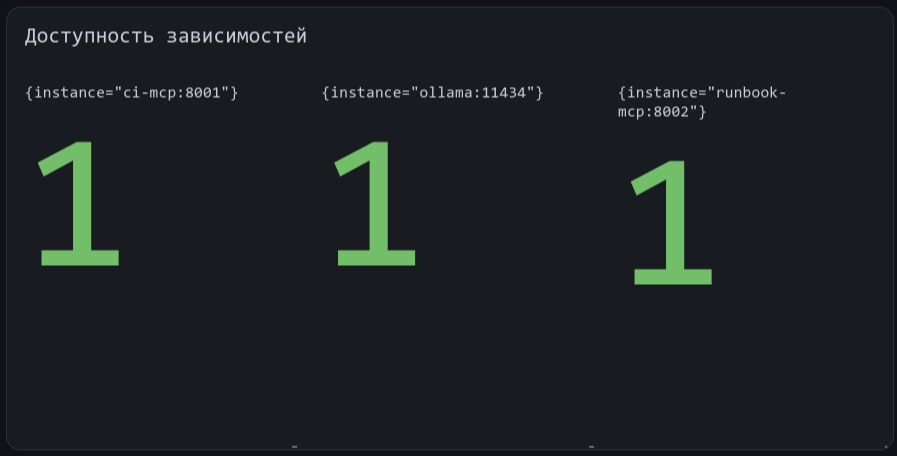

Все 3 зависимости (`ci-mcp`, `runbook-mcp`, `ollama`) доступны.

### Метрики для алертов

Правила находятся в файле [`monitoring/alerts.yml`](monitoring/alerts.yml). Выбраны следующие 3 метрики.

| alert | выражение | порог | уровень |
|---|---|---|---|
| `TriageWorkflowFailureRate` | `increase(n8n_workflow_failed_total[15m]) / increase(n8n_workflow_started_total[15m])` | выше 0,2 в течение 1 минуты | critical |
| `DependencyDown` | `probe_success` | равно 0 в течение 1 минуты | critical |
| `N8nHighMemory` | `n8n_process_resident_memory_bytes` | выше 1,5 ГБ в течение 5 минут | warning |

1) Доля неуспешных запусков. Это главный показатель того, что процесс вообще доставляет отчёты разработчикам. Абсолютное число ошибок менее информативно, чем доля, так как оно зависит от числа сбоев ci в этот день. Порог 20% отсекает единичные случайные ошибки. В выражение добавлено условие, что запуски были, чтобы деление на ноль не давало ложных срабатываний. В эту долю попадают и запросы с невалидным payload, что полезно, так как показывает, что ci присылает некорректные данные.

2) Доступность mcp-серверов и ollama (`probe_success`). Если недоступен хотя бы один из них, агент не может собрать анализ, но сам n8n при этом выглядит исправным и продолжает принимать запросы. Без этого алерта поломку заметили бы только по отсутствию отчётов. Метрика объединяет 3 зависимости одним правилом, а имя недоступного сервиса попадает в сообщение через метку `instance`. Задержка в 1 минуту защищает от ложных срабатываний при перезапуске контейнера.

3) Память процесса n8n. Процесс хранит контексты выполнения агентов, и при утечке контейнер будет остановлен по нехватке памяти, а текущие выполнения потеряются. Наблюдаемая норма составляет около 510 мб, поэтому порог 1,5 гб оставляет трёхкратный запас и срабатывает только при устойчивом росте. Уровень warning выбран потому, что у оператора остаётся время на реакцию до остановки контейнера. Значение порога следует согласовывать с лимитом памяти контейнера.

На момент снимка сработал алерт `TriageWorkflowFailureRate` со значением 0,75, то есть неуспешными завершились 75% запусков за последние 15 минут. Алерты `DependencyDown` и `N8nHighMemory` находились в нормальном состоянии.

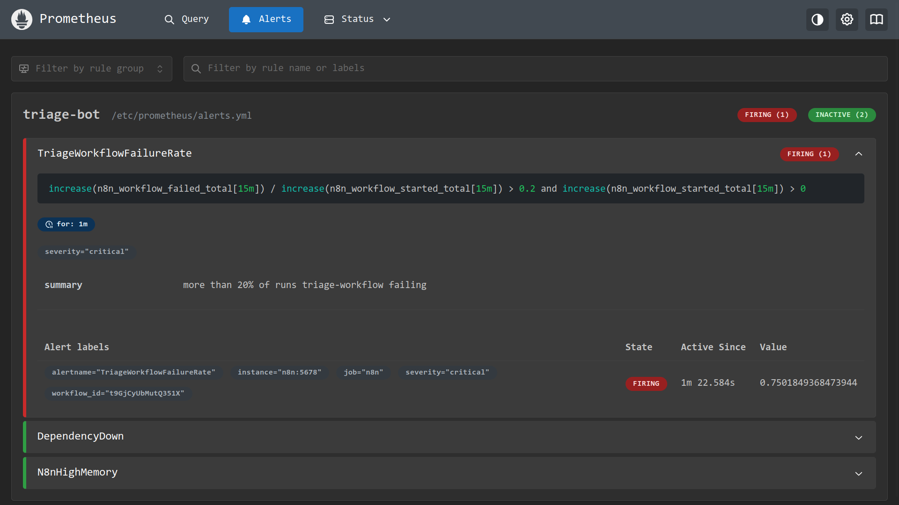

---

## Ручные действия

Конфигурация задаёт всё, кроме перечисленного ниже.

| Действие | Причина |
|---|---|
| `docker exec -it ollama ollama pull qwen2.5:7b` | модель не входит в образ и загружается отдельно |
| создание учётной записи владельца n8n | выполняется при первом входе |
| создание credential ollama (`http://ollama:11434`) | секреты и credentials не входят в экспорт workflow |
| импорт и публикация обоих workflow | экспорт содержит только схему, а боевые адреса webhook работают только у опубликованных workflow |
| проверка адреса `runbook-mcp` в одноимённой ноде | в экспорте указан ip-адрес контейнера, который может отличаться на другой машине |
| импорт `monitoring/dashboard.json` в grafana | в автоматическую настройку включён только источник данных |

---

# Выводы

Главное, что я вынес из работы, это то, что надёжность системы с ии агентом упирается не в "умность" модели, а в то, насколько жёстко ограничен процесс вокруг неё. Модель размером 7B во всех трёх случаях верно определила категорию сбоя, но при этом игнорировала часть правил из skills: писала текст по-английски (что в принципе пофиг), не приводила идентификаторы инструкций и в одном отчёте выдумала связь между лимитом реестра и коммитом. Также были и проблемы по невнимательности, но куда без них. Работа была полезной для меня потому, что раньше я никогда не работал с ии агентами и относился к ним довольно скептически, и, после этой работы, мое отношение улучшилось, так как я увидел, что они могут быть полезны.
